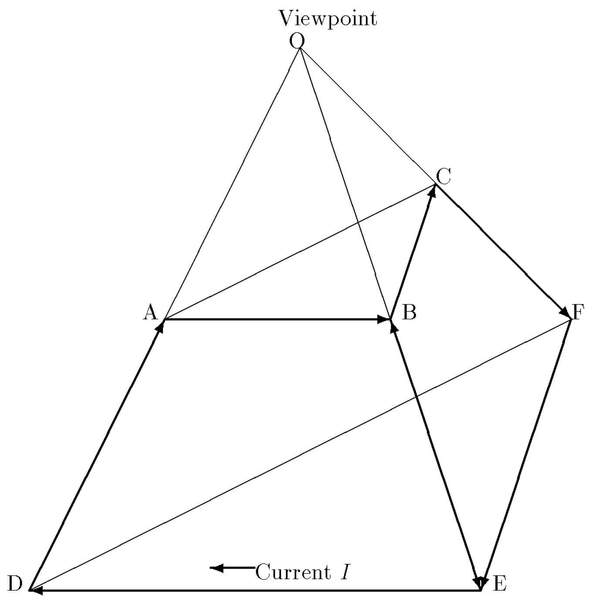

# When Should a Quantity Have Its Own Dimension?
## Uniqueness of Natural Units as a Design Criterion

## Abstract

The long-standing controversy over the dimensional status of the plane angle in the SI has been conducted as a binary question — dimensional or dimensionless — specific to the angle. We propose a cross-kind design criterion: for a specified kind of quantity, a numerical value can identify the quantity without an externally supplied reference convention when independent users have a unique natural unit on which to converge. Where two or more comparably natural candidates exist, the number alone leaves the reference unsettled. Assigning the kind a distinct dimension makes distinctions between kinds visible within equations; the choice between units of the same kind must still be recorded by unit notation or dimensioned conversion constants. The criterion adjudicates the amount of substance (unique natural unit *N*A⁻¹; the mole is legitimate but optional) and the plane and solid angles (two incommensurable candidates each — rad vs. Ω₁ = 2π rad, sr vs. Ω₂ = 4π sr; an independent plane-angle dimension and a derived solid-angle dimension recommended) within a single framework, and reads the documented incoherence between the hertz and the radian per second, and the century-old rationalization controversy in electromagnetism, as consequences of leaving the choice between such candidates implicit. Logarithmic quantities, with three candidates — log e, log 2, log 10 — furnish a third, purely mathematical test case. Rather than proposing any change to the SI, we examine the Universal Unit System (UUS)/Harmonic System, a complete implemented system that adopts the opposite choice, as an existence proof: quantities of dimension [X/angle] form a coherent, historically familiar category of bridging constants (the nautical mile and the original metre are lengths obtained through constants of this form), and the added dimensions strengthen dimensional analysis, separating calendrical from physical time and yielding a symmetric arrangement of electromagnetic quantities on five base dimensions, established there in 1997 — in which the field-strength ratio and the electrical resistance acquire distinct dimensions, and one coefficient, 1/2Ω₂, is exhibited in both the electromagnetic energy density and the Einstein field equation, unmasking the conventional 8π's as a single dimensioned constant. In that system, three usages of s⁻¹ separate into [angle/time] for frequency, [amount of substance/time] for activity, and [logarithmic quantity/time] for decay constants. The comparison is offered as complementary to the SI: each system makes a choice; side by side, the choices become visible as choices.

---

## 1. Introduction

The status of the plane angle within the International System of Units (SI) has been unsettled for as long as the SI has existed. The radian and the steradian were originally placed in a category of their own — the *supplementary units* — in 1960. CIPM Recommendation U1 (1980) interpreted the supplementary units as dimensionless, and in 1995 the category was abolished altogether, reclassifying the radian and steradian as dimensionless derived units. The current SI Brochure accordingly treats the plane angle as a ratio of two lengths, so that 1 rad = 1 m/m = 1 [1].

This settlement has never commanded universal assent, and over the past decade the debate has intensified in the pages of *Metrologia* and elsewhere. Mohr and Phillips argued that the SI treatment of dimensionless units — angles and counting units alike — introduces an incoherence, exemplified by the ambiguous status of the hertz [2]. Mills examined the relationship between the radian and the cycle [3]. Quincey, Mohr and Phillips subsequently argued that angles are inherently neither length ratios nor dimensionless [4]; Kalinin proposed assigning independent dimensions to both the plane angle and the solid angle [5]; and Quincey put forward a detailed proposal in which the radian is treated as an independent unit, made consistent by reinstating a dimensioned angle constant *θ*C (formerly *θ*N, of value 1 rad) in physical equations [6, p. 1]. The proposal drew critical comments [7, 8] and further elaboration [9], and contributions continue to appear [10]. Lewis and Coveney have since argued from the practical realization of angle by circular closure for treating the radian as an SI base unit; they derive solid angle from plane angle rather than proposing another base unit [11]. In their account the full circle already appears as a dimensioned quantity, 2π rad, and they distinguish the 2π of geometry from the 2π of working in radians — the distinction that the present paper assigns to Ω₁. Their proposal thus overlaps with the treatment of Ω₁ and derived solid angle here, but asks how to change the SI rather than how to formulate a decision rule across kinds. The controversy is not a historical curiosity; it is an active, unresolved question in contemporary metrology.

At the institutional level, however, the question is frozen. When the president of the Consultative Committee for Units (CCU) consulted the Consultative Committee for Length (CCL) in 2016, the reported consensus of the CCL was that there was no support for making the radian a base unit of the SI [8]. The official position — the plane angle is dimensionless — therefore stands, and these proposals do not by themselves imply an imminent revision.

Previous work has exposed the ambiguity of the unit one for angular and counting quantities [2], discussed radian and cycle as competing references [3, 12], and considered coherent units for angular and logarithmic quantities together [13]. The question we address is therefore narrower than whether these difficulties, or these candidate units, have been noticed before: can one decision rule distinguish kinds that admit a pure-number representation without an externally specified reference from kinds for which the choice of reference must be communicated? The amount of substance and the angles offer opposite tests of such a rule. A distinct dimension can then make differences between kinds checkable within equations, while names of units and dimensioned constants continue to record conversions within a kind. The proposal concerns how that information is distributed, not a claim that existing SI usage rules fail to communicate it.

This paper proposes such a criterion — the *uniqueness of the natural unit* of the kind of quantity in question — and examines its consequences. We emphasize at the outset what this paper does **not** propose: any change to the SI. Our method is comparative. The Universal Unit System (UUS) / Harmonic System [14, 15] is a complete, implemented system of units that made the opposite design choice to the SI on precisely this point: it retains an independent dimension for plane angle and a derived, squared angle dimension for solid angle. Placing the two systems side by side allows choices that each system makes tacitly to become visible *as choices*. The comparison is offered in the spirit of complementarity, not competition: the aim is a deeper understanding of both systems, not the replacement of either. Nor is the question confined to physical quantities: the criterion rests on nothing but the ratio structure of a kind, and its most transparent application is to a purely mathematical one — the logarithm taken without a base, the baseless logarithm (Section 4.5).

The contributions of the paper are: (i) a general criterion for when a kind of quantity should retain an independent dimension (Section 2); (ii) its application to the amount of substance as a case of uniqueness (Section 3), to the plane and solid angles as cases of non-uniqueness (Section 4), and to logarithmic quantities as a third case of non-uniqueness, one in which no physics is involved at all (Section 4.5); (iii) an account of how a system that adopts the criterion resolves the well-known practical objections concerning radius-type quantities and dimensional analysis (Section 5); (iv) an exhibition of what the choice buys, drawing on results already established within that system — the dimensional separation of calendrical from physical time, and a symmetric dimensional arrangement of electromagnetic quantities (Section 6); and (v) the UUS/Harmonic System as an existence proof that the design is coherent and livable in full (Section 7). Section 8 concludes.

## 2. The Criterion: Uniqueness of Natural Units

### 2.1 What constitutes a unit

A unit of measurement is standardly defined as a quantity of the same kind [^kind] as the quantity to be expressed, chosen by convention as the reference with which quantities of that kind are compared [1, 16]. Two elements are present in this definition, and both are essential. A unit is (a) a *quantity* — something belonging to nature; and (b) a *convention* — something belonging to an agreeing community. A unit is therefore not a self-standing natural object. It is constituted jointly by a quantity and by the parties who agree to use it as a reference. The metre is not merely a length; it is a length *plus* an agreement.

[^kind]: Throughout, "kind" is short for kind of quantity in the sense of the VIM [16, 1.2].

The convention reaches further than the choice of a reference. Whether a unit is *coherent* is itself relative to an elected family of defining relations. Whether the area of a triangle is *ah*/2 or *ah* is convention, not logic, and a coherent unit of area is fixed only when that relation is specified; the rationalized/unrationalized split of electromagnetic units (Section 6.2) is the same freedom in another field [17, pp. 45–50; 18, App. A.3]. The relativity is not an external observation but definitional: the VIM defines a system of quantities as a "set of quantities together with a set of noncontradictory equations relating those quantities", and a coherent derived unit as one carrying no proportionality factor other than one "for a given system of quantities and for a chosen set of base units" [16, 1.3 and 1.12]. 'Coherent' is used throughout in this relative sense; the limit construction of Section 4.4 is, in this light, the explicit election of the defining relation between plane and solid angle.

For most kinds of quantity this two-party structure is conspicuous: nothing in nature singles out the metre among lengths or the second among durations, and elaborate institutions exist precisely to maintain the agreement. The interesting cases are those in which nature appears to do the community's work for it.

### 2.2 Natural units as focal points

Suppose that within some kind of quantity there exists a quantity so exceptionally distinguished that independent agents, without any prior communication, could each be expected to select it as the reference. Such a quantity functions as what game theory calls a *focal point* of a coordination problem [19]: agreement is reached without negotiation because the candidate is salient to all parties. We call such a quantity a *natural unit* of its kind.

When a specified kind of quantity has a unique natural unit salient to the parties involved, the ratio of a quantity of that kind to the unit is a pure number. Communicating the number need not require a separately stated unit convention: the receiving party can reconstruct the quantity by supplying the same reference. Counting is the paradigm. As Kuroki observed in a widely circulated remark, deleting the unit from "the length is 5 mm" destroys the information, whereas deleting the counter word from "the count is 5 items" destroys nothing [20]. In the present vocabulary: the kind *number of entities* possesses a natural unit — the single entity — and it is unique. The amount of substance inherits this structure, with the entity count fixed by the Avogadro number; we return to it in Section 3.

One caution is needed, and it does real work in what follows. The judgment that a quantity is "exceptionally distinguished" is a judgment made *by agents*; salience is relative to the parties coordinating.[^salience] The two-party structure of Section 2.1 is thus not eliminated by natural units — it is merely satisfied silently. This observation converts what might look like a defect (subjectivity) into an operational test: whether coordination succeeds without communication is decided by whether the salient candidate is *unique*. If two or more comparably distinguished candidates exist, no focal point forms; the parties must communicate after all, and the choice among candidates is once again an explicit convention.

[^salience]: Note the form of the definition of salience in Section 2.2: salience is characterized not by any intrinsic property of the candidate but by the pattern of behavior it induces among the coordinating parties — which is what makes the test operational, and the failures observable.

### 2.3 The criterion

We can now state the criterion. Throughout, the kind of quantity and the community whose coordination is at issue are taken as given; “without a reference convention” means that the numerical value is not accompanied by a separately stipulated choice of unit.

> **(C1)** If a kind has a unique natural unit salient to independent users, its values can be represented by pure numbers without a separately communicated reference convention; an independent dimension is optional.
>
> **(C2)** If two or more comparably natural candidate units exist, a pure number by itself does not identify which reference was used; we recommend assigning the kind a distinct dimension where it is to remain distinguishable from other kinds within equations.

A unit is a **label**, and labels are needed only where things must be told apart. A unit marks which of several candidate references was singled out — and where only one was available, there is nothing to mark. An independent dimension may still be useful for recording the kind in equations, as the mole shows (Section 3), but it carries no reference that a pure number would otherwise lose. This is why the criterion turns on **uniqueness** rather than on the nature of the quantity.

Under (C2) the missing information can be supplied by an explicit unit label; it is not literally irrecoverable. What a distinct dimension adds falls into two parts, which the rest of the paper keeps apart. **(D)** Between kinds: a distinct dimension allows dimensional analysis to detect a confusion between differently dimensioned kinds. **(N)** Within a kind: the choice — radian or cycle, for example — still requires a unit label or a named, dimensioned conversion constant such as Ω₁. The two are linked: a distinct dimension favours neither radian nor cycle, but it makes replacing either unit symbol by the scalar 1 a change of dimension; values in either unit then keep their labels, and the 2π between them is carried as an ordinary unit conversion rather than silently absorbed into a pure number.

The proposed test is thus not a claim that dimensions alone fix all unit choices. It concerns where a system places the information needed for interpretation: in external usage rules and unit labels alone (as the SI does for angle), or also in the algebraic structure of its quantity equations (as the UUS does, Section 7). The recommendation turns on the non-uniqueness of the reference, not on the assertion that a labelled numerical value is intrinsically ambiguous.

One clarification before the criterion is applied, since the standing debate has largely been conducted in the vocabulary of base units: (C2) prescribes an independent dimension, not a base unit. Recommending that a kind remain distinguishable from pure numbers in quantity equations says nothing about whether its dimension is primitive in a given system or derived from the dimensions of other kinds; the choice between the two is an implementation decision internal to the system. The solid angle will furnish the example (Section 4.4): it satisfies (C2), yet its dimension is derived — the square of the plane angle's — and no new base unit accompanies it. The question this paper poses is accordingly not the one on which the CCL reported no consensus for change [8] — whether the radian should become a base unit of the SI — but the prior one: whether an unlabelled numerical expression of angle requires a separately communicated reference convention.

With this distinction in place, the criterion reframes the standing debate. The question "is the plane angle dimensional or dimensionless?" becomes a question of fact about the structure of the kind: *does the plane angle possess a unique natural unit?* We will argue (Section 4) that it does not — the radian and the full circular angle Ω₁ are both exceptionally distinguished, on different but comparably compelling grounds — and that the solid angle fails uniqueness in the same way. The amount of substance, by contrast, passes (Section 3). A third kind — the logarithm, taken without a base — fails threefold, with no physics anywhere in the argument; Section 4.5 takes it up, and with it the demonstration that the criterion engages nothing but ratio structure. Notably, the observation that the angle has "two natural units" is already present in the debate: Mills devoted a paper to the radian and the cycle as alternatives [3], and Quincey remarked that for mathematicians and theoretical physicists the natural unit of angle is the radian, while for everyone else it is the revolution [12]. In that literature the observation appears as a description of a difficulty. The present paper's proposal is to promote it to a *criterion*: non-uniqueness of the natural unit is not an inconvenience to be worked around but the very signal that the choice of reference has to be recorded, and that a distinct dimension is warranted to keep that record from being dropped unnoticed.

Two consequences of adopting (C2) for the angles are developed in the remainder of the paper. First, the practical objections traditionally raised against dimensioned angles — radius-type lengths acquiring the unit m/rad, the apparent breakdown of dimensional analysis in familiar formulas — turn out, in a system designed around (C2), to be neither anomalies nor casualties: the "per-angle" quantities form a general and deliberately institutionalized category of bridging constants (Section 5). Second, the added dimensions increase, rather than degrade, the resolving power of dimensional analysis, separating pairs of quantities that the SI is obliged to identify (Section 6).

---

## 3. A case of uniqueness: amount of substance

The amount of substance is a base quantity of the SI, and since the 2019 revision its unit, the mole, is defined by fixing the Avogadro number[^avogadro]: one mole contains exactly 6.022 140 76 × 10²³ elementary entities [1]. The kind of quantity is, by this very definition, proportional to a *count* of specified entities.

Apply the test of Section 2.2. Does the kind possess a natural unit — a candidate reference so salient that independent parties would converge on it without communication? It does: the *single entity*. Whoever undertakes to express an amount of substance as a number must divide by some reference amount, and the amount corresponding to one entity — *N*A⁻¹ — is distinguished by the very structure of counting: it is the indivisible step, the generator of the kind. Nor does it face a serious rival. Every other conceivable reference — the pair, the dozen, the gross, or indeed the mole itself — is an integer multiple of the entity, and derives whatever salience it has *from* the entity. Rival candidates exist, but they are derivative, not independent; the focal point is unique.

The criterion therefore returns (C1): given the kind and the counted entity, values of amount of substance can be expressed as pure numbers without separately stipulating the single entity as reference. This is exactly the content of Kuroki's observation quoted in Section 2.2 — "the count is 5" loses nothing that "the count is 5 items" contains [20] — and it is why long-standing skepticism about the unit status of the mole is, in one precise sense, correct: the mole is not *necessary* in the way the metre is. But (C1) cuts both ways, and this should be stressed. It says the independent dimension is *optional*, not that it is wrong. The SI's decision to give the amount of substance a base unit is a legitimate exercise of the option, made on grounds of practical convenience — chemistry lives at the macroscale, and a unit sized to the gram rather than to the yoctogram earns its keep daily. What (C1) rules out is only the claim that the dimension is forced. Between "unit" and mere "counter word" (the classifier particles of Japanese and other classifier languages [21]) there is, on this analysis, no sharp boundary but a gradation of explicitness of convention [22]; the mole sits on that gradation by choice, not by necessity.

The 2019 redefinition of the mole is, in this respect, an ally of the analysis: by turning *N*A from a measured constant into an exactly fixed defining constant, and with it reversing the direction of definition — the mole is now defined from *N*A, rather than *N*A measured against a macroscopic mole — the SI itself relocated the anchor of the dimension from a macroscopic artefact-convention (0.012 kg of carbon-12) to the single entity — placing the unique natural unit, *N*A⁻¹, at the system's foundation, if not under that name.

We note in passing that the treatment of counting quantities within the SI has itself been identified as a source of incoherence by Mohr and Phillips, who discuss counting units alongside angular ones [2]. Their own remedy deserves record here, because it is this section's verdict reached from another direction: they propose the symbol *ent* for the entity, and write the mole as a multiple of it, 1 mol = 6.02 × 10²³ ent [2] — electing as the unit of the kind precisely the focal point identified above, and leaving the mole a named multiple of the natural unit rather than an independent standard. The present criterion locates the two cases on opposite sides of the line: counting passes the uniqueness test, angles — as we now argue — fail it.

[^avogadro]: Strictly, the Avogadro *number* (dimensionless) and the Avogadro *constant* *N*A (dimension [amount of substance]⁻¹) are distinct; before 2019 the latter was measured, since 2019 it is a defining constant. This paper uses the dimensioned reading throughout — see the remark on the 2019 redefinition below.

## 4. Cases of non-uniqueness: the angles, and the logarithm

### 4.1 Two candidates, two structures

For the plane angle, two candidate references present themselves, and each is exceptionally distinguished — but by *different structures* in which the kind participates.

The first candidate is the **radian**. Its salience is analytic: it is the unit in which the arc-length relation reads *s* = *rθ* with no numerical factor, in which d(sin *θ*)/d*θ* = cos *θ*, in which the Taylor series and Euler's formula take their unadorned forms. Within the differential and analytic structure of the kind, the radian is not one choice among many; it is *the* choice.

The second candidate is the **full circular angle**, here written Ω₁ — the cycle, the revolution (the UUS convention is to speak Ω₁ as "cycle" [18]). Its salience is topological and periodic: the angle is a quantity on which the physical world imposes a natural period, and Ω₁ is that period. Winding numbers are counted in units of Ω₁; rotational frequencies are stated in revolutions per unit time; the degree — the working unit of practical angle measurement for several millennia — is defined as a subdivision (1/360) of Ω₁, not of the radian; the hertz, as actually used, means cycles per second. Within the periodic structure of the kind, Ω₁ is *the* choice. Indeed the point is granted by those who argue for a dimensioned angle: Kalinin observes that every known unit of plane angle — degree, radian, gradian, revolution — is defined by fixing a value of Φ, the angle of one complete revolution, which he calls a natural constant of two-dimensional geometry [10].

Two features distinguish this situation from the counting case of Section 3. First, neither candidate is derivative of the other in the way the dozen is derivative of the entity: the ratio Ω₁/rad = 2π is irrational, so neither candidate is an integer multiple, subdivision, or notational variant of the other. Second, the grounds of salience have no common scale on which to rank them: the analytic structure and the periodic structure are both genuinely constitutive of what an angle is, and there is no neutral standpoint from which one trumps the other. The focal point fails to be unique, and by (C2) the plane angle should carry an independent dimension — whereupon the working-unit choice becomes what it always covertly was, an explicit convention (the UUS, for the analytic reasons above, selects the radian [14]), and the displaced candidate Ω₁ becomes a dimensioned constant of value 2π rad, non-coherent in the sense of Section 2.1.

### 4.2 The non-uniqueness is documented, not conjectured

The observation that the angle has two natural units is not ours (Section 2.3). Quincey, while still defending the dimensionless treatment, wrote that at the heart of the problem lies the fact that there are two natural units for angle — for mathematicians and theoretical physicists the radian, for everyone else the revolution [12]. In that literature, however, the observation figures as the *description of a difficulty* — an explanation of why the field is confusing — to be managed by more careful wording, or later, in Quincey's own developed position, by reinstating a dimensioned angle constant [6]. The step taken here is to read the observation normatively: non-uniqueness of the natural unit is not an unfortunate circumstance surrounding the dimensional question; it *answers* the dimensional question. With two competing focal points, an unlabelled pure number does not tell a recipient which reference was used. An explicit unit label can supply that information (N); a distinct dimension serves the further purpose of making the kind distinguishable from other kinds within quantity equations (D).

The risk of leaving a reference implicit is documented, not hypothetical. The incoherence exhibited by Mohr and Phillips — the same physical situation described as 1 Hz or as 2π s⁻¹ depending on which dimensionless unit was silently replaced by the number one, with the potential for factor-of-2π errors as the downstream consequence [2] — illustrates the ambiguity that motivates (C2). An angle dimension distinguishes angular rates from rates of other kinds (D); cycle/s and rad/s share that dimension, so their 2π conversion still requires unit notation or Ω₁ (N). What the dimension does settle is that the reference cannot be dropped unnoticed: writing an angular rate in s⁻¹ alone becomes a dimensional error. Dropping the reference costs nothing for a kind with a unique one; for the angle it leaves no dimensional record of the choice. So, at the institutional level, is the SI's own history with the angle: a category created (1960), reinterpreted (1980), and abolished (1995) [1, 5] is not the record of a community that possesses a unique, self-evident reference. Where a unique natural unit genuinely exists — counting — no comparable institutional oscillation is to be found. The incoherence that Mohr and Phillips locate on the counting side [2] arises not from any non-uniqueness within counting, but from counting and angle being folded into the same dimensionless unit; it is the fold, not the counting, that carries the ambiguity.

### 4.3 The strongest objection: is the radian not *really* unique?

The defender of dimensionless angle will reply that the two candidates are not comparably natural: the analytic privilege of the radian is objective mathematics, while the salience of the cycle is mere habit and anthropology. If the radian is the *real* focal point, uniqueness holds after all, and (C1) applies.

The reply underestimates the periodic structure. The cycle's privilege is not a habit; it is the topological fact that the angle, unlike length or duration, is natively a quantity on a circle, and Ω₁ is the circumference of that circle in the kind's own terms. Winding number — an integer, and among the most robust invariants in mathematics — is a count of Ω₁'s, not of radians; a phase is physically meaningful modulo Ω₁, not modulo 1 rad. A homely test makes the point concrete. The oldest and most universal angular quantity in human life is the day — one full rotation of the Earth. Even the most committed partisan of the radian, holding it the one true natural unit of angle, does not propose to conceive of the day as an angle of 2π rad, or to count time in radians of rotation: days are counted, by everyone, as integers of full rotations (a fact Section 6.1 will put to systematic use). Where the phenomenon itself is periodic, the cycle is salient even to those whose analytic practice is built on the radian; and a candidate that commands, within the periodic structure, the spontaneous allegiance of its rival's own partisans is not a habit to be explained away. Indeed the contest between the two candidates is alive within pure mathematics: the recurring argument over whether the fundamental circle constant should be π or τ = 2π is, at bottom, a dispute over which structure has the right to name the constant — the τ side arguing from the period (one full rotation as the only non-arbitrary reference), the π side from the accumulated weight of analytic identities in which π appears unadorned (π*r*², eiπ + 1 = 0, Γ(½) = √π). That each side can marshal its battery of formulas, and that the argument recurs without resolution, is what grounds of salience without a common scale look like in practice — and the disputants are exactly the population for whom the radian's analytic privilege is supposed to be decisive.

More fundamentally, the objection mislocates the question. Recall from Section 2.2 that salience is a relation between a candidate and the coordinating parties; the operational test of uniqueness is whether coordination in fact succeeds without communication. On this test the verdict is empirical, and it is in the record: two communities of practice have coexisted for as long as the quantities have been measured, each finding a different candidate self-evident — and where the SI permitted both the radian and the cycle to be replaced by the same number one, the coordination visibly failed [2]. One does not argue a focal point into uniqueness; a unique focal point is one that *makes the argument unnecessary*. The persistence of this very debate is the datum.

We stress that this account implies no criticism of the radian. The analytic grounds for selecting it as the *working unit* are excellent, and the UUS so selects it (Section 4.1). The criterion's claim is only that this selection is a convention that must be recorded — by a unit designation or a dimensioned constant in a system that retains the angle dimension — rather than a discovery that may be presupposed.

### 4.4 The solid angle fails the same test

The solid angle presents the same structure one dimension up. The analytic candidate is the steradian, related to the radian by sr = rad² when solid angle is referred to the plane angle's dimension; the periodic — more precisely, the *closure* — candidate is the full spherical solid angle Ω₂ = 4π sr, the solid angle of a closed surface about an interior point, distinguished by the integral theorems (Gauss) and by isotropy.

The century-old division of electromagnetic unit systems into "rationalized" and "unrationalized" families concerns where factors of 4π appear. In the dimensional reading developed here, Ω₂ = 4π sr makes that geometrical factor explicit; this is a way to compare the conventions, not a claim that all their historical motivations reduce to a choice of solid-angle unit [15]. A choice that must be made, that has been made differently by coexisting major systems, and whose silent divergence generates the very 4π bookkeeping that every student of electromagnetism learns to dread, is an explicit convention in all but name. By (C2), the solid angle fails the uniqueness test as the plane angle does, and the verdict is the same.

No *second* primitive dimension is needed to honor this verdict. In the UUS, hyperspherical solid angles are integer powers of the plane angle: the steradian is rad², and the total solid angle of the k-dimensional hypersphere is Ω*k* = (2π(*k*+1)/2 / Γ((*k*+1)/2)) rad*k*, giving Ω₁ = 2π rad, Ω₂ = 4π rad², Ω₃ = 2π² rad³, and so on [18]. The design has a merit worth stating explicitly: the criterion is applied *once*, to the plane angle, and a single added dimension then services spherical geometry in every dimension k — there is no unbounded proliferation of angular dimensions as one ascends to hyperspheres [18]. The solid angle inherits its dimension (rad²) from the plane angle, and inherits its non-uniqueness as well: the pair (sr, Ω₂) stands to solid angle exactly as (rad, Ω₁) stands to plane angle, and Ω₂ enters the system as a dimensioned constant of value 4π rad², with the electromagnetic consequences developed in Section 6.2.

A remark on rigor is in order, because a critic is entitled to ask in what sense two plane angles can be multiplied at all. The identification sr = rad² is not a notational stipulation. On the sphere, no finite figure realizes the product exactly: the solid angle of a spherical square of finite side *θ* deviates from *θ*² by curvature terms [18, eq. (18)]. The UUS therefore *defines* the product by an infinitesimal construction — *θ*² is the limit, as n → ∞, of n² times the solid angle of a spherical square of side *θ*/n [18, eq. (19)] — under which the curvature deviation vanishes and the dimensional arithmetic becomes exact. This is not a blemish peculiar to solid angles; it places the composition of angular dimensions on the same footing as the radian's own analytic privilege (Section 4.1), which is likewise a statement about the infinitesimal, flat structure of the kind.[^rectification] Dimensional analysis asks no more than that the kinds compose multiplicatively; the limit construction supplies the geometric realization of the composition.

[^rectification]: Both the rectification of arc length and the small-angle identities are limit statements; the plane angle retains, via the circle's symmetry, one exact finite relation, *s* = *rθ*, which the solid angle has no counterpart of.

---

### 4.5 A third test case: logarithmic quantities

The criterion was formulated for kinds of quantity in general, and it would be suspicious if its only non-trivial applications were the two angular kinds. There is a third, and it is instructive precisely because no physics is involved at all.

Consider the logarithm — not log to any particular base, but the object defined by the functional equation log(*xy*) = log *x* + log *y*. The equation fixes the *structure* (a homomorphism from multiplication to addition) but no normalization: its continuous solutions form the one-parameter family {c·ln}. The definition, in other words, delivers a kind of quantity and stops short of electing a member. The author called this object the *baseless logarithm* and argued, in an appendix to the original UUS proposal, that it is a purely mathematical entity which is nevertheless a *quantity*, not a number [18, App. A.2]: log 2 = 0.3010… log 10 is an equation between quantities, reducible to numbers only by dividing through by a chosen member of the same kind.

That division is the familiar change-of-base identity read with fresh eyes: log *x* / log 2 = log₂ *x*. Taking a base *is* choosing a unit; the subscript in log₂ is unit notation in disguise, and the numerical value log₂ x stands to the quantity log x exactly as the number 5 stands to the length 5 m. The same reading applies within the angular case: Kalinin distinguishes the dimensional plane angle φ from the dimensionless combination *θ* = *φ*/(*Φ*/2π) that enters the equations of physics, and identifies the latter as what metrology calls the numerical value of the angle expressed in radians [10] — a quantity divided by an elected unit, in precisely the present sense. It follows that the standard reason for regarding logarithms as dimensionless — "log₂ *x* is just a number" — establishes nothing: every dimensioned quantity yields a number upon division by a unit. What the purely mathematical setting adds is a proof of scope: the two-party structure of Section 2.1 and the uniqueness test of Section 2.2 engage only the *ratio structure* of a kind, not measurability by physical apparatus. (The VIM's definition of quantity speaks of properties of phenomena, bodies and substances [16]; the extension to mathematical objects made in [18] is deliberate, and harmless here, because nothing in the criterion's machinery uses more than ratios.)

The formulation of functions that take dimensioned quantities as arguments has been pursued independently for angles: Mohr et al. generalize the trigonometric and exponential functions so that they accept arguments carrying the dimension of angle, without reference to units [9]. The present application to the logarithm is a parallel case, in a setting where no physical quantity is involved at all.

Now apply the test. Candidates for the natural unit of the logarithmic kind present themselves in at least three, each salient within a different structure: **log e** (the neper), distinguished analytically — it is the normalization with d(log *x*)/d*x* = 1/*x* and log(1+ε) ≈ ε; **log 2** (the bit), distinguished by counting — it is the logarithm of the smallest integer ratio, the unit of doublings; and **log 10** (the hartley; the bel family), distinguished by positional notation — it counts decimal digits. As with rad and Ω₁, the candidates are mutually non-derivative: log₂ 10 is irrational by unique factorization (2p = 10q is impossible), so neither of log 2 and log 10 is an integer multiple or subdivision of the other; and log e stands apart from the whole integer-logarithm family, e being transcendental. None reduces to another. The focal point fails to be unique — here threefold — and (C2) returns the same verdict as for the angles.

The relation between the inverse trigonometric functions and the complex logarithm noted in [18, App. A.2] has also been weighed in the opposite direction: from the parallel with the radian, Mills, Taylor and Thor argued that the neper is the most logical coherent unit for logarithmic decay [13]. The present criterion agrees that the two kinds belong together; it differs on what settles their status. A structural parallel shows that whatever is said of one kind should be said of the other, but not what is to be said. Here that is decided by the uniqueness test applied to each kind separately, and the parallel does not carry everything across: Ω₁ is the period 2π of the imaginary part, which the real part does not have; log 2 and log 10 come from counting and positional notation, which have no angular counterpart; and the angle has a squared kind, the solid angle, to which nothing on the logarithmic side corresponds. The two kinds fail the test independently and receive the same verdict. As throughout (Section 2.3), the kinds are taken as given; an analytic parallel between them can transfer a verdict but does not determine one.

And, as with the angles, the verdict is corroborated rather than contradicted by the historical record. Shannon opened the founding paper of information theory by identifying the choice of logarithmic base with the choice of the unit of information, naming bits, decimal digits and natural units in a single breath [23] — the identification this subsection formalizes, present at the birth of the field. Metrology, for its part, has never managed to collapse the logarithmic units into the number one in practice: the neper, bel and decibel persist as named units whose definitions and interrelation required a paper of their own [13], the information units are standardized as a plurality (shannon, hartley, natural unit) [24] — three units for one kind, coexisting because no choice among them was ever forced. The neper and the bel are sometimes held to belong to two different kinds of quantity — the one to amplitude ratios, the other to power-like ratios — on the ground that their defining equations differ by a factor of two [25]. On the present account the factor belongs to the argument of the logarithm rather than to the logarithmic kind itself: what varies is which ratio is being taken, not which kind of quantity results. The UUS accordingly writes such expressions with a dedicated operator, °, which combines a scale interval with a base point (°C and dBm are abbreviated forms of this kind), so that the choice of reference is recorded alongside the unit [14, App. A.1, item (8)]; and in the architecture described in Section 7 it implements the verdict itself — the logarithmic dimension with the neper elected as its working unit (a base unit in the UUS), and the displaced candidates housed as dimensioned constants ℧*k* = log 2*k*, the bit among them.

One further datum deserves record because of its evidential form. In 2026 — twenty-four years after [18] — the same object was formalized independently, under the very same name "baseless logarithm," in an essay by Kritchevsky [26], which develops the same picture of base-change as unit-change before a general audience. The convergence has the same structure as that noted in Section 6.1(c) between the UUS's Ω₁ and the *θ*C of the SI-side proposal [6]: two parties, starting from different concerns and unaware of each other, arriving at the same construction. A criterion may be argued for; a construction that keeps being rediscovered is at least evidence that it is not an artefact of one author's notation.

---

## 5. Living with dimensioned angles: the bridging constants

### 5.1 The design tasks

Criterion (C2) tells a system to give the angles a dimension; it does not by itself tell the system how to keep house afterwards. The housekeeping questions are well known, having been catalogued precisely by Quincey in 2015, before his own position changed [12], and pressed again by Křen, who objects that dimensioned angles introduce quantities of a different kind for time, with units defined as the second per radian (s/rad) [8]. If the angle *θ* carries a dimension, then the arc-length relation *s* = *rθ* cannot hold with r a plain length; the "radius" that converts angles into arcs must carry the unit m/rad, and one must apparently distinguish two kinds of length — with the Bohr radius, the r² in πr², the moment of inertia, and the routine practice of dimensional analysis (the Stokes-drag argument) offered as places where the distinction becomes awkward. Since this paper proposes no change to the SI, these are for us not objections to be rebutted but *design tasks*: any system that adopts (C2) owes an account of how quantities of dimension [X/angle] behave, and the account had better be systematic rather than a patch per formula. The questions are not new, and neither are the answers: Eder explored them systematically in 1982, under the explicit hypothesis that the plane angle is dimensional, working out the consequences for trigonometric functions, rotational volumes, limits and series expansions, and proposing revisions to a number of derived-unit expressions in the SI [27]. What the critics present as a catalogue of difficulties is, in Eder's hands, a programme of consequences to be developed. This section describes the account given by the UUS, in which such quantities form a deliberate, named category; the mechanics-side bookkeeping (torque, angular momentum, moment of inertia) is the subject of an ongoing exchange within the debate itself [6, 7, 9] and is not re-litigated here.

### 5.2 Per-angle constants are old friends, not anomalies

The central observation is that quantities of dimension [X per angle] are not exotica conjured by the dimensioning of angles. Operational metrology has always contained them; the dimensionless-angle convention merely denies them a visible unit.

Consider the nautical mile. It was historically defined through the statement "one minute of arc of latitude along a meridian" — that is, as the product of an angle (one arc-minute) with a bridging constant of dimension length-per-angle: the length of meridian per unit of subtended angle. Since 1929 the international nautical mile has been fixed at exactly 1852 m [1], a value chosen for its agreement with that historical definition; the fixing changed the definition, not the practice. A navigator who converts a latitude difference into a sailed distance is multiplying an angle by a bridging constant of unit m/rad, and has been doing so for centuries without embarrassment. The original definition of the metre itself — one ten-millionth of the quadrant of the Paris meridian — is a statement of the same form: a length obtained from an angle (a quarter cycle) through the meridian constant.

The UUS names this constant and promotes it to a system constant: **meridian**, *m*E, the length of the Earth's meridian circle per full circular angle, of dimension [length/plane angle], with *m*E · rad ≈ 6.37 × 10⁶ m — a representative Earth radius [28]. The point of the name is the point of this section: in a system with dimensioned angles, "radius-type length" is not a defect to be tolerated but a *physically meaningful category with named members*. The geometric radius of a circle, qua converter of central angle into arc, is a quantity of this category; the meridian constant is its planetary-scale exemplar.

And the category is not confined to length. The UUS defines a second Earth-local constant, **solar**, *s*E: the Earth's mean solar rotation period per full circular angle, of dimension [physical time/plane angle] [28]. The civil day — "one rotation of the Earth relative to the mean Sun" — stands to *s*E exactly as the nautical mile stands to *m*E: an angle rendered as a duration through a bridging constant. (The full development of this case is the subject of Section 6.1.) The parallel is exact, and it is the parallel that turns a bookkeeping nuisance into a structure: *one* category, [X/angle], with members at least in length (*m*E, and every radius of curvature) and in time (*s*E, and every rotation period per cycle), each converting the periodic variable into the linear one. What the critics present as two kinds of length is better described as the general distinction between a quantity and its per-angle rate of accumulation — a distinction the SI does not record and the UUS is able to state.

Indeed the two per-angle constants are the angular members of a wider family with a uniform job description: the Earth-local bridging constants of the system form a quartet — meridian *m*E (length per Earth angle), solar *s*E (physical time per calendar angle), gravity *g*E (Earth weight per mass), and a reference temperature *T*E (everyday Earth temperature against thermodynamic temperature) — each relating a locally salient quantity to a universal kind [14, Table 8]. What the critics present as an anomaly of length is one seat in a four-member institution. More generally, a bridging constant is any dimensioned constant whose office is to relate quantities of one kind to those of another; the per-angle constants and the Earth-local quartet are its most familiar members, and among the universal members, the Planck constant joins the per-angle family (Section 6.1), while Section 6.2 will meet two more, the Planck force *F*P and Ω₂.

### 5.3 A demonstration that the arithmetic closes

Skepticism about dimensioned angles has always been less about principle than about practice: will real formulas, mixing several branches of physics, still balance? A compact test case is the relation between a planet's gravitational radius and a stipulated representative gravitational acceleration. In the UUS, a rotating planet *X* is characterized by a quartet of planet-local constants — the family of Section 5.2 in its general form: its meridian *m**X*, its solar *s**X*, its gravity *g**X* and a reference temperature *T**X* — and *g**X* and *m**X* are tied together by the identity

  *g**X* = *c*₀² *r**X* (*m**X* rad)⁻²,

where *r**X* = G*M**X*/*c*₀² is the gravitational radius of a planet of mass *M**X* (half the Schwarzschild radius ≈ 4.4 mm for the Earth); this is how the official description presents *g*E [14, Table 8; the identity evaluates the general relation *g* = *c*₀² *r**X*/*r*² from App. C, eq. (8) at the specified reference radius]. Track the dimensions: *m**X* rad is [length/angle]·[angle] = [length] — a mean radius reconstituted from the meridian constant; and *c*₀² *r**X* (*m**X* rad)⁻² is [length³ time⁻²]·[length⁻²] = [length/time²]. A chain that traverses geodesy, gravitation and relativity closes dimensionally with the angle factors written out, and the explicit rad does honest work: it records the single point at which a periodic quantity (the meridian, as so-much-length-per-angle) is converted into a linear one (a radius, as a distance).

Note the two different questions the identity answers, for that is where the interest lies. Membership in the planet-characterizing quartet is a matter of role: *g**X* belongs because it bridges — a test mass *m* to the reference weight *W* = *m* *g**X* assigned under the stipulated representative acceleration — as *m**X* and *s**X* bridge in their kinds; the gravitational radius *r**X*, a plain length that bridges nothing, is for all its importance not a member — indeed in the UUS *r**X* is how the body's mass itself is represented [14, App. C], universal physics rather than Earth-local bridging. Evaluation, by contrast, is a matter of measurability: the two quantities known to highest precision are *r**X* — since GM is determined exquisitely well from orbital dynamics — and *m**X*, the meridian arc that geodesy has in fact always surveyed; so in practice the identity is read from right to left, computing the bridging constant from the two best-measured inputs. The UUS explicitly chooses the full meridian as its reference rather than an equatorial, polar or particular-latitude radius: *m**X* rad is its rectifying radius (≈ 6 367.45 km for Earth [28, §12]). This is a choice of prescription, but it requires no choice of observation latitude. Inserting this radius in the inverse-square relation yields a representative acceleration that is likewise independent of latitude; it is not the effective gravity measured at every point on the surface.[^reference-gravity] This is the per-angle category earning its keep: the constant of dimension [length/angle] makes a latitude-independent reference explicit without pretending that local gravity is uniform.

[^reference-gravity]: For Earth this prescription gives *g*E ≈ 9.831 m/s², the attraction alone at the reference radius. It is a representative value, not the local effective gravity, which also includes the centrifugal term and the oblateness, and not a derivation of the standard acceleration of gravity, 9.80665 m/s², adopted by the 3rd CGPM (1901).

The distinction matters for the old comparison between the meridian and the seconds pendulum as candidates for the metre [29]. A pendulum operated at a particular site still responds to the local effective gravity and thus depends on latitude; its measured period cannot be made location-independent by notation. The meridian prescription instead supplies a reference acceleration independent of the chosen site, against which such local measurements can be compared. Within the UUS quartet this representative *g**X* is computed from the gravitational radius and the meridian constant rather than separately stipulated.

### 5.4 More dimensions, stronger analysis

The remaining task on the list — "dimensional analysis breaks" — understates the situation, and it is worth saying plainly why. The method of dimensions derives its power from the constraints that dimensions impose; every dimension added (where a genuine distinction of kind exists, which is what (C2) certifies) adds constraints and therefore *narrows* the space of formulas that pass the check. In a dimensionless-angle system, an expression that confuses an angular rate with a rate of another kind, or a torque with an energy, can balance dimensionally and pass the check undetected. Assigning different dimensions to those kinds makes such confusions type errors (D). By contrast, ν in cycles per second and ω in radians per second are, in the UUS treatment of Section 6.1(c), rates of the same angular kind: dimensional analysis alone cannot detect a missing factor of 2π between their units; explicit unit notation or Ω₁ carries that conversion (N) [2, 18, §A.3]. What the critics register as "breakage" is the experience of formulas, long written in the convention that erases angle factors, failing the stronger check until the erased factors are restored — a one-time migration cost, not a defect of the destination. Put more sharply, the 'breakage' is always the same experience: that of testing a new dimensional assignment against the old set of defining relations — a hybrid that no assignment could satisfy. Since coherence is relative to an elected family of relations (Section 2.1), a dimensional reassignment is complete only together with its re-elected family; what the UUS demonstrates is that the re-elected family can actually be written down, in full, and lived in — as it was, for electromagnetism in 1997 [15] and for gravitation by 2002 [18, App. C]. The electromagnetic framework of Section 6.2, with its five base dimensions, is this point at full scale: a *rearrangement* of the SI's four dimensions into five, every formula remaining mathematically equivalent, with distinctions (field-strength ratio versus resistance) becoming visible that the analysis on four base dimensions is structurally unable to draw [15].

With the housekeeping established — the per-angle category named and populated, the arithmetic demonstrated, the analysis strengthened — we can turn to what the dimensions were added *for*.

---

## 6. Consequences: what the added dimensions buy

Criterion (C2) recommends retaining an angle dimension and, with it, a derived dimension for solid angle. In the UUS the full circular angle Ω₁ and the full spherical solid angle Ω₂ — the other candidates beside rad and rad² as working units — are explicit dimensioned constants. The two benefits of Section 2.3 must be kept separate: distinct dimensions make differences between kinds testable within equations (D); named units and constants record conversions between alternatives of the same kind (N). The cases below show both benefits, without claiming that a dimension alone detects every conversion error.

### 6.1 Ω₁ dimensioned: the separation of calendrical and physical time

Astronomy has long operated with two distinct notions of time. One is the uniform time in which the laws of physics are expressed — historically Ephemeris Time, today Terrestrial Time (TT). The other is the time that tracks the rotation angle of the Earth — Universal Time (UT), the time of sunrises, sunsets and civil calendars [30]. The two are commonly treated as two *scales* of one and the same kind of quantity, to be reconciled by ever-finer calibration (leap seconds being the visible symptom of the reconciliation; the 28th CGPM in 2026 decided to discontinue them from 20 May 2027 and to let UT1 − UTC grow to one hour, but the framework of reconciliation itself remains [31]).

The reconciliation, however, is unstable in principle, not merely in practice. Tidal friction secularly decelerates the Earth's rotation [32, §2.4], so that no synchronization of the two times, however precisely established, survives on the scale of millennia; and the historical eclipse record shows the deceleration to be irregular as well as secular — the mean observed increase in the length of the day since −500, +1.7 ms per century, falls short of the +2.3 ms per century that tidal friction alone would give, and the observed curve wanders about the trend rather than tracking it [32, Fig. 14.7]. The difference between TT and UT is not an error to be calibrated away; it is a difference in kind. The subsequent institutional history reads as a slow ratification of the point. The mid-century attempt to make rotation time more uniform — UT2 [33], which smoothed the seasonal terms out of UT1 — was abandoned with the redefinition of broadcast time in 1972. The structure of that decision is itself the separation of roles: the recommendation calls at once for the elimination of all frequency offsets and for conformity with the SI second, and, in the same breath, acknowledges "the continuing need of many users for Universal Time" [34] — a uniform time kept uniform, and a rotation time kept separately, in place of a single scale made to serve both. And the angular character of the survivor is now official: since the IAU 2000 resolutions, UT1 is defined as a conventional linear function of the Earth Rotation Angle [35] — the conventional coefficient being a bridging quantity of precisely the *s*E type. That calendar time is a coordinated rotation angle is not a reading imposed from outside; it is where the definitions themselves arrived.

The UUS/Harmonic System expresses this difference dimensionally. *Calendrical time* is assigned the dimension of plane angle: one mean solar day is one full rotation, Ω₁, of the Earth relative to the mean Sun[^coordinate]. *Physical time* retains the dimension of time. The two kinds are bridged by a dimensioned constant of the system, **solar** (*s*E), defined as the rotation period per full circular angle, with dimension [time/angle] [14]. Physical duration = calendrical duration × *s*E, in exact analogy with arc length = angle × radius-of-curvature-type constant (Section 5).

[^coordinate]: Throughout, the dimension attaches to displacements — elapsed angles, elapsed times. Clock readings and calendar dates are coordinates on the corresponding periodic or affine structure (whence phase is meaningful modulo Ω₁, Section 4.3); the coordinate/displacement distinction is orthogonal to, and presupposed by, the dimensional one.

Three consequences follow.

**(a) Portability.** Because a calendar day is an angle, "one mean solar day = one full rotation" holds identically on Earth, on Mars, or on any rotating body; only the local bridging constant s changes [30]. The calendrical structure is decoupled from the planet-specific physics.

**(b) Frequency-offset timekeeping is dimensionally natural.** Before 1972, broadcast time signals were kept close to UT2 by operating the carrier at a deliberate, announced frequency offset from the atomic definition of the second. In a system where calendrical and physical time share a dimension, such an offset can only be read as running a clock at the "wrong" rate — inviting the unanswerable question of which of the two subtly different times is the *real* one. The scheme was abandoned in 1972 (CCIR Recommendation 460 [34], whose first consideration is "the desirability of eliminating all offsets from nominal values") amid precisely this discomfort. In the present system the question does not arise. The clock rate — the derivative of physical time with respect to calendrical time — is a quantity of dimension [time/angle], numerically the current value of *s*E; adjusting it is not the correction of an error but the maintenance of a bridging constant that nature itself is slowly changing[^constant], and neither time is the "wrong" one, because they are not times of the same kind. The historically practiced scheme is thereby given a clean dimensional foundation — and the discomfort that ended it is explained as an artifact of the shared dimension, not of the scheme.

[^constant]: That *s*E changes with time does not disqualify it from being called a constant. The word has long been used for a quantity that takes a single value at a given epoch and enters the equations as a fixed parameter rather than as a variable: the Hubble constant *H*0 is the present value of the Hubble parameter, which itself varies over cosmic time, and the solar constant varies by about 0.1 % over the solar cycle. The bridging constants are constants in this sense. What a bridging constant bridges is fixed by definition — for *s*E, one full rotation, Ω₁ — while its value records the present state of the rotating body.

**(c) Relation to Quincey's angle-constant proposal — a convergence, and a divergence.** Quincey calls his dimensioned constant *θ*C (formerly *θ*N), with value 1 rad. His complete relation is *ω* = 2π*θ*C·*ν*: angular frequency *ω* has dimension [angle/time] and frequency *ν* has dimension [1/time] [6, p. 1 and Table 1, p. 5]. The UUS resolves the same well-known ambiguity by the complementary move: *ν* and *ω* are one kind of quantity, of dimension [angle/time], expressed in two units — the cycle per unit time and the radian per unit time — so that the 2π is a unit conversion, of exactly the standing of the 180/π between degrees and radians [18, §A.3, p. 18]. The two treatments locate the distinction differently — two kinds, versus one kind with two units. The difference reflects the conditions under which each works: as a proposal within the SI, [6] must keep the established SI distinction between frequency and angular frequency, and under that condition restores an angle constant in the complete equation [6, Table 1, p. 5]. The SI Brochure says that their numerical values differ by 2π [1, §2.3.4, p. 136], while the BIPM's electronic Appendix 2 on realizing the metre writes *ω* = 2π*f* in its interferometry discussion.[^si-frequency] The UUS, free to re-elect the family of defining relations itself, instead elects a family of relations in which cycle/s and rad/s are units of one angular kind (Sections 2.1 and 5.4). The two treatments nonetheless agree on the criterion's essential point: what the SI writes as a bare 2π is the full circular angle Ω₁ in working clothes; and that two independent lines of work, resolving the detail differently, converge on this point suggests that the distinction is structural rather than merely notational.

[^si-frequency]: BIPM, *Mise en pratique for the definition of the metre in the SI*, SI Brochure, Appendix 2, v1.2 (19 June 2026), §3b, p. 4, https://www.bipm.org/documents/20126/41489670/SI-App2-metre.pdf. The printed Brochure describes the 2π relation; this practical-realization document displays the familiar equation explicitly.

Is there then a fact of the matter between the two readings? The criterion presses toward one answer. Ask of any 's⁻¹' the question every unit must answer — one *what*, per second? For a periodic phenomenon the individual is a cycle, and a cycle is not a bare countable: it is constituted by the closure of phase, one Ω₁'s worth, so that counting cycles is measuring accumulated phase and the rate has dimension [angle/time]. For a stochastic process the individual is an event — an entity — and the UUS says so explicitly: activity, the SI's becquerel, is expressed as ♮mol per unit time [28], ♮mol (the natural mole *N*A⁻¹ of Section 3) serving as the unit of the single event. For exponential decay the 'decay constant' is the slope of a logarithm, of dimension [logarithmic quantity/time] — the neper per second of attenuation practice [36].

The SI maintains, over the single dimension s⁻¹, exactly this many special usages — hertz for the periodic, becquerel for the stochastic, the neper-based coefficients for the exponential — with instructions, since the dimension cannot say it, about which name belongs where: the hertz "shall only be used for periodic phenomena and the becquerel shall only be used for stochastic processes", and the brochure explains that "the use of the different names emphasizes the different nature of the quantities concerned" [1, Table 4 note (d); §2.3.4]. It goes further, recommending that quantities called frequency or angular frequency "always be given explicit units of Hz or rad/s and not s⁻¹", precisely because ignoring the 2π factor "may cause an error of 2π" [1, §2.3.4]. In the present framework the three usages separate into the paper's three case-study dimensions, [angle/time], [amount of substance/time] and [logarithmic quantity/time], and the residual pure s⁻¹ is left with no natural occupant at all. The one-kind reading is thus what the policy yields — repeal every silent erasure, and each s⁻¹ departs for its proper dimension, frequency among the angles. Press the question of what makes one cycle one event, and the angle reappears. Thus Hz and Bq provide two examples of implicit references — periodic cycles and radionuclide events — that the SI communicates by names and usage rules [1, Table 4 note (d)], while the UUS assigns them the kinds discussed above. This comparison does not claim that cycle or the UUS natural mole is an SI unit defining Hz or Bq.

The unit-plural reading pays dividends of two distinct kinds. Where a conventional pair names one quantity twice, it merges: the mean lifetime and the half-life of a decaying population become a single slowness of decay, of dimension [time/logarithmic quantity] — the time for the population to change by one unit of logarithm — read in seconds per neper and in seconds per log 2 (a half-life of 7 s and a mean lifetime of 10 s are the same statement, since ln 2 ≈ 0.7); the logarithmic dimension of Section 4.5 earning its keep.

And where the pair is genuinely two, it organizes: *h* and *ħ* differ by exactly the angle dimension — *h* = *ħ*/rad = 2π*ħ*/Ω₁ [18, §A.3, p. 19, eq. (30)], *ħ* a plain action, *h* an action per angle — so that *h* stands to *ħ* precisely as torque stands to energy, and the Planck constant joins the per-angle family of Section 5.2, alongside length-per-angle (meridian) and time-per-angle (solar). One law then remains: *E* = *hν*, valid whichever unit the [angle/time] quantity is read in. With *ω* in radians per time the same law reads *E* = *hω* — dimensionally impeccable, though in practice one would write *E* = (*ħ*/rad)·*ω*, since readers schooled on the conventional split would misread the *h*; notation, too, is a convention, and must serve the readers one actually has. The familiar *E* = *ħω* is this law with the rad silently erased — the Radian Convention [6] at work in the most famous equation of quantum theory. The criterion's dimensions are additions to the dimension system but net subtractions from the conceptual inventory.

### 6.2 Ω₂ dimensioned: a symmetric arrangement of electromagnetic quantities

The second case concerns electromagnetism. Its dimensional arrangement was presented by the author in 1997 [15]; it is not a new result of this paper. We read it here as an example of the two distinct benefits of (C2): separating kinds in a dimensional map (D), and making the full solid-angle constant visible when comparing electromagnetic conventions (N). Recent SI-side proposals concerning solid angle [5, 37], including that of Lewis and Coveney [11], address a related question. The connection between solid angle and the factors of 4π is itself old — the magnetic scalar potential has long been derived from the solid angle subtended by a circuit [38]; what is added here is to read it as an instance of the two benefits of (C2).

The historical divide between "rationalized" and "unrationalized" systems of electromagnetic units turns on the placement of factors of 4π — which is to say, of the full spherical solid angle. The 1997 study set out to make Ω₂ visible in the dimensional expressions themselves, and to obtain a bird's-eye view of where the electromagnetic quantities stand with respect to the two conventions. Two moves are made: the solid angle Ω₂ is included explicitly in dimensional expressions, and the characteristic impedance of the vacuum, *Z*P, is introduced as a dimensional element in place of the electric current. The resulting framework, MKS*Z*PΩ₂, has five base dimensions where MKSA has four. We emphasize, as the original paper does, what this is *not*: it is not a modification of Maxwell's equations, and not a contraction in the manner of the Gaussian system — it is a *rearrangement*, with every formula remaining mathematically equivalent to its SI form. The disappearance of *ε*₀ and *μ*₀ from the dimensional expressions is a by-product, not the aim [15].

What emerges — unexpectedly, in the original study — is a highly symmetric arrangement of the major electromagnetic quantities: field strengths (*E*, *H*), potentials (*V*, *V*m), fluxes (*Φ*, *Ψ*) and densities (*B*, *D*, *ρ*, *j*) fall into parallel electric/magnetic positions connected through *Z*P and Ω₂ [15] (Figure 1). Two dimensional identifications that the four-base system is obliged to make come apart: the ratio of electric to magnetic field strength and the electrical resistance, which share the unit Ω in the SI, acquire distinct dimensions, differing by the dimension of solid angle. Figure 1 displays the first benefit (D) as distinct positions: its horizontal arrows show relations through impedance and solid angle, and its vertical arrows through length, time and area. The arrows do not themselves choose sr or Ω₂ as a unit of solid angle. That second choice (N) becomes visible in the formulas below when Ω₂ is kept as a named, dimensioned constant instead of being reduced at once to 4π. The figure and the formulas together show what the added dimension and the explicit unit choice each contribute.

![**Figure 1.** Symmetric dimensional arrangement of electromagnetic quantities, based on the 1997 study [15]; the accompanying formulas record the choice between sr and Ω₂.](../fig/Figure_1.png)

The symmetry has a geometric anchor, which supplies the intuition. The magnetic scalar potential of a current loop, at a given viewpoint, is the current multiplied by the solid angle subtended by the loop — a classical result going back to Ampère's theory of magnetic shells — one that textbooks have long used to explain the multivaluedness of the magnetic scalar potential (the solid angle subtended jumps by Ω₂ when the viewpoint encircles the circuit) [38]. What the dimensional treatment adds to the textbook insight is permanence: an explanation that lives in a figure is available only while the figure is on the page; recorded in the dimension [current × solid angle], it is on duty in every formula. In a system where solid angle is dimensionless, the formula is dimensionally mute: potential looks like bare current, and its symmetry with the electric potential is invisible. With Ω₂ dimensioned, the classical formula becomes dimensionally transparent — magnetic potential *is* current × solid angle — and the parallel placement of *V* and *V*m in the arrangement is explained rather than stipulated [15] (Figure 2). Nothing new is claimed about electromagnetism here; a textbook result is being read at its proper dimensional resolution. This gives the electromagnetic counterpart to the frequency and activity examples above: in the conventional dimensional bookkeeping the solid-angle factor associated with a circuit's magnetic scalar potential is not a separate dimension, whereas retaining Ω₂ keeps the full-sphere reference explicit in the UUS reading [15, 38]. It does not imply that the SI defines a hidden unit called “turn” for each electromagnetic quantity.

Nor is the bookkeeping confined to electromagnetism. In the UUS presentation the electromagnetic energy density reads *u* = (1/2Ω₂)(*E*·*D* + *H*·*B*) [15; 18, App. B, p. 22] and the Einstein field equation reads *T**ik*/*F*P = (1/2Ω₂)(*R**ik* − ½*R* *g**ik* + *Λ g**ik*) [14, App. C, eq. (9)], where *F*P = *c*₀⁴/G is the Planck force — one and the same coefficient in both fundamental interactions, unmasking the 8π's of the conventional forms (1/8π in Gaussian energy density, 8π*G* in gravitation) as a single constant (N). As the dimensional reading of these formulas — implicit in [14] and stated in [28, §8] — shows, the two bridging constants divide the labor — *F*P bridging the matter side and the geometric side, Ω₂ the solid-angle side and the geometric side — and each does so by its own dimension (D): *F*P, being a force, converts the matter side — the stress–energy tensor is an energy density, which is to say a force per area — into a purely geometric [length⁻²], while Ω₂ converts the curvature side, whose native dimension is [solid angle/length²] (fittingly, for a quantity whose operational meaning is holonomy: an angle accumulated per area enclosed[^curvature]), to that same [length⁻²]; the cosmological constant is thereby exhibited as a curvature, not a bare inverse area.

The practical complaint that animated rationalization — that 'unrationalized' formulas burden calculation with scattered 4π's — dissolves in the same movement. With Ω₂ dimensioned one computes with the symbol, which cancels between numerator and denominator as dimensioned constants do (no one is troubled by carrying *ħ* or *c*₀ symbolically), and the number 4π is substituted only at the end, if ever. The century of rationalization presupposed that 4π was a number in search of a placement; on the present analysis it is a constant with an address (N). What remains is pure gain for the reader rather than the calculator: the coefficient sits where the solid-angle physics is, and stays there — and understanding a formula, as opposed to evaluating it, is precisely a matter of knowing where things live.

That the common provenance of these coefficients is hard to see in conventional notation is itself an instance of the mechanism of Section 4.2: MKSA leaves Ω₂ implicit — silently setting it to one, exactly as the Radian Convention does *θ*C [6] — and a dimensionless 8π carries no provenance. Two occurrences of a number may be a coincidence; two occurrences of a named constant are a hypothesis that can be checked.

[^curvature]: The dimension [sr/m²] can be factorized as ([rad/m])², but no single measurement corresponds to the factor [rad/m] alone; a dimensional expression should preserve the constitution of the quantity. The elementary (Riemann) process is [plane angle/area] — a rotation per circuit traversed — and the rise to [solid angle/area] in the Ricci and scalar curvatures comes of integrating over directions. This refinement is not stated in [14] or [28]; it is made explicit here.

### 6.3 The common pattern

In both cases the mechanism is the one announced in Section 2.3. Where a kind of quantity has two comparably natural units, a dimensionless treatment does not remove the choice between them; it merely makes the choice silently, and the silence takes the form of a dimensional identification — calendar time with physical time, field-strength ratio with resistance. Retaining the angle dimension makes former identifications between kinds visible to dimensional analysis (D). Electing rad and sr as working units also permits Ω₁ and Ω₂ to be written as dimensioned conversion constants (N); this is a separate choice, not something the dimension alone makes — though the dimension is what keeps the choice in view: without it Ω₁ and Ω₂ may be reduced, without dimensional consequence, to the numerals 2π and 4π, and nothing in the algebra then distinguishes their recurrences in Section 6.2 from coincidence. Figure 1 illustrates (D) through its distinct electromagnetic positions, while the occurrences of Ω₂ in Section 6.2 illustrate (N). Together these choices put more of the relevant conventions into equations, without making unit labels or usage rules unnecessary.

And there is a gain here that outruns error-catching. A dimension is a semantic marker: formulas whose constants carry their dimensions do not merely balance — they say what they are about. The reinstated Ω₂ in the field equations announces that curvature is angular. Returning the displaced candidates to their places makes the equations legible, and not only checkable.

---

## 7. The criterion as architecture: the UUS/Harmonic System

The preceding sections argued from the criterion to its consequences. This section exhibits a complete system of units whose taxonomy *is* the criterion, and whose several decades of documented existence [14, 18] answer the practical question — can one actually live this way? — in the affirmative.

The unit table of the UUS [14, Table 4] organizes its base units into two categories whose names could serve as this paper's summary: *base units that are natural units*, and *base units that are not*. Alongside them stands a third category, the *non-coherent supplementary constants*. The three categories realize the criterion as follows.

**Kinds with a natural unit → the base unit is a natural unit.** Four dimensions appear here: the plane angle (working unit rad), the logarithmic quantity (neper), the amount of substance (the entity, *N*A⁻¹, the "natural mol"), and impedance (the "natural ohm" *Z*P ≈ 29.98 Ω, tied to the vacuum). For the amount of substance — the unique case of Section 3 — the UUS elects the natural unit itself as the base unit, the mirror image of the SI's macro-scale choice; both are legitimate exercises of the (C1) option, made with opposite weightings.

**Displaced candidates → dimensioned supplementary constants.** For the non-unique kinds, the candidates not elected do not vanish; they take up residence as non-coherent constants of the system [14, Table 4, non-coherent part]. Ω*k* = (2π(*k*+1)/2/Γ((*k*+1)/2)) rad*k* houses the closure candidates of the angular dimensions (Ω₁ = 2π rad, "cycle"; Ω₂ = 4π sr, "turn"); ℧*k* = log(2*k*) houses the integer-logarithm candidates of the logarithmic dimension, the index running over the reals rather than the integers: ℧₁ = bit = log 2[^bit]; ℧*z* = the duodecimal digit, where 2*z* = 12; ℧*z*−2 = log 3, the trit. Since log 2 ≠ 0 the ℧*k* exhaust the kind: they are a parameterization of the one-parameter family of Section 4.5, not a shortlist of favourites. Section 4's abstract picture — election plus dimensioned residue — is here a table one can point to. Even the unique-case dimension receives, symmetrically, a convenience constant: the 'universal mol' ≈ 132 mol, given as 12²⁴/*N*A, which plays in the UUS the practical-scale role that the mole plays in the SI — an instance of the system's general machinery for bridging natural and human scales [28, §9].

**Kinds with no natural unit at human scale → conventional units fixed by defining constants.** Length, time, energy and thermodynamic temperature are not without distinguished candidates — the four defining constants generate them with coefficient one — but the candidates so generated lie tens of orders of magnitude from the scale of human life, and salience that cannot be lived with does not become agreement: a focal point must be focal for the coordinating parties (Section 2.2). For these kinds, accordingly, the UUS units are frankly conventional, fixed through the defining constants *R*∞, *c*₀, *ħ*, *k*B [14] — the method of the 2019 SI [1]. On this flank the two systems are siblings; they part company only where the criterion says a choice exists to be made.

The table also quietly confirms the reach of the criterion beyond this paper's three case studies: the logarithmic quantity, discussed as the third test case (Section 4.5), is not a speculation but an implemented dimension of the system, with neper elected and the bit among its supplementary constants — and impedance stands as a fourth candidate case, which we flag for future work rather than argue here.

| Criterion verdict | Kind | UUS base/working unit | Displaced candidates, as dimensioned constants |
|---|---|---|---|
| (C1) unique natural unit | amount of substance | ♮mol = *N*A⁻¹ | (convenience constant: universal mol ≈ 132 mol) |
| (C2) two+ candidates | plane angle | rad | Ω₁ = 2π rad ("cycle") |
| (C2) two+ candidates | solid angle (= rad²) | sr = rad² | Ω₂ = 4π sr ("turn") |
| (C2) two+ candidates | logarithmic quantity | neper | ℧₁ = bit = log 2; ℧*z* = digit₁₂ |
| no natural unit at human scale | length, time, energy, temperature | conventional, via *R*∞, *c*₀, *ħ*, *k*B | — |

To conclude the comparison in the register promised in Section 1: nothing in this section is an argument that the SI should adopt this architecture. It is the demonstration that the architecture exists, is internally coherent from mechanics through electromagnetism (Sections 5–6), and has been maintained and refined over decades [18, 14] — so that the design choice analyzed in this paper is a choice between two inhabited houses, not between a house and a blueprint.

[^bit]: That the bit serves as a unit of the logarithmic kind is no equivocation between 'information' and 'logarithm': information is measured by the logarithm of the number of cases the information narrows down, and is in the UUS simply a quantity of the logarithmic kind — the same kind whose units were catalogued in Section 4.5. Another reading is also possible, in which information, like entropy, is a logarithmic quantity multiplied by *k*B; [14, Table 7] brackets the entry and leaves the point open.

---

## 8. Conclusion

The question this paper set out to answer is prior to the question the debate has been asking. Before one asks whether the plane angle *is* dimensional, one should ask what, in general, entitles a kind of quantity to a dimension. The answer proposed here is the uniqueness of its natural unit. For a specified kind with a unique focal point — counting, and by inheritance the amount of substance — a pure number can be understood without a separately agreed reference unit. Retaining a dimension remains an option, exercised by the SI in the mole. For kinds with competing focal points — the plane angle with rad and Ω₁, the solid angle with sr and Ω₂, the baseless logarithm with log e, log 2 and log 10 — an unlabelled number does not disclose its reference. A unit label can remedy that ambiguity (N); but where the kind is dimensionless, replacing the label by 1 leaves every equation dimensionally consistent, so its loss goes undetected. A distinct dimension makes that replacement a change of dimension, detectable by dimensional analysis, and in addition makes distinctions between kinds testable within equations (D). The Hz example and the rationalized/unrationalized division in electromagnetism show why the placement of these distinctions matters.

On this analysis the SI and the UUS/Harmonic System stand not as rivals but as the two horns of a genuine design choice, each made coherently. The SI de-dimensionalizes the angles, and the choice shows up as silent identifications — of frequency with angular frequency, of calendrical with physical time, of the field-strength ratio with resistance. In the first case the SI supplies explicit instructions about which name belongs where; in the others the distinction is left to usage. But they are maintained in the catalogue and in usage — where the algebra of dimensions cannot enforce them; dimensional analysis cannot check what the dimension does not record. The UUS dimensions the angles, and the same distinctions are carried in the formulas instead. The second choice, we have argued, makes several distinctions explicit: a per-angle category, a dimensional check on differently assigned kinds, the separation of the two times, and the symmetric arrangement of electromagnetic quantities. Named conversion constants then preserve choices between units of the same kind (N); they are not substitutes for the dimension, nor consequences of it alone. But the first choice was made by a community with its own weightings, and nothing in the criterion condemns it — (C2) identifies what the SI's choice leaves unrecorded, not that the SI was wrong to make it.

What the comparison contributes to the standing debate is therefore not a verdict but a vantage point. Proposals within the SI to reinstate a dimensioned angle constant [6, 9] and the UUS, constructed independently on the same principle at system scale, converge on the same structure; the convergence suggests that the structure is not merely notational. If the debate's next round asks whether the angle has a unique natural unit, and where a unit system should record the answer, this paper will have served its purpose.

---

## Acknowledgments

The English draft of this paper was prepared with the assistance of a large language model (Claude, Anthropic). The criterion and its application are the author's; the model was used for drafting in English, for locating and cross-checking references, and for editorial review. All content, including every reference, has been verified by the author.

