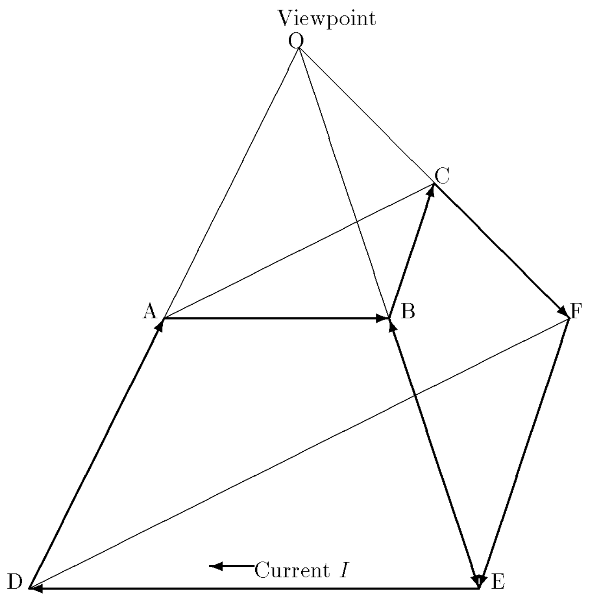

# When Should a Quantity Have Its Own Dimension?
## Uniqueness of Natural Units as a Design Criterion

## Abstract

The dimensional status of the plane angle in the SI has long been debated as a binary question, dimensional or dimensionless, specific to the angle. We propose a criterion across kinds of quantity. If a kind has a unique natural unit on which independent users would converge, a bare number identifies its quantities without a stated reference. Where there is none — no candidate being salient, or several comparably natural ones competing — the number leaves the reference unsettled, and we recommend a distinct dimension, which turns the omission of a unit label into a change of dimension and lets dimensional analysis detect confusions between kinds. Whether candidates compete is decided by two conditions: whether each is singled out by structure without a free parameter, and how many families remain when candidates related by rational factors are grouped together. To Flater's two mistakes, confusing kinds and confusing units, we add a third, confusing distinct quantities of one kind, which neither dimensions nor unit labels catch. For the amount of substance the criterion finds a unique natural unit, *N*A⁻¹, so that the mole is legitimate but optional; for the plane angle it finds two incommensurable candidates, rad and Ω₁ = 2π rad, and recommends an independent dimension, which the solid angle inherits squared. Logarithmic quantities, with structural candidates log e and log 2, are a third, purely mathematical test case. The action, the impedance and the electric charge each have a unique candidate. Proposing no change to the SI, we set beside it an implemented system that makes the opposite choice, the Universal Unit System (UUS)/Harmonic System. Side by side, the two show as choices what appears given within either. Frequency, activity and decay constant, kept apart in the SI over a single s⁻¹ by names and rules, separate into [angle/time], [amount of substance/time] and [logarithmic quantity/time]. Calendrical time takes the dimension of plane angle and separates from physical time through a bridging constant. The electromagnetic quantities are arranged symmetrically over five mutually independent dimensions, and the field-strength ratio and the resistance, like the characteristic impedance of vacuum and the Planck impedance, become quantities differing by the dimension of solid angle, as *h* and *ħ* differ by that of plane angle. Of the nine pairs examined, six are distinguished only by names and symbols when the system is read as given; read as a choice, every one becomes a distinction of dimension or of unit. The comparison gives a bird's-eye view of the design choices every unit system makes, mostly tacitly; the UUS is a constructive existence proof.

---

## 1. Introduction

One hertz and one becquerel are each one s⁻¹, yet they must not be interchanged; the SI keeps them apart not by dimension but by names and usage rules [1, Table 4 note (d)]. Which distinctions should a dimension carry, and which can be left to names or units? The same choice arises, in one direction or the other, for the amount of substance (Section 3), the plane and solid angles (Section 4) and logarithmic quantities (Section 5). It extends to calendrical and physical time (Section 6.4) and to the electromagnetic quantities (Section 6.5). This paper surveys these not as separate problems but under a single criterion; Table 1 (Section 6.6) gives the bird's-eye view.

The status of the plane angle within the International System of Units (SI) has been unsettled for as long as the SI has existed. The radian and the steradian were originally placed in a category of their own — the *supplementary units* — in 1960. CIPM Recommendation 1 (CI-1980) interpreted the quantities of the supplementary units as dimensionless derived quantities, and in 1995 Resolution 8 of the 20th CGPM abolished the category altogether, reclassifying the radian and steradian as dimensionless derived units. The current SI Brochure makes the radian the coherent unit of plane angle; it notes that the definition suggests rad = m/m, but adds that this representation "is not intrinsic and may be misleading since angle is not the same kind of quantity as other length ratios" [1, Table 4 note (b)].

The dimensionless treatment has never commanded universal assent, and over the past decade the debate has intensified in the pages of *Metrologia* and elsewhere. Mohr and Phillips argued that the SI treatment of dimensionless units — angles and counting units alike — introduces an incoherence, exemplified by the ambiguous status of the hertz [2]. Mills examined the relationship between the radian and the cycle [3]; Quincey, Mohr and Phillips argued that angles are inherently neither length ratios nor dimensionless [4]; and Kalinin proposed treating the plane angle as a quantity independent of the other SI quantities, with the solid angle derived from it as its square [5]. Quincey argued that treating the radian as an independent unit does not require redefining frequency or the hertz [6], and then put forward a detailed proposal reinstating a dimensioned angle constant *θ*C, of value 1 rad, in physical equations [7, p. 1]; these drew critical comments [8, 9] and further elaboration [10], and contributions continue to appear [11]. Lewis and Coveney have since argued from the practical realization of angle by circular closure for treating the radian as an SI base unit; they derive solid angle from plane angle rather than proposing another base unit [12]. In their account the full circle already appears as a dimensioned quantity, 2π rad, and they distinguish the 2π of geometry from the 2π of working in radians — the distinction that the present paper assigns to Ω₁ (Section 2.3). Their proposal thus overlaps with the treatment of Ω₁ and derived solid angle here, but asks how to change the SI rather than how to formulate a decision rule across kinds. At the institutional level, at the 22nd meeting of the Consultative Committee for Units (CCU) in 2016, the representative of the Consultative Committee for Length (CCL) reported that no support had so far been expressed within the CCL for making the radian a base unit of the SI [13, §3.1.8]. The controversy is not a historical curiosity; it is an active, unresolved question in contemporary metrology.

Previous work has exposed the ambiguity of the unit one for angular and counting quantities [2], discussed radian and cycle as competing references [3, 14], and considered coherent units for angular and logarithmic quantities together [15]; the range of options for handling plane and solid angle within a system of units, with their advantages and drawbacks, has also been surveyed [16]. Flater has argued that treating such quantities as "simply numbers" forfeits the protection quantity calculus provides against confusing units and confusing kinds, and has proposed revisions to the SI Brochure; he expressly sets aside, as "a completely separate question", whether any kind should be allocated an SI dimension [17]. Laying out the options and weighing them is one task; giving a rule that decides which treatment a given kind should receive is another. This paper takes up the second — the separate question that Flater set aside. The amount of substance and the angles offer opposite tests of such a rule.

This paper proposes such a criterion — the *uniqueness of the natural unit* of the kind of quantity in question — and examines its consequences. It proposes no change to the SI. The proposal concerns where the information needed for interpretation is placed in a system of units, not a claim that existing SI usage rules fail to communicate it. As a point of comparison we use the Universal Unit System (UUS)/Harmonic System [18, 19] (hereafter UUS), an implemented system of units that made the opposite design choice to the SI on precisely this point: it retains an independent dimension for plane angle and gives solid angle a derived, squared angle dimension. Placing the two systems side by side lets what appears to be *given* in each become visible as a *choice*. Nor is the question confined to physical quantities: the criterion rests on nothing but the ratio structure of a kind, and its most transparent application is to a purely mathematical one — the logarithm taken without a base, the baseless logarithm (Section 5).

Section 2 states the criterion; Section 3 applies it to the amount of substance as a case of uniqueness, Section 4 to the plane and solid angles as cases of non-uniqueness, and Section 5 to logarithmic quantities as a third case in which no physics is involved at all. Section 6 shows, by worked examples, where in a system of units the choice of a factor such as 2π or 4π is recorded: per-angle quantities (Section 6.1), the three usages of s⁻¹ (Section 6.2) and *h* and *ħ* (Section 6.3) are followed by the dimensional separation of calendrical from physical time (Section 6.4) and the symmetric dimensional arrangement of electromagnetic quantities (Section 6.5), and Table 1 collects them (Section 6.6). Section 7 presents the UUS as an existence proof and sets out its choice of units in the light of the criterion.

---

## 2. The criterion: uniqueness of natural units

### 2.1 What constitutes a unit

A unit of measurement is standardly defined as a quantity of the same kind[^kind] as the quantity to be expressed, chosen by convention as the reference with which quantities of that kind are compared [1, 20]. Two elements are present in this definition, and both are essential. A unit is (a) a *quantity* — something belonging to nature; and (b) a *convention* — something belonging to an agreeing community. A unit is therefore not a self-standing natural object. It is constituted jointly by a quantity and by the parties who agree to use it as a reference. The metre is not merely a length; it is a length *plus* an agreement.

[^kind]: Throughout, "kind" is short for kind of quantity in the sense of the VIM [20, 1.2].

The convention reaches further than the choice of a reference. Whether a unit is *coherent* is itself relative to an adopted family of defining relations. The relativity is definitional: the VIM defines a system of quantities as a "set of quantities together with a set of noncontradictory equations relating those quantities", and a coherent derived unit as one carrying no proportionality factor other than one "for a given system of quantities and for a chosen set of base units" [20, 1.3 and 1.12]. The system of quantities is itself chosen. In the Gaussian system Coulomb's law is written with coefficient one, in the ISQ with 1/(4π*ε*₀), and the two electric charges are placed in different kinds of quantity; rationalization was a deliberate change of such coefficients [21, p. 4; 22, pp. 45–50]. Read with the system of quantities as *given*, the difference is one between distinct kinds of quantity; read with it as a *choice*, it is a choice of defining relations. We take the second reading, and use "coherent" throughout in this relative sense. The freedom to choose which relation is written with coefficient one is not confined to electromagnetism: Silsbee lists the coefficients 1 : ½ : π : 3√3/2 in the area formulas for the rectangle, triangle, circle and regular hexagon, and shows that which formula is written with coefficient one — which figure serves as the unit of area — is a matter of convention [21, §4.4, p. 13]. The limit construction of rad² in Section 4.4 is, in this sense, the explicit election of the defining relation between plane and solid angle. We return to the divide over rationalization of electromagnetic units in Section 6.5.

For most kinds of quantity this two-party structure is conspicuous: nothing in nature singles out the metre among lengths or the second among durations, and elaborate institutions exist precisely to maintain the agreement. The interesting cases are those in which nature appears to do the community's work for it.

### 2.2 Natural units as focal points

Suppose that within some kind of quantity there exists a quantity so exceptionally distinguished that independent agents, without any prior communication, could each be expected to select it as the reference. Such a quantity functions as what game theory calls a *focal point* of a coordination problem [23]: agreement is reached without negotiation because the candidate is salient to all parties. We call such a quantity a *natural unit* of its kind[^natural].

[^natural]: Not in the sense of the natural units obtained by setting ħ = c = 1, nor of the nat (natural unit of information).

When a specified kind of quantity has a unique natural unit salient to the parties involved, the ratio of a quantity of that kind to the unit is a pure number. Communicating the number need not require a separately stated unit convention: the receiving party can reconstruct the quantity by supplying the same reference. Counting is the paradigm. As Kuroki observed in a widely circulated remark, deleting the unit from "the length is 5 mm" destroys the information, whereas deleting the counter word from "the count is 5 items" destroys nothing [24]. In the present vocabulary: the kind *number of entities* possesses a natural unit — the single entity — and it is unique. The amount of substance inherits this structure; we return to it in Section 3.

One caution is needed, and it does real work in what follows. The judgment that a quantity is "exceptionally distinguished" is a judgment made *by agents*; salience is relative to the parties coordinating[^salience]. The two-party structure of Section 2.1 is thus not eliminated by natural units — it is merely satisfied silently. This observation converts what might look like a defect (subjectivity) into an operational test: whether coordination succeeds without communication is decided by whether the salient candidate is *unique*. If no candidate is salient, or if two or more comparably distinguished candidates exist, no focal point forms; the parties must communicate after all, and the choice of reference is once again an explicit convention.

[^salience]: Salience is characterized here not by any intrinsic property of the candidate but by the pattern of behaviour it induces among the coordinating parties — which is what makes the test operational, and its failures observable. Condition (i) of Section 2.3 relocates this salience onto the structures a community shares.

### 2.3 The criterion

We can now state the criterion. Throughout, the kind of quantity and the community whose coordination is at issue are presupposed. For a general-purpose system of units such as the SI, that community is the whole body of the system's users, including sub-communities with different practices; the form of the criterion is universal, but its verdict is relative to the community. "Without a reference convention" means that the numerical value is not accompanied by a separately stipulated choice of unit.

> **(C1)** If a kind has a unique natural unit salient to independent users, its values can be represented by pure numbers without a separately communicated reference convention; an independent dimension is optional.
>
> **(C2)** If a kind lacks a unique natural unit — either no candidate is salient, or two or more comparably natural candidate units exist — a pure number by itself does not identify which reference was used; we recommend assigning the kind a distinct dimension. A distinct dimension makes replacing the unit label by 1 a change of dimension, so that dropping the record of the reference is detectable by a dimensional check.

First, what the criterion is for. A unit symbol functions as a **label**, and a label is needed only where there are alternatives to tell apart. A unit marks which of several candidate references was singled out — and where only one was available, there is nothing to mark. An independent dimension may still be useful for recording the kind in equations, as the mole shows (Section 3), but it carries no reference that a pure number would otherwise lose. A counting unit accordingly records the kind rather than a choice of reference, and the kind is what the criterion presupposes [cf. 17]. This is why the criterion turns on **uniqueness** rather than on the nature of the quantity.

The criterion is not a claim that dimensions alone fix all unit choices. It concerns where a system places the information needed for interpretation: in names, usage rules and unit labels (as the SI does for angle), or also in the dimensional structure of its quantity equations (as the UUS does). The recommendation turns on the non-uniqueness of the natural unit, not on the assertion that a labelled numerical value is intrinsically ambiguous.

Nor is it a static table for classifying kinds of quantity. It is a guide for the designer of a unit system, indicating where a choice must be recorded: (C1) does not forbid a dimension, and (C2) does not compel one. (C2) has two forms. **(C2a)** Where no candidate is salient (length, time and the like; Section 7.1), any choice of reference remains a convention. **(C2b)** Where two or more comparable candidates exist (the angles, the logarithm; Sections 4 and 5), natural candidates compete, and it becomes meaningful to preserve the displaced ones as named constants — Ω₁, or the bit (Section 7.1).

Which of (C1), (C2a) and (C2b) applies to a kind can be decided, before consulting any record of debate, by two conditions on its candidates.

> **(i)** Each candidate is singled out, without a free parameter, by a structure in which the kind participates, among those the community in question uses; that is, it is not an arbitrary member of a parametric family[^family].
>
> **(ii)** When candidates whose rational relation is given by structure are grouped into one *family*, two or more families remain.

[^family]: A *parametric family* is a collection of quantities that yields one quantity for each value chosen for a free parameter. The continuous solutions {c·ln} of the logarithm (Section 5) form a continuous parametric family, and choosing the parameter c is choosing a unit. The parameter need not be continuous. Since log 3 and log 5 are not rational multiples of log 2, (ii) alone would set up a separate family for every prime; but they are members of a discrete parametric family whose parameter is the prime taken as base, and no structure singles out which prime. Which real base, which measuring rod, and which atom (the Bohr radius, the Rydberg wavelength — these are also excluded by the stipulation of scope below) are likewise parameters of parametric families. log 2 is singled out from that family by the condition of the smallest integer greater than one (Section 5).

A family in the sense of (ii) is a collection of candidates related by rational factors. In counting, the pair and the dozen are integer multiples of the entity and fall within its family; only one family remains, and (ii) fails (Section 3). For the plane angle the ratio 2π of a revolution to a radian is irrational, so the two candidates belong to different families (Section 4.1). When a family has finitely many candidates, candidates related by rational factors have a greatest common divisor and a least common multiple. The counting family is infinite, but all its members are integer multiples of the entity, so the entity is its greatest common divisor — the generator of the family (Section 3). A finite example appears among the calendar units of Section 7.2.

The three verdicts are thus distinguished by the number of families that remain when the candidates meeting (i) are grouped as in (ii): one gives (C1) (the amount of substance, Section 3), two or more give (C2b) (the plane and solid angles, Section 4; logarithmic quantities, Section 5), none gives (C2a) (length, time and the like, Section 7.1). Condition (i) moves the salience that Section 2.2 made relative to agents onto the structures a community shares; for a general-purpose system, the community is the totality of the fields that use it (Section 4.2). The historical record is not the basis of the verdict but a check on it (Section 4.3).

Only quantities determined by the structure of the kind itself, without constants of other kinds, count as candidates. This is a stipulation of scope. Combining constants of other kinds, one can construct salient quantities even for kinds of type (C2a); the Planck length is an example. The stipulation excludes them from the candidates, so that the units of (C2a) kinds remain conventions fixed by the values of defining constants (Section 7). The same combinations can also create a second candidate for a kind of type (C1). Within the scope, the candidates for electric charge form a single family — the elementary charge *e* and its rational multiples (the quark charges *e*/3 and so on) — and charge falls under (C1) (Section 6.5); the Planck charge √(*ħ*/*Z*P) lies outside the scope. Extending the scope to admit such quantities as candidates would change the verdicts. Length and time would gain the Planck units as candidates; variants that differ only by a factor, such as *ħ* and *h*, or *G* and 8π*G*, become in the UUS reading quantities differing by the dimension of angle or solid angle and a rational factor (Sections 6.3 and 6.5), so that one family remains and the verdict moves to (C1). For charge, *e* and the Planck charge are separated by √α, and no structure shows α to be rational, so two families remain and the verdict moves from (C1) to (C2b) (Section 6.5). This extension opens a separate question — which system of natural units to choose — and is not pursued here.

The criterion can be tested on further kinds. The action has two apparent candidates, *h* and *ħ*, but they do not compete: their ratio 2π is Ω₁/rad, the two candidates of the angle carried over into the action (Section 6.3). The quantum of action *ħ*, which appears in relations with no angle in view such as the uncertainty relation Δ*x*Δ*p* ≥ *ħ*/2, is a unique candidate determined by the structure of the action itself, prior to any normalization of angle; the action, like the amount of substance, falls under (C1). (C1) says only that a dimension is optional; it does not ask for the dimension to be removed. Communities that set *ħ* = 1 drop the dimension; the SI keeps it, for the action as for the amount of substance. As a record of current usage: of the systems of natural units listed in the Wikipedia article "Natural units", every one whose defining constants include the Planck constant sets *ħ*, not *h*, to 1; and, the article notes, although Planck himself used *h*, Planck units are now understood to use *ħ* [25].

The 2019 revision changed, for these two kinds, how the ratio to the natural reference is handled. Before it, the kilogram was defined by the international prototype and the mole through 12 g of carbon 12, and *h* and *N*A were quantities measured against units so defined; the ratio to the natural reference was a consequence of defining the unit otherwise, not something chosen. Since 2019 the SI has defined the kilogram through the value of *h* and the mole through that of *N*A, in each case fixing the ratio to the natural reference as a defining constant while preserving continuity with the macroscopic unit. The value of the ratio was carried over, but it is now a choice recorded as the value of a defining constant (Section 3).

The criterion would be refuted by a kind that meets (i) and (ii) and yet shows, on the record, successful coordination without communication. Counting fails (ii) and coordination holds; the angle meets both conditions and coordination fails (Section 4.2).

Under (C2) the missing information can be supplied by an explicit unit label; it is not literally irrecoverable. We distinguish three types of confusion. **(K)** A confusion between kinds; if the system assigns the two kinds different dimensions, dimensional analysis can detect it. **(U)** A confusion between units of the same quantity — radian or cycle, for example (Section 4.3): the quantity is right, but its number is read in the wrong unit. It is guarded against by a unit label or by a named, dimensioned conversion constant for the full circular angle 2π rad (written Ω₁ below). **(Q)** A confusion between distinct quantities of the same kind — a radius and a diameter, for instance; neither dimensions nor unit labels distinguish them, and their identity must be carried by quantity names, symbols or context. The letters stand for kind, unit and quantity; (K) and (U) are the two mistakes that Flater distinguishes in his critique of the unit one — confusing kinds and confusing units [17]. A type belongs not to a mistake as such but to a mistake under a given reading of the system: the same confusion may be (Q) on one reading and (K) or (U) on another (Table 1, Section 6.6).

Two quantities related by a constant factor may, however, be read as one quantity in two units only if (a) they measure the same property of the same object and (b) the factor is the ratio of a natural reference of a kind that enters the definition of the quantity to another reference of that kind. The number of revolutions and the angle measure the same rotation (Section 4.2), and 2π is the ratio of a revolution to a radian; a radius and a diameter measure different parts of a circle, and length has no natural reference, so the factor 2 does not satisfy condition (b), and they remain (Q). Conversely, a radius and the circumference per revolution measure the same size of a circle, and 2π is the ratio of a revolution to a radian; they are one quantity expressed in m/rad and in m/Ω₁, and the [length/angle] quantities of Section 6.1 follow from this.

One clarification is needed: (C2) recommends a distinct dimension, not a base unit. Whether the dimension of a kind is primitive in a given system or derived from the dimensions of other kinds is an implementation decision internal to the system, and the solid angle will furnish the example (Section 4.4). The question this paper poses is accordingly not the one for which the CCL representative reported no support [13, §3.1.8] — whether the radian should become a base unit of the SI — but the prior one: whether an unlabelled numerical expression of angle requires a separately communicated reference convention.

With this distinction in place, the question "is the plane angle dimensional or dimensionless?" becomes a question of fact about the structure of the kind: *does the plane angle possess a unique natural unit?* We will argue (Section 4) that it does not. The observation that the angle has two natural units has appeared in the debate as the description of a difficulty [3, 14]. The present paper promotes it to a *criterion*.

Two consequences of adopting (C2b) for the angles are developed in Section 6. First, the practical objections raised against dimensioned angles — radius-type lengths acquiring the unit m/rad, the apparent breakdown of dimensional analysis in familiar formulas — are not anomalies in a system built along (C2b): the [X/angle] quantities form a category, the bridging constants, that practice has long used (Section 6.1). Second, the added dimensions separate pairs of quantities that the SI places in a single dimension, moving part of what was left to names and symbols into distinctions of dimension or unit (Sections 6.2–6.6).

---

## 3. A case of uniqueness: amount of substance

The amount of substance is a base quantity of the SI, and since the 2019 revision its unit, the mole, has been defined by fixing the Avogadro constant[^avogadro]: one mole contains exactly 6.022 140 76 × 10²³ elementary entities [1]. The kind of quantity is, by this very definition, proportional to a *count* of specified entities.

[^avogadro]: Strictly, the Avogadro *number* (dimensionless) and the Avogadro *constant* *N*A (dimension [amount of substance]⁻¹) are distinct. This paper uses the dimensioned reading throughout.

Apply the test of Section 2.2. Does the kind possess a natural unit? It does: the *single entity*. Whoever undertakes to express an amount of substance as a number must divide by some reference amount, and the amount corresponding to one entity, *N*A⁻¹, is distinguished by the very structure of counting: it is the indivisible step, the generator of the kind. Among other conceivable references, the pair, the dozen and the gross are integer multiples of the entity and fall within its family, deriving whatever salience they have *from* the entity. The size of the mole was chosen through a unit of another kind — originally as the number of atoms in 12 g of carbon 12, a value the 2019 revision carried over; it owes its salience to the unit of mass, not to the structure of the kind, and is not a candidate in the sense of condition (i). The focal point is unique.

The criterion therefore returns (C1): given the kind and the counted entity, values of amount of substance can be expressed as pure numbers without separately stipulating the single entity as reference. This is exactly the content of Kuroki's observation quoted in Section 2.2, and it is why long-standing scepticism about the unit status of the mole has, in one precise sense, a ground: the mole is not *necessary* in the way the metre is. Here *N* and *n* = *N*/*N*A are read as one quantity expressed in two units, the entity and the mole. The ISQ sets them up as distinct quantities; that is the reading of the system as given (Section 2.1; Table 1).

But (C1) says only that an independent dimension is *optional*, not that it is mistaken. The SI's decision to give the amount of substance a base unit is a legitimate exercise of the option, made on grounds of practical convenience: chemistry lives at the macroscale, and a unit sized to the gram rather than to the yoctogram earns its keep daily. What (C1) rules out is only the claim that the dimension is forced. Between "unit" and mere "counter word" (the classifier particles of Japanese and other classifier languages [26]) there is, on this analysis, no sharp boundary but a gradation of explicitness of convention [27]; the mole sits on that gradation by choice, not by necessity.

As noted in Section 2.3, the 2019 revision carried over the size of the mole while reversing the direction of its definition, fixing the ratio to the natural unit *N*A⁻¹ as a defining constant. The SI does not call this natural unit by name, but defines the mole as its fixed multiple.

The treatment of counting quantities within the SI has itself been identified as a source of incoherence by Mohr and Phillips, who discuss counting units alongside angular ones [2]. Their own remedy reaches this section's verdict from another direction: they propose the symbol *ent* for the entity and write the mole as a multiple of it [2], electing as the unit of the kind precisely the focal point identified above, and leaving the mole a named multiple of the natural unit rather than an independent standard. With the exact value fixed since 2019, 1 mol = 6.022 140 76 × 10²³ ent. The present criterion locates counting and angle on opposite sides of the line: counting passes the uniqueness test, angles — as we now argue — fail it.

---

## 4. Cases of non-uniqueness: the plane and solid angles

### 4.1 Two candidates, two structures

For the plane angle, two candidate references present themselves, and each is exceptionally distinguished — but by *different structures* in which the kind participates.

The first candidate is the **radian**. Its salience is analytic: it is the unit in which the arc-length relation reads *s* = *rθ* with no numerical factor, in which d(sin *θ*)/d*θ* = cos *θ*, in which the Taylor series and Euler's formula take their unadorned forms. Within the analytic structure of the kind, the radian is not one choice among many; it is *the* choice.

The second candidate is the **full circular angle**, the revolution — in SI terms the angle of value 2π rad, which is the Ω₁ of Section 2.3 (the UUS convention is to speak Ω₁ as "cycle" [19]). Its salience is topological and periodic. Winding numbers are counted in units of Ω₁; rotational frequencies are stated in revolutions per unit time; the degree — the working unit of practical angle measurement for several millennia — is defined as a subdivision (1/360) of Ω₁, not of the radian; the hertz, as actually used, means cycles per second. Within the periodic structure of the kind, Ω₁ is *the* choice. Kalinin likewise observes that every known unit of plane angle — degree, radian, gradian, revolution — is defined by fixing a value of Φ, the angle of one complete revolution, which he calls a natural constant of two-dimensional geometry [11, §2].

Two features distinguish this situation from the counting case of Section 3. First, the ratio Ω₁/rad = 2π is irrational, so no rational relation groups the two candidates into one family; neither is derived from the other in the way the dozen derives from the entity. Second, the grounds of salience have no common scale on which to rank them: the analytic structure and the periodic structure are both genuinely constitutive of what an angle is, and there is no neutral standpoint from which one trumps the other. The focal point fails to be unique, and by (C2b) an independent dimension is recommended for the plane angle. The choice of working unit then becomes an explicit convention; the UUS, for the analytic reasons above, selects the radian [18]. If the working unit is the radian, the displaced candidate, the revolution, remains as a dimensioned constant Ω₁ of value 2π rad, whose value, under the defining relation that writes the arc-length relation *s* = *rθ* with coefficient one, is not a coherent unit in the sense of Section 2.1.

### 4.2 The strongest objection: is the radian not *really* unique?

The defender of dimensionless angle will reply that the two candidates are not comparably natural: the analytic privilege of the radian is objective mathematics, while the salience of the cycle is mere habit. If the radian is the real focal point, uniqueness holds after all, and (C1) applies.

The periodic structure, however, has grounds that do not reduce to habit. The angle, unlike length or duration, is natively a quantity on a circle, and Ω₁ is the circumference of that circle in the kind's own terms. Winding number — an integer, and among the most robust invariants in mathematics — is a count of Ω₁'s, not of radians; a phase is physically meaningful modulo Ω₁, not modulo 1 rad. For a periodic quantity such as phase, what carries the information is the fractional part left after removing whole revolutions. A homely example makes the point concrete. The oldest and most universal angular quantity in human life is the day — one rotation of the Earth relative to the Sun. Even for those whose analytic practice is built on the radian, the day is measured in units of one revolution rather than as a multiple of 2π rad, and the time of day is expressed as its fractional part (a fact Section 6.4 puts to systematic use). Where the phenomenon itself is periodic, the cycle is salient even to those whose working unit is the radian.

The contest between the two candidates is alive within pure mathematics too. The recurring argument over whether the fundamental circle constant should be π or τ = 2π [28, 29] is a dispute over which structure names the constant. The τ side argues from the period (one full rotation as the reference); the π side from the accumulated analytic identities in which π appears unadorned (π*r*², eiπ + 1 = 0, Γ(½) = √π) [29, §§2.3, 3, 4.2]. That each side can marshal its formulas, and that the argument recurs without resolution, is one face of grounds of salience without a common scale.

A reader working within the ISQ will raise a stronger objection. The number of revolutions *N* is a count, a (C1) quantity with the unique natural unit "one revolution"; the angle *φ* = 2π*N* rad is a different quantity, whose natural unit is the radian; non-uniqueness appears only because two quantities have been folded into one kind. But a revolution is not a unit of counting. An entity is an indivisible generator — half an entity means nothing — whereas a revolution can be divided, and for periodic quantities, as seen above, the fractional part is precisely what is put to use: a phase is a fraction of a revolution, a degree is 1/360 of one, a time of day is a fraction of a day. The number of turns of a closed path is an integer because the path is closed, not because a revolution is indivisible. A "number of revolutions" is the numerical value of a continuous quantity expressed in the unit "one revolution", not a count. Indeed, ISO 80000-3 defines rotation as *N* = *φ*/2π and notes that it is not necessarily an integer [30, item 3-14]. Setting up *N* and *φ* as distinct quantities is therefore a (Q) distinction when the system is read as given (Section 2.1; Table 1); read as a choice, it is, by conditions (a) and (b), the choice (U) between two units of one quantity, Ω₁ and rad. The same answer applies to the parallel objection for the logarithm, that the number of doublings is a count while the natural logarithm of a ratio is another quantity (Section 5).

Grötschel and co-authors argue from the observation that there are angles of special significance, such as the right angle and the straight angle, while Euclidean geometry has no distinguished length, that angular measures are numbers [31]. We share the observation that the angle has special references. But the special angles they list are all rational multiples of a revolution — the right angle is Ω₁/4, the straight angle Ω₁/2, all members of the family of Ω₁ — while the measure they treat as a number (π/2 for the right angle) is the value in radians. References from two families stand side by side within the same argument.

More fundamentally, uniqueness is not decided by the intrinsic merits of the candidates. As Section 2.2 noted, salience is a relation between a candidate and the coordinating parties, and the operational check on uniqueness is whether coordination in fact succeeds without communication. For as long as these quantities have been measured, two communities of practice have coexisted, each finding a different candidate self-evident. Within either community alone the focal point may be unique; this is why, within a practice that strongly privileges the analytic structure, coordination on the radian can succeed without difficulty. A general-purpose system such as the SI, however, must coordinate the two communities together, and there factor-of-2π confusions appear in the published record (Section 4.3). The record of coordination checks the verdict that conditions (i) and (ii) give. The persistence of this debate is consistent with the focal point's not being unique.

This account implies no criticism of choosing the radian as the working unit. The analytic grounds for that choice are excellent, and the UUS makes it (Section 4.1). The criterion's claim is only that this choice is not a discovery that may be presupposed but a convention it is recommended to record — by a unit designation or, in a system that retains the angle dimension, by a dimensioned constant.

### 4.3 The non-uniqueness is documented

Quincey, while still defending the dimensionless treatment, wrote that at the heart of the problem lies the fact that there are two natural units for angle — for mathematicians and theoretical physicists the radian, for everyone else the revolution [14]. In that literature the observation figures as the description of a difficulty, an explanation of why the field is confusing, to be managed by more careful wording or, in Quincey's own later position, by reinstating a dimensioned angle constant [7]. The promotion announced in Section 2.3 is precisely to read this observation as a criterion. With two competing focal points, an unlabelled pure number does not tell a recipient which reference was used (C2).

The risk of leaving a reference implicit is not hypothetical. As Mohr and Phillips showed, the same physical situation can be described as 1 Hz or as 2π s⁻¹ depending on which dimensionless unit was silently replaced by the number one, with factor-of-2π errors as a possible consequence [2]. Such mistakes appear in the published record; the two notices below show that they occur, not how often. One erratum reports that "the conversion factor of 2π between the angular frequency ω … and the frequency ν … was accidentally dropped" [32]; another reports that the reduced Planck constant was used instead of the Planck constant, making computed resistances "lower by a factor of 2π" [33]. On the reading of the UUS, the two belong to different types. Ω₁/s and rad/s share a dimension, so the 2π between them can be recorded only by unit notation, not by the dimension (U); the first erratum is a mistake of this type, which dimensional homogeneity alone does not catch. By contrast, under an assignment in which *h* and *ħ* differ by the angle dimension (Section 6.3), a resistance of the form *R* = Ω₁·*h*UUS/*e*² is written so, since *h*UUS is an action per angle; substituting *ħ* for *h*UUS leaves a surplus factor of angle, and the mistake reported in the second notice becomes one that dimensional analysis can detect (K).

Mohr and Phillips also locate an incoherence on the counting side [2]. It arises not from any non-uniqueness within counting, but from counting and angle being folded into the same dimensionless unit one; it is the fold, not the counting, that carries the ambiguity.

### 4.4 The solid angle

The solid angle presents the same structure one dimension up. The analytic candidate is the steradian. The closure candidate — the full-angle candidate — is the full spherical solid angle, in SI terms 4π sr (written Ω₂ below), the solid angle of a closed surface about an interior point, distinguished by the integral theorems (Gauss) and by isotropy.

The century-old division of electromagnetic unit systems into rationalized and unrationalized families concerns where this 4π is placed [21, p. 4]. Heaviside, proposing rational units, traced the 4π to "the area of the spherical surface over which the force is spread", and held that its presence in spherical problems "would be perfectly natural", 4π "being the area of the unit sphere" [34, p. 199]. Heaviside's word is area; reading it as Ω₂ is the present paper's interpretation. In the dimensional reading developed here, Ω₂ = 4π sr makes that geometrical factor explicit; this is a way to compare the conventions, not a claim that all their historical motivations reduce to a choice of solid-angle unit [35]. The solid angle fails the uniqueness test as well, and the verdict is the same.

No second primitive dimension is needed to honour it, however. Treating the solid angle as derived from the plane angle, with the steradian equal to the square radian, has also been proposed by Kalinin [5]. Then Ω₂ = 4π sr = 4π rad². In the UUS, hyperspherical solid angles are likewise integer powers of the plane angle: the total solid angle of the *k*-dimensional hypersphere is Ω*k* = (2π(*k*+1)/2/Γ((*k*+1)/2)) rad*k*, giving Ω₁ = 2π rad, Ω₂ = 4π rad², Ω₃ = 2π² rad³, and so on [19]. The criterion is applied once, to the plane angle, and a single added dimension then services spherical geometry in every dimension *k*; there is no unbounded proliferation of angular dimensions as one ascends to hyperspheres. The solid angle inherits its dimension (rad²) from the plane angle, and inherits its non-uniqueness as well: the pair (sr, Ω₂) stands to solid angle exactly as (rad, Ω₁) stands to plane angle, and Ω₂ enters the system as a dimensioned constant of value 4π rad², with the electromagnetic consequences of Section 6.5.

The product of two plane angles can be defined as follows, and it is fair to ask in what sense two plane angles can be multiplied at all. On the sphere, no finite figure realizes the product exactly: the solid angle of a spherical square of finite side *θ* deviates from *θ*² by curvature terms [19, eq. (18)]. But *n*² times the solid angle of a spherical square of side *θ*/*n* loses that deviation as *n* → ∞. Defining *θ*² as this limit [19, eq. (19)] makes sr = rad² an identity about a defined product rather than a notational agreement. This is the choice of Section 2.1 — which figure's formula carries coefficient one — made for the infinitesimal spherical square. It is not a weakness peculiar to solid angles; it places the composition of angular dimensions on the same footing as the radian's own analytic privilege (Section 4.1), which is likewise a statement about the infinitesimal, flat structure of the kind[^rectification]. Dimensional analysis asks no more than that the kinds compose multiplicatively; the limit construction supplies the geometric realization of the composition. The solid angle thus receives the (C2b) verdict, but its distinct dimension need not be a new base dimension: by the geometric relation it is derived as [solid angle] = [plane angle]². This is the distinction between dimension and base dimension drawn in Section 2.3.

[^rectification]: Both the rectification of arc length and the small-angle identities are limit statements; the plane angle retains, via the circle's symmetry, one exact finite relation, *s* = *rθ*, which the solid angle has no counterpart of.

---

## 5. A third test case: logarithmic quantities

The criterion was formulated for kinds of quantity in general, and it would be suspicious if its only non-trivial applications were angular. There is a third, and it is instructive precisely because no physics is involved at all.

Consider the logarithm — not log to any particular base, but the object defined by the functional equation log(*xy*) = log *x* + log *y*. The equation fixes the structure (a homomorphism from multiplication to addition) but no normalization: its continuous solutions form the one-parameter family {c·ln}. The definition delivers a kind of quantity and stops short of electing a member. The author called this object the *baseless logarithm* and argued, in an appendix to the original UUS proposal, that it is a purely mathematical entity which is nevertheless not a number but a quantity, whose numerical value depends on a choice of unit [19, App. A.2]: log 2 = 0.3010… log 10 is an equation between quantities, reducible to an equation between numbers only by dividing through by a chosen member of the same kind.

That division is the change-of-base identity log *x* / log 2 = lb *x* (lb denoting the binary logarithm [36, item 2-13.7]) read with fresh eyes: taking a base *is* choosing a unit, and the numerical value lb *x* stands to the quantity log *x* exactly as the number 5 stands to the length 5 m. The same reading applies within the angular case: Kalinin distinguishes the dimensional plane angle *φ* from the dimensionless combination *θ* = *φ*/(*Φ*/2π) that enters the equations of physics, and identifies the latter as what metrology calls the numerical value of the angle expressed in radians [11] — a quantity divided by an elected unit, in precisely the present sense. It follows that the standard reason for regarding logarithms as dimensionless — "lb *x* is just a number" — establishes nothing by itself: every dimensioned quantity yields a number upon division by a unit. What the purely mathematical setting adds is a proof of scope: the two-party structure of Section 2.1 and the uniqueness test of Section 2.2 engage only the ratio structure of a kind, not measurability by physical apparatus. The VIM's definition of quantity speaks of properties of phenomena, bodies and substances [20, 1.1]; the extension to mathematical objects is deliberate, and harmless here, because nothing in the criterion's machinery uses more than ratios.

Now apply the test. Two candidates are determined by structure, each salient within a different one. **log e** (the neper) is distinguished analytically — it is the normalization with d(log *x*)/d*x* = 1/*x* and log(1 + *ε*) ≈ *ε*[^lognum]. **log 2** (the bit) is distinguished as the binary unit — it is the logarithm of the smallest integer greater than one: one binary choice, or one doubling. log e, e being transcendental, is not a rational multiple of log 2 and does not fall within its family. **log 10** (the hartley; the bel family) is established in practice by positional notation, but its base is a convention rather than a structure, and it does not count as a candidate in the sense of condition (i); lb 10 being irrational by unique factorization (no positive integers satisfy 2*p* = 10*q*), log 10 remains a conventional third unit, within neither family. The focal point fails to be unique, and (C2b) returns the same verdict as for the angles.

[^lognum]: These formulas hold for numerical values expressed in nepers.

From the parallel with the radian, Mills, Taylor and Thor argued that the neper is the most logical coherent unit for logarithmic decay [15]. The present criterion agrees that the two kinds should be treated alike; it differs on what settles their treatment. A structural parallel shows that whatever is said of one kind should be said of the other, but not what is to be said. Here that is decided by the uniqueness test applied to each kind separately, and the parallel does not carry everything across. Ω₁ corresponds to the period 2π of the imaginary part of the complex logarithm, which the real part does not have; the salience of log 2 comes from the smallest integer greater than one, which has no angular counterpart; and the angle has a squared kind, the solid angle, to which nothing on the logarithmic side corresponds. The two kinds fail the test independently and receive the same verdict. The kinds are presupposed by the criterion (Section 2.3); an analytic parallel between them can transfer a verdict but does not determine one.

The verdict is corroborated by the historical record. Shannon opened the founding paper of information theory by identifying the choice of logarithmic base with the choice of the unit of information, naming bits, decimal digits and natural units in the same sentence [37]. The SI does not make the neper, bel and decibel SI units but retains them by name as non-SI units for specialized technical disciplines, stating whether their values rest on the natural or the decadic logarithm and requiring that the quantity and any reference value be specified [1, Table 8 note (m); 15]. The names go on carrying the choice of base that collapsing them into a pure number would lose (U). ISO 80000-3 likewise requires the unit to be written out even though 1 Np = 1, and compares the neper and the bel to the radian and the degree [30, 0.5]. The units of information, too, are standardized as a plurality (shannon, hartley, natural unit) [38].

The neper and the bel are sometimes held to belong to two different kinds of quantity — the one to amplitude ratios, the other to power-like ratios — on the ground that their defining equations differ by a factor of two [39]. The SI Brochure itself describes this as a practice of application: values in Np are usually applied to amplitude ratios, values in B and dB usually to power ratios [1, Table 8 note (m)]. On the present account the factor belongs to the argument of the logarithm rather than to the logarithmic kind itself: what varies is which ratio is being taken, not which kind of quantity results[^levels].

[^levels]: In the usual notation a power level is written 10 lg(*P*/*P*₀) dB and a voltage level 20 lg(*U*/*U*₀) dB = 10 lg(*U*²/*U*₀²) dB; the factor 2 sits, as a square, in the argument. The SI Brochure likewise reads a value in dB as *m* = 10 lg(*X*/*X*₀), calling it a power level when *X* is a mean-square signal or a power-like quantity [1, Table 8 note (m)]. ISO 80000-3 defines both levels as one quantity *L*, the natural logarithm of a ratio of field quantities, inserting a square root for power: *L*P = ln √(*P*/*P*₀) = ½ ln(*P*/*P*₀) [30, 0.5]; there the factor ½ is absorbed into the relation between units, 1 B = ½ ln 10 Np. The UUS keeps the units as pure logarithms (1 B = log 10 = (ln 10) Np) and places the factor with the base point, using the binary operator ° [18, App. A.1 (8)]. The operator ° combines a scale interval with a base point (°C and dBm are abbreviated forms of this kind); its left operand is the unit, its right operand the base point, brought into the dimension of the left operand, a logarithm, in the way the existing notation prescribes. Thus dBW (dB°W) is deci log 10 ° log(W), dBV (dB°V) is deci log 10 ° log(V²), and the neper applied to a voltage (Np°V) is log e ° log(V). Take a doubling. A power of 2 W reads 3.01 dB°W, and the quantity is log(2 W) − log(W) = log 2: one bit. A voltage of 2 V reads 6.02 dB°V, and the quantity is log((2 V)²) − log(V²) = log 4: two bits. Written as log e ° log(V), the same 2 V reads 0.693 Np°V, the quantity being log 2. As logarithms the units never change (1 bit = log 2 = 3.01 dB throughout), and the factor 2 sits with the right operand. The familiar 1 B = (ln 10)/2 Np equates two conventional level readings of the same doubling of voltage (6.02 dB and 0.693 Np), which as logarithmic quantities of the present paper are log 4 and log 2. The numerical readings agree with both the SI Brochure and ISO 80000-3; only the way the quantity is set up differs.

Once the logarithm is given a dimension, the equations change in the same way as they do for the angle. With the inverse of the baseless logarithm, log⁻¹ (the antilogarithm, not 1/log), defined on logarithmic quantities, exponential decay reads *N*/*N*₀ = log⁻¹(−*λt*), with no conversion constant: the decay constant *λ* has dimension [logarithmic quantity/time] and *λt* is a logarithmic quantity. The conventional *N* = *N*₀ e−*λt* passes the numerical value of *λt* in nepers to the exponential function. In differential form, d*N*/d*t* = −*λN*/Np; the factor 1/Np plays the role that 1/rad plays in d(sin *θ*)/d*θ* = (cos *θ*)/rad when angle is dimensioned. Ways of writing functions that take dimensioned angular arguments are given in [7, 10]. This is why the activity *A* = −d*N*/d*t* = *λN*/Np has the dimension [amount of substance/time] of Section 6.2. The UUS has a logarithmic dimension, elects the neper as its working unit, and houses the displaced candidates as dimensioned constants, the bit among them (Section 7).

One further fact deserves record. In 2026 — twenty-four years after [19] — the same object was formalized independently, under the very same name "baseless logarithm", in an essay by Kritchevsky [40], which develops the same picture of base-change as unit-change before a general audience. The convergence has the same structure as that between the UUS's Ω₁ and the *θ*C of the SI-side proposal [7] (Section 8): two parties, starting from different concerns and unaware of each other, arriving at the same construction. A construction that keeps being rediscovered is at least evidence that it is not an artefact of one author's notation.

---

## 6. Where is the choice recorded?

This section shows, by worked examples, where a system of units records the choice of a factor such as 2π or 4π. Sometimes it is recorded by a dimension, sometimes by a unit label or a named constant. In the types of Section 2.3, a distinct dimension makes confusions between kinds checkable within equations (K), and named units and constants record conversions between units of the same kind (U). The cases below show both, without claiming that a dimension alone detects every conversion error. Sections 6.1–6.3 treat individual quantities and constants; Sections 6.4 and 6.5 are larger cases, in which giving dimensions to the angle and the solid angle actually changes the design of a system of units. Section 6.6 collects them in Table 1.

### 6.1 Per-angle quantities: the bridging constants

(C2b) recommends giving the angles a dimension, but does not by itself settle how to keep house afterwards. The housekeeping questions are well known, having been catalogued by Quincey in 2015, before his own position changed [14], and raised again by Křen. The objection is that if the angle *θ* carries a dimension, then under the arc-length relation *s* = *rθ* the "radius" must carry the unit m/rad [14], and that the same happens for time in the form s/rad [8]. The Bohr radius, the *r*² in π*r*², the moment of inertia and the routine practice of dimensional analysis (the Stokes-drag argument) have been offered as places where this becomes awkward. These are design tasks for a system that gives the angles a dimension: such a system owes an account, systematic rather than a patch per formula, of how quantities of dimension [X/angle] behave. The questions are not new, and neither are the answers. Eder explored them systematically in 1982, under the explicit hypothesis that the plane angle is dimensional, working out the consequences for trigonometric functions, rotational volumes, limits and series expansions, and proposing revisions to a number of derived-unit expressions in the SI [41]. What has been listed as a catalogue of difficulties was, for Eder, a programme of consequences to be developed. Quincey and Brown rejected this treatment, which gives radii the dimension [length/angle], as requiring ad hoc dimensional rules, and preferred to insert a conversion constant *η* = 1 rad⁻¹ into the equations [42]. The mechanics-side bookkeeping (torque, angular momentum, moment of inertia) is the subject of an ongoing exchange within the debate [7, 9, 10] and is not entered into here. This section describes the account given by the UUS, in which [X/angle] quantities form a deliberate, named category.

The central observation is that quantities of dimension [X/angle] are not exotica conjured by the dimensioning of angles. Operational metrology has always contained them; the dimensionless-angle convention merely denies them a visible unit.

Consider the nautical mile. It was originally conceived as the length of one minute of arc of latitude along a meridian — the product of an angle (one arc-minute) with a conversion constant of dimension length/angle, the length of meridian per unit of subtended angle. Since 1929 the international nautical mile has been fixed at exactly 1852 m [1], a value chosen for its agreement with that historical definition; the fixing changed the definition, not the practice. A navigator converting a latitude difference into a sailed distance has been multiplying an angle by a constant of unit m/rad (in SI terms about 6.37 × 10⁶ m/rad). The original definition of the metre itself — one ten-millionth of the quadrant of the Paris meridian — is a statement of the same form: a length obtained from an angle (a quarter revolution) through the meridian constant [43].

The UUS names this constant and makes it a system constant: **meridian**, *m*E, the length of the Earth's meridian circle per full circular angle, of dimension [length/plane angle], in SI terms about 6.37 × 10⁶ m/rad [44]; *m*E·rad gives a representative Earth radius. The UUS gave this constant the name of the meridian because, as Section 2.3 showed, a radius and the circumference per revolution are the same quantity — the size of one circle expressed in m/rad and in m/Ω₁. The full meridian divided by one revolution and the representative radius divided by one radian are two expressions of a single quantity. In a system with dimensioned angles, radius-type length is not a defect to be tolerated but a physically meaningful category with named members. The radius of a circle, as converter of central angle into arc, is a quantity of this category; the meridian constant is its planetary-scale exemplar.

The category is not confined to length. The UUS defines a second Earth-local constant, **solar**, *s*E: the Earth's mean solar rotation period per full circular angle, of dimension [physical time/plane angle] [44]. The civil day — one rotation of the Earth relative to the mean Sun — stands to *s*E exactly as the nautical mile stands to *m*E: an angle rendered as a duration through a bridging constant (Section 6.4). There is *one* category, [X/angle], with members in length (*m*E, and every radius of curvature) and in time (*s*E, and every rotation period per cycle), each converting the periodic variable into the linear one. What has been taken as two kinds of length is better described as the general distinction between a quantity and its per-angle rate of accumulation. The SI does not record this distinction; the UUS is able to state it.

These two per-angle constants are the angular members of a wider family. The Earth-local bridging constants of the UUS form a quartet — meridian *m*E (length per Earth angle), solar *s*E (physical time per calendar angle), gravity *g*E (Earth weight per mass), and a reference temperature *T*E (everyday Earth temperature against thermodynamic temperature) — each relating a locally salient quantity to a universal kind [18, Table 8]. More generally, a bridging constant is any dimensioned constant whose office is to relate quantities of one kind to those of another. The per-angle constants and the Earth-local quartet are its most familiar members; among the universal members, the Planck constant joins the per-angle family (Section 6.3), and Section 6.5 meets two more, the Planck force *F*P and Ω₂.

Scepticism about dimensioned angles has been less about principle than about practice: will real formulas, mixing several branches of physics, still balance? A compact test case is the relation between a planet's gravitational radius and a stipulated representative gravitational acceleration. In the UUS, a rotating planet *X* is characterized by a quartet of planet-local constants — the family above in its general form: meridian *m**X*, solar *s**X*, gravity *g**X* and a reference temperature *T**X* — and *g**X* and *m**X* are tied together by the identity

  *g**X* = *c*₀² *r**X* (*m**X* rad)⁻²,

where *r**X* = G*M**X*/*c*₀² is the gravitational radius of a planet of mass *M**X* (half the Schwarzschild radius; ≈ 4.4 mm for the Earth). This is how the UUS specification gives *g*E [18, Table 8; the identity evaluates the general relation *g* = *c*₀² *r**X*/*r*² of App. C, eq. (8) at the specified reference radius]. Track the dimensions: *m**X* rad is [length/angle]·[angle] = [length], a representative radius reconstituted from the meridian constant; and *c*₀² *r**X* (*m**X* rad)⁻² is [length³ time⁻²]·[length⁻²] = [length/time²]. A chain that traverses geodesy, gravitation and relativity closes dimensionally with the angle factors written out. The explicit rad records the single point at which a periodic quantity (the meridian, as so-much-length-per-angle) is converted into a linear one (a radius, as a distance).

The identity answers two different questions. Membership in the planet-characterizing quartet is a matter of role. *g**X* belongs because it bridges — a test mass *m* to the reference weight *W* = *m* *g**X* under the stipulated representative acceleration — as *m**X* and *s**X* bridge in their kinds. The gravitational radius *r**X*, a plain length that bridges nothing, is for all its importance not a member; in the UUS *r**X* is how the body's mass itself is represented [18, App. C], universal physics rather than Earth-local bridging. Evaluation, by contrast, is a matter of measurability. The two quantities known to highest precision are *r**X* (since *GM* is determined extremely well from orbital dynamics) and *m**X* (the meridian arc that geodesy has always surveyed); in practice the identity is read from right to left, computing the bridging constant from the two best-measured inputs. The UUS chooses the full meridian as its reference rather than an equatorial, polar or particular-latitude radius: *m**X* rad is the rectifying radius so specified (≈ 6 367.45 km for the Earth [44, §12]). This is a choice of prescription, but it requires no choice of observation latitude. Inserting this radius in the inverse-square relation yields a representative acceleration that is likewise independent of latitude; it is not the effective gravity measured at every point on the surface[^reference-gravity]. The constant of dimension [length/angle] makes a latitude-independent reference explicit without pretending that local gravity is uniform.

[^reference-gravity]: For the Earth this prescription gives *g*E ≈ 9.831 m/s², the attraction alone at the reference radius. It is a representative value, not the local effective gravity, which also includes the centrifugal term and the oblateness, and not a derivation of the standard acceleration of gravity, 9.80665 m/s², adopted by the 3rd CGPM (1901).

The distinction bears on the old comparison between the meridian and the seconds pendulum as candidates for the metre [43]. A pendulum operated at a particular site responds to the local effective gravity, and its period depends on latitude; no choice of notation can turn an actual pendulum into a site-independent standard. The meridian prescription instead supplies a representative acceleration independent of the measuring site, against which local measurements can be compared. Within the UUS quartet this representative *g**X* is computed from the gravitational radius and the meridian, not separately stipulated.

The gain from distinguishing per-angle quantities is (K). The method of dimensions derives its power from the constraints that dimensions impose: adding a dimension where a distinction of kind exists adds constraints, and narrows the range of formulas that pass the check. In a system with dimensionless angles, an expression that confuses an angular rate with a rate of another kind, or a torque with an energy, can balance dimensionally. Assigning those kinds different dimensions makes such a confusion a type error (K). By contrast, *ν* in cycles per second and *ω* in radians per second are, in the UUS, rates of the same angular kind (Section 6.2): dimensional analysis alone cannot detect a missing factor of 2π between their units, and explicit unit notation or Ω₁ carries that conversion (U) [2; 19, §A.3]. What has been recorded as "dimensional analysis breaking" is the experience of formulas written under the convention that erases angle factors failing the stronger check until the erased factors are restored — a one-time migration cost, not a defect of the destination. More precisely, it is the experience of testing a new dimensional assignment against the old set of defining relations. Since coherence is relative to an adopted family of relations (Section 2.1), a dimensional reassignment is complete only together with a re-elected family of relations. What the UUS shows is that the re-elected family has actually been written down, and can be computed with — for electromagnetism in 1997 [35] and for gravitation by 2002 [19, App. C].

### 6.2 Three usages of s⁻¹

The SI distinguishes frequency *ν* and angular frequency *ω* by writing them in Hz and rad/s. The UUS reads both as expressions, in two units, of one kind of quantity of dimension [angle/time]. The 2π then becomes a unit conversion of exactly the standing of the 180/π between degrees and radians [19, §A.3, p. 18], and what the SI writes as a bare 2π is the full circular angle Ω₁.

Quincey's proposal within the SI [7, p. 1 and Table 1, p. 5] treats the same ambiguity by another move. With a dimensioned constant *θ*C (formerly *θ*N) of value 1 rad it writes *ω* = 2π*θ*C·*ν*, giving *ω* the dimension [angle/time] and *ν* the dimension [1/time]. The two treatments locate the distinction differently: two kinds, or one kind with two units. The difference reflects the conditions under which each works. A proposal within the SI must keep the established SI distinction between frequency and angular frequency, and under that condition restores an angle constant in the complete equation. The SI Brochure says that their numerical values differ by 2π [1, §2.3.4], and the practical-realization document for the metre writes *ω* = 2π*f* in its interferometry discussion[^si-frequency]. The UUS, free to re-elect the family of defining relations itself, instead elects a family in which cycle/s and rad/s are units of one angular kind (Section 2.1). Read in accordance with the SI convention, *θ*C = 1, Quincey's equation is numerically unchanged, *ω* = 2π*ν*; only on the reading that treats *θ*C as a dimensioned constant of value 1 rad do *ν* and *ω* acquire different dimensions. The proposal is designed to make the choice visible while leaving it to the reader to make; the UUS makes the same choice within the system itself. The two treatments nonetheless agree on the point essential to the criterion: what the SI writes as a bare 2π is the full circular angle Ω₁ (Section 8).

[^si-frequency]: BIPM, *Mise en pratique for the definition of the metre in the SI*, SI Brochure, Appendix 2, v1.2 (19 June 2026), §3b, p. 4, https://www.bipm.org/documents/20126/41489670/SI-App2-metre.pdf. The printed Brochure describes the 2π relation; this practical-realization document displays the familiar equation explicitly.

The criterion can be taken a step further. Ask of any "s⁻¹" the question every unit must answer — one of what, per second? For a periodic phenomenon the individual is a cycle, and a cycle is constituted by the closure of phase, one Ω₁'s worth, so that counting cycles is measuring accumulated phase (Section 4.2) and the rate has dimension [angle/time]. For a stochastic process the individual is an event — an entity. Activity, which the SI expresses in becquerels, the UUS expresses as ♮mol per unit time, in SI terms *N*A⁻¹/s [44]; ♮mol (the natural unit *N*A⁻¹ of Section 3) serves as the unit of the single event. This does not follow automatically from the criterion. The number of events is a count, with a unique natural unit (one event); it falls under (C1) and may remain dimensionless. Mapping it onto the dimension of amount of substance — treating the counting of events and the counting of entities as one counting structure — is the UUS's exercise of the (C1) option. For exponential decay the "decay constant" is the slope of a logarithm, of dimension [logarithmic quantity/time] (Section 5) — the neper per second of attenuation practice [30, item 3-23].

Among the usages examined here, the SI maintains three over the single dimension s⁻¹ — hertz for the periodic, becquerel for the stochastic, the neper-based coefficients for the exponential — and, because the dimension cannot distinguish them, the Brochure adds rules stating which name applies where: the hertz "shall only be used for periodic phenomena and the becquerel shall only be used for stochastic processes" [1, Table 4 note (d)], and the Brochure explains that "the use of the different names emphasizes the different nature of the quantities concerned" [1, §2.3.4]. It further recommends that quantities called frequency or angular frequency "always be given explicit units of Hz or rad/s and not s⁻¹", precisely because ignoring the 2π factor "may cause an error of 2π" [1, §2.3.4]. In the present framework the three usages separate into the paper's three case-study dimensions, [angle/time], [amount of substance/time] and [logarithmic quantity/time]; as far as these three cases go, no residual pure s⁻¹ is needed. What the SI communicates by names and usage rules, the UUS communicates by dimensions (K). Hz and Bq are two examples of implicit references — periodic cycles and radionuclide events — that the SI communicates by names and usage rules. The comparison does not claim that one revolution per unit time, or *N*A⁻¹/s, is an SI unit defining Hz or Bq.

The same separation also merges a conventional pair that names one quantity twice. The mean lifetime and the half-life of a decaying population become a single slowness of decay, of dimension [time/logarithmic quantity] — the time for the population to change by one unit of logarithm — read in seconds per neper and in seconds per log 2 (Section 6.6). The logarithmic dimension of Section 5 earns its keep here.

### 6.3 *h* and *ħ*

Where the two members of a pair are genuinely different quantities, the angle dimension makes the difference explicit. The relation that the SI writes as *h* = 2π*ħ* the UUS writes as *h* = 2π*ħ*/Ω₁ = *ħ*/rad [19, §A.3, p. 19, eq. (30)]; in SI units, *ħ* corresponds to J s and *h* to J s/rad. The *h* of the UUS is therefore not the same quantity as the SI *h*: the two correspond by *h*UUS = *h*SI/(2π rad). For frequency likewise *ν*UUS = 2π rad·*ν*SI, so that *h*UUS*ν*UUS = *h*SI*ν*SI, and *E* = *hν* gives the same energy in either system. *ħ* is a plain action, and *h*SI is a plain action too. *h*UUS is an action per angle, and *ħ* and *h*UUS differ by exactly the angle dimension. So *h*UUS stands to *ħ* precisely as torque stands to energy, and the Planck constant joins the per-angle family of Section 6.1, alongside length per angle (meridian) and time per angle (solar). With *ω* in radians per unit time, the same energy is written *E* = (*ħ*/rad)·*ω*. The familiar *E* = *ħω* is this practical notation with the rad silently erased — the Radian Convention [7] at work. This is not a proposal to change the SI definition of frequency: it is the correspondence obtained when the system of quantities is read as a choice (Section 2.1), the right-hand entry of the *ν* and *ω* row of Table 1. The reading of frequency is itself divided among proposals within the SI [2, 42], and which of *h* and *ħ* carries the angle dimension follows it: on the option of Quincey and Brown *ħ* is an action per angle [42], in the UUS *h* [19]; on either reading the two differ by exactly that dimension. On the assignment of the UUS *ħ* remains a plain action, so that relations with no angle in view, such as Δ*x*Δ*p* ≥ *ħ*/2, stand unchanged.

### 6.4 Calendrical and physical time

Astronomy has long operated with two distinct notions of time. One is the uniform time in which the laws of physics are expressed — historically Ephemeris Time, today Terrestrial Time (TT). The other is the time that tracks the rotation angle of the Earth — Universal Time (UT), the time of sunrises, sunsets and civil calendars [45]. The two are commonly treated as two *scales* of one and the same kind of quantity, to be reconciled by ever-finer calibration. Leap seconds are the visible symptom of the reconciliation. The 28th CGPM in 2026 decided to widen, from 20 May 2027, the tolerance on UT1 − UTC to one hour; discontinuous adjustments of UTC become rare but do not disappear, and the framework of reconciliation itself remains [46].

The reconciliation is unstable in principle, not merely in practice. Tidal friction secularly decelerates the Earth's rotation [47, §2.4], so that no synchronization of the two times, however precisely established, survives on the scale of millennia. The historical eclipse record shows the deceleration to be irregular as well as secular: the mean observed increase in the length of the day since −500, +1.7 ms per century, falls short of the +2.3 ms per century that tidal friction alone would give, and the observed curve wanders about the trend [47, Fig. 14.7]. The difference between TT and UT can be read not as an error to be calibrated away but as a difference in kind. The subsequent institutional history is consistent with this reading. The attempt to make rotation time more uniform — UT2 [48], which smoothed the seasonal terms out of UT1 — was abandoned with the redefinition of broadcast time in 1972. The structure of that decision is itself a separation of roles: the recommendation calls for the elimination of all frequency offsets and for conformity with the SI second, while acknowledging "the continuing need of many users for Universal Time" [49] — a uniform time kept uniform, and a rotation time kept separately, rather than a single scale made to serve both. And the angular character of the rotation side is now written into the definition: since the IAU 2000 resolutions, UT1 is defined as a conventional linear function of the Earth Rotation Angle [50], the conventional coefficient being a bridging quantity of precisely the *s*E type.

The UUS expresses this difference by dimension. *Calendrical time* is assigned the dimension of plane angle: one mean solar day is one full rotation, Ω₁, of the Earth relative to the mean Sun[^coordinate]. *Physical time* retains the dimension of time. The two kinds are bridged by the solar *s*E of Section 6.1 — the rotation period per full circular angle, of dimension [time/angle] [18]. Physical duration = calendrical duration × *s*E, in exact analogy with arc length = angle × meridian-type constant (Section 6.1).

[^coordinate]: Throughout, the dimension attaches to displacements — elapsed angles, elapsed times. Clock readings and calendar dates are coordinates on the corresponding periodic or affine structure (whence phase is meaningful modulo Ω₁, Section 4.2); the coordinate/displacement distinction is orthogonal to, and presupposed by, the dimensional one.

Two consequences follow.

**(a) Portability.** Because a calendar day is an angle, "one mean solar day = one full rotation" holds identically on Earth, on Mars, or on any rotating body; only the local bridging constant *s* changes [45]. The calendrical structure is decoupled from the planet-specific physics.

**(b) Frequency-offset timekeeping is dimensionally natural.** Before 1972, broadcast time signals were kept close to UT2 by operating the carrier at a deliberate, announced frequency offset from the atomic definition of the second. In a system where calendrical and physical time share a dimension, such an offset can only be read as running a clock at the "wrong" rate — inviting the unanswerable question of which of two subtly different times is the *real* one. The scheme was abandoned in 1972 (CCIR Recommendation 460 [49], whose first consideration is "the desirability of eliminating all offsets from nominal values") amid precisely this discomfort. On the UUS reading the question does not arise. The clock rate — the derivative of physical time with respect to calendrical time — is a quantity of dimension [time/angle], numerically the current value of *s*E; adjusting it is not the correction of an error but the maintenance of a bridging constant that nature itself is slowly changing[^constant]. Neither time is the "wrong" one, because they are not times of the same kind. The historically practised scheme is thereby given a dimensional foundation, and the discomfort that ended it is explained as an artefact of the shared dimension, not of the scheme.

[^constant]: That *s*E changes with time does not disqualify it from being called a constant. The word has long been used for a quantity that takes a single value at a given epoch and enters the equations as a fixed parameter rather than as a variable: the Hubble constant *H*0 is the present value of the Hubble parameter, which itself varies over cosmic time, and the solar constant varies by about 0.1 % over the solar cycle. The bridging constants are constants in this sense. What *s*E bridges — one full rotation, Ω₁ — is fixed by definition, while its value records the present state of the rotating body.

This separation moves a pair that, on the reading as given, was distinguished only by the names of two scales of one kind (time) into a distinction of dimension (Table 1). How the calendar units are chosen — between the year and the day, quantities given empirically and not candidates in the sense of (i) — is described in Section 7 as part of the UUS choice of units.

### 6.5 A symmetric arrangement of electromagnetic quantities

The second large case concerns electromagnetism. Its dimensional arrangement was presented by the author in 1997 [35]; it is not a new result of this paper. We read it here as an example of the two types of Section 2.3: separating kinds in a dimensional map (K), and making the full solid-angle constant visible when comparing electromagnetic conventions (U). Recent SI-side proposals concerning solid angle [5, 51], including that of Lewis and Coveney [12], address a related question. The connection between solid angle and the factors of 4π is itself old: the magnetic scalar potential has long been derived from the solid angle subtended by a circuit [52].

The divide between rationalized and unrationalized systems of electromagnetic units turns on the placement of the factor 4π — which is to say, of the full spherical solid angle (Section 4.4). The 1997 study set out to make Ω₂ visible in the dimensional expressions themselves, and to obtain a bird's-eye view of where the electromagnetic quantities stand with respect to the two conventions. Two moves are made: the solid angle Ω₂ is included explicitly in dimensional expressions, and the Planck impedance *Z*P = *Z*₀/4π (the ♮Ω of the UUS) is introduced as a dimensional element in place of the electric current. The resulting framework, MKS*Z*PΩ₂, has five mutually independent dimensions against the four base dimensions of MKSA. In the UUS as a whole the solid angle is a dimension derived from the plane angle (Section 4.4), but within the arrangement of electromagnetic quantities it acts as a dimension independent of the other four. We emphasize, as the original paper does, what this is *not*: it is not a modification of Maxwell's equations, and not a contraction in the manner of the Gaussian system — it is a *rearrangement*, with every formula remaining mathematically equivalent to its SI form. The disappearance of *ε*₀ and *μ*₀ from the dimensional expressions is a by-product, not the aim [35].

What emerges — unexpectedly, in the original study — is a highly symmetric arrangement of the major electromagnetic quantities: field strengths (*E*, *H*), potentials (*V*, *V*m), fluxes (*Φ*, *Ψ*) and densities (*B*, *D*, *ρ*, *j*) fall into parallel electric/magnetic positions connected through *Z*P and Ω₂ [18] (Figure 1). Of the pairs of quantities that a system with four base dimensions places in one dimension, two come apart: the ratio of electric to magnetic field strength and the electrical resistance, which share the unit Ω in the SI, acquire distinct dimensions, differing by the dimension of solid angle. Figure 1 displays this (K) as distinct positions: its horizontal arrows show relations through impedance and solid angle, its vertical arrows through length, time and area. The arrows do not themselves choose sr or Ω₂ as the unit of solid angle. That choice (U) becomes visible in the formulas below when Ω₂ is kept as a named, dimensioned constant instead of being reduced at once to 4π.

![**Figure 1.** Symmetric dimensional arrangement of electromagnetic quantities, based on the 1997 study [35]; the accompanying formulas record the choice between sr and Ω₂.](../fig/Figure_1.png)

The most familiar instance of this separation is the impedance of vacuum. The conventional characteristic impedance of vacuum, *Z*₀ ≈ 376.73 Ω, is the *E*/*H* of a plane wave in vacuum, and in the UUS it is written 4π♮Ω/Ω₂ = ♮Ω/sr. It differs from the natural reference of electrical resistance, ♮Ω (= *Z*P ≈ 29.98 Ω), by exactly the dimension of solid angle. This has the same form as *h* and *ħ* in Section 6.3. As *h*UUS = *ħ*/rad is an action per angle, *Z*₀ is in the UUS an impedance per solid angle, and the quantity corresponding to the SI *Z*₀ is written Ω₂·♮Ω/sr = 4π♮Ω. Just as the ratio 2π of *h* to *ħ* carries the two candidates of the plane angle, Ω₁ and rad, into the action, the ratio 4π of *Z*₀ to *Z*P carries the two candidates of the solid angle, Ω₂ and sr, into the impedance. The two are therefore not competing candidates, and the impedance, like the action, falls under (C1). *Z*P appears in relations with no solid angle in view, such as that of the fine-structure constant, α = *Z*P*e*²/*ħ*.

The same question can be put for electric charge. Under the stipulation of scope (Section 2.3), the candidates for charge form the single family of the elementary charge *e*. Charge is quantized, and the quark charges *e*/3 and 2*e*/3 are rational multiples of *e* in the same family. Charge therefore falls under (C1). The UUS nevertheless does not take *e* as its unit of charge, but uses √(*ħ*/*Z*P), assembled from *Z*P and *ħ*. Like the SI's use of the mole, this is an exercise of the (C1) option. The UUS so chooses in order to keep ♮Ω as the unit of impedance and to write the electromagnetic relations symmetrically with Ω₂. One could take *e* as the unit of charge [18, note 47], but then the unit of impedance moves to the side of *ħ*/*e*², and ♮Ω is no longer a unit quantity. Since *e* = √α·√(*ħ*/*Z*P), the choice is a choice of where √α is recorded. The UUS records √α in the value of *e*; the choice of *e* as the unit would record α on the side of the impedance (♮Ω = α·*ħ*/*e*²).

Extending the scope gives the relation a symmetric form. If the Planck charge √(*ħ*/*Z*P) is admitted as a candidate, charge has two families, *e* and √(*ħ*/*Z*P), separated by √α; since no structure shows α to be rational, charge moves to (C2b) (Section 2.3). Impedance likewise acquires two families, that of *Z*P and that of *ħ*/*e*², separated by α. The von Klitzing constant *R*K = *h*/*e*² belongs to the latter family; in the UUS it is written Ω₁·*h*UUS/*e*² (the form of resistance in Section 4.3), and numerically it is 2π·*ħ*/*e*² = 2π*Z*P/α. Outside the scope, then, charge and impedance both fall under (C2b). As long as *ħ* is the unit of action, choosing a unit of charge determines the unit of impedance and vice versa, and √α and α are recorded in the value of the candidate not chosen. Charge and impedance stand back to back with respect to the record of √α. Within the scope both remain (C1) because the Planck charge and *ħ*/*e*² are both quantities assembled from constants of other kinds.

The symmetry of the arrangement in Figure 1 has a geometric anchor, which supplies the intuition. The magnetic scalar potential of a current loop, at a given viewpoint, is the current multiplied by the solid angle subtended by the loop — a classical result going back to Ampère's theory of magnetic shells, which textbooks have long used to explain the multivaluedness of the magnetic scalar potential. When the viewpoint encircles the circuit, the subtended solid angle jumps by Ω₂ [52]. What the dimensional treatment adds to the textbook insight is permanence: an explanation that lives in a figure is available only while the figure is on the page; recorded in the dimension [current × solid angle], it is on duty in every formula. In a system where solid angle is dimensionless, the formula is dimensionally mute: potential looks like bare current, and its symmetry with the electric potential is invisible. With Ω₂ dimensioned, the classical formula becomes dimensionally transparent — magnetic potential *is* current × solid angle — and the parallel placement of *V* and *V*m in the arrangement is explained rather than stipulated [18] (Figure 2)[^turn]. Nothing new is claimed about electromagnetism here; a textbook result is being read at its proper dimensional resolution. This is the electromagnetic counterpart of the hertz and becquerel example of Section 1: in the conventional dimensional bookkeeping the solid angle associated with a circuit's magnetic scalar potential does not appear as a separate dimension, whereas in the UUS reading retaining Ω₂ keeps the full-sphere reference explicit [35, 52].

[^turn]: In the UUS this Ω₂ is also called the "turn" [18]. The name comes from the conventional unit of magnetomotive force, the ampere-turn: each turn of a circuit makes the subtended solid angle jump by Ω₂. This does not imply that the SI defines a hidden unit called "turn" for each electromagnetic quantity.

Nor is the bookkeeping confined to electromagnetism. In the UUS the electromagnetic energy density reads *u* = (1/2Ω₂)(*E*·*D* + *H*·*B*) [35; 19, App. B, p. 22] and the Einstein field equation reads *T**ik*/*F*P = (1/2Ω₂)(*R**ik* − ½*R* *g**ik* + *Λ g**ik*) [18, App. C, eq. (9)], where *F*P = *c*₀⁴/*G* is the Planck force. One and the same coefficient appears in both fundamental interactions, unmasking the 8π of the conventional forms (1/8π in Gaussian energy density, 8π*G* in gravitation) as a single dimensioned constant (U). The conventional 8π*G* corresponds in the UUS to 2Ω₂*G*, so that building Planck units on *G* or on 8π*G* differs by the dimension of solid angle and the rational factor 2 (Section 2.3). As the dimensional reading of these formulas — implicit in [18] and stated in [44, §8] — shows, the two bridging constants divide the labour, and each does so by its own dimension (K). *F*P bridges the matter side and the geometric side, Ω₂ the solid-angle side and the geometric side. *F*P, being a force, converts the matter side — the stress–energy tensor is an energy density, which is to say a force per area — into a purely geometric [length⁻²]. Ω₂ converts the curvature side, whose native dimension is [solid angle/length²] (fittingly, for a quantity whose operational meaning is holonomy: an angle accumulated per area enclosed[^curvature]), to that same [length⁻²]. The cosmological constant is thereby exhibited as a curvature, not a bare inverse area.

[^curvature]: The dimension [sr/m²] can be factorized as ([rad/m])², but no single measurement corresponds to the factor [rad/m] alone; a dimensional expression should preserve the constitution of the quantity. The elementary (Riemann) process is [plane angle/area] — a rotation per circuit traversed — and the rise to [solid angle/area] in the Ricci and scalar curvatures comes of integrating over directions. This refinement is stated neither in [18] nor in [44]; it is made explicit here.

The practical complaint that motivated rationalization — that unrationalized formulas burden calculation with scattered 4π's — dissolves in the same movement. With Ω₂ dimensioned one computes with the symbol, which cancels between numerator and denominator as dimensioned constants do (no one is troubled by carrying *ħ* or *c*₀ symbolically), and the number 4π is substituted only at the end, if ever. The history of rationalization presupposed that 4π was a number in search of a placement; on the present reading it is a named constant (U). The coefficient sits where the solid-angle physics is, and stays there.

That the common provenance of these coefficients is hard to see in conventional notation is itself an instance of the mechanism of Section 4.3. MKSA leaves Ω₂ implicit — silently setting it to one, exactly as the Radian Convention does *θ*C [7] — and a dimensionless 8π carries no provenance. Two occurrences of a number may be a coincidence; two occurrences of a named constant are a hypothesis that can be checked.

### 6.6 Where the factors sit

Table 1 collects the pairs discussed in this paper[^table1], in the order in which they appear in the text.

**Table 1.** The system of quantities read as given, or read as a choice — where is the factor recorded?

| Pair | System of quantities read as given, or SI practice | Error type / where recorded | System of quantities read as a choice, or the UUS | Error type / where recorded |
|---|---|---|---|---|
| Number of entities and amount of substance (Section 3) | distinct quantities of different dimensions (*n* = *N*/*N*A) | K / dimension | the same quantity in different units (*N*A⁻¹ and mol) | U / unit label |
| Number of revolutions and angle (Section 4.2) | distinct quantities (*N* and *φ* = 2π*N* rad) | Q / quantity names and symbols only | the same quantity in different units (Ω₁ and rad) | U / unit label |
| *ν* and *ω* (Section 6.2) | distinct quantities of one dimension, s⁻¹ (*ω* = 2π*ν*) | K / names (Hz and rad/s) and their usage rules | the same quantity in different units (Ω₁/s and rad/s) | U / unit label |
| Frequency and activity (Section 6.2) | distinct quantities of one dimension, s⁻¹ | K / names (Hz and Bq) and their usage rules | different dimensions ([angle/time] and [amount of substance/time]) | K / dimension |
| Half-life and mean lifetime (Section 6.2) | distinct quantities of one kind, time (*T*½ = *τ* ln 2) | Q / quantity names and symbols only | the same quantity, [time/logarithmic quantity], in different units (s/log 2 and s/log e; a half-life of 10 s is 10 s/log 2 = 14.43 s/log e) | U / unit label |
| *h* and *ħ* (Section 6.3) | two constants of one kind, action (*h* = 2π*ħ*) | Q / quantity names and symbols only | different dimensions (*h*UUS = *ħ*/rad; the quantity corresponding to *h*SI is written Ω₁·*h*UUS) | K / dimension |
| Calendrical and physical time (Section 6.4) | two scales of one kind, time (UT and TT) | Q / names of the time scales only | different dimensions (calendrical time [angle], physical time [time], bridged by *s*E) | K / dimension |
| Field-strength ratio and electrical resistance (Section 6.5) | one dimension, one unit Ω (*E*/*H* and *R*) | Q / quantity names and symbols only | different dimensions (*E*/*H* is [impedance/solid angle]) | K / dimension |
| *Z*₀ and *Z*P (Section 6.5) | two constants of one kind, impedance (*Z*₀ = 4π*Z*P) | Q / quantity names and symbols only | different dimensions (*Z*0,UUS = ♮Ω/sr; the quantity corresponding to *Z*0,SI is written Ω₂·*Z*0,UUS) | K / dimension |

In the column read as given, the distinctions between factors are carried, except in the row of the amount of substance, by names, symbols and usage rules, and quantity calculus itself does not check them. Six of the nine rows are (Q), protected only by quantity names and symbols. Read as a choice, every row falls under (K) or (U): part of the distinction between quantities that had been left to names and symbols is moved into the structure of dimensions or units.

In the right-hand column, (K) and (U) divide according to the character of the factor. In the four rows that become (U), the factor is the ratio of two references of the same kind: Ω₁/rad, log 2/log e, mol/*N*A⁻¹. In the five rows that become (K), the two members of the pair differ in kind from the outset. For frequency and activity, the difference that names carried becomes a difference of dimension as it stands. For *h* and *ħ*, 2π = Ω₁/rad carries the dimension of plane angle into the action; for *Z*₀ and *Z*P, 4π = Ω₂/sr carries the dimension of solid angle into the impedance. These two rows have the same form, the one for plane angle, the other for solid angle. The row of field-strength ratio and resistance is the general form of the row of *Z*₀ and *Z*P, since *Z*₀ is the *E*/*H* of a plane wave in vacuum. For calendrical and physical time, the factor *s*E is a bridging constant, joining two kinds, plane angle and time. The UUS does not move distinctions into dimensions wholesale, but places factors that mark a difference of kind in dimensions, and factors that mark a choice within one kind in units. Neither system assigns every factor to a dimension.

Every row that becomes (U) in the right-hand column presupposes that the angle, the logarithmic quantity or the amount of substance carries a dimension — a (K) distinction from dimensionless numbers. In the row of *ν* and *ω*, the (K) that the SI records by names and rules, and in the row of the number of entities and the amount of substance, the (K) that the SI records by dimension, move from the level of the pair to the level of the kind versus number. In the row of frequency and activity, the (K) that the SI records by names and rules moves to a record by dimension. This is the present paper's answer to the question about the hertz and the becquerel with which Section 1 opened.

If Quincey's proposal within the SI (Section 6.2) is read with *θ*C = 1, the left-hand entries of the *ν* and *ω* row stand as they are. Only on the reading that treats *θ*C as a dimensioned constant of value 1 rad does the record in the left-hand entry move to "dimension" (the type remains K). The first erratum of Section 4.3 falls in the *ν* and *ω* row, the second in the *h* and *ħ* row.

[^table1]: The column "read as given" reads the system of quantities as given; the column "read as a choice" reads it as something to be chosen (Section 2.1). What follows "or" names a system that takes that reading. "Error type" indicates whether a confusion within the pair is (K), (U) or (Q) (Section 2.3); "where recorded" indicates what prevents or detects such a confusion. In the column read as given, the factor, where there is one, sits in the quantity equation given in parentheses. The mol of the first row is not a candidate singled out by structure (Section 3); it is the "other reference of that kind" of condition (b).

---

## 7. The UUS/Harmonic System as an existence proof

The analysis leaves one question: can a system of units organized according to (C1)/(C2) be constructed coherently? The UUS, documented and implemented [19, 18], answers it in the affirmative, by construction. The existence proof here is a proof that such a system can be constructed, not a claim of wide adoption. The UUS was, moreover, designed before the present criterion, not derived from it; the criterion explains its choices after the fact and shows them to be consistent with it.

The construction can be checked from outside. The definitions of the UUS are published in machine-readable form; the tables that write the units of each system, the SI included, as expressions in base units and constants are checked mechanically against the conversion data in every variant. The dimensions in which an SI unit silently sets a constant to one are listed as well; the hertz and the becquerel of Section 6.2 are among them [18, Appendix A.1 (9)]. The right-hand column of Table 1 is the reading of this system.

### 7.1 Three categories of the unit table

The unit table of the UUS [18, Table 4] organizes its base units into two categories: *base units that are natural units*, and *base units that are not*. Alongside them stands a third category, the *non-coherent supplementary constants*. The three categories correspond to the verdicts of the criterion as follows (Table 2).

**Base units that are natural units.** Four dimensions appear here: the amount of substance (the entity, *N*A⁻¹, ♮mol), the impedance (♮Ω = *Z*P ≈ 29.98 Ω), the plane angle (rad) and the logarithmic quantity (neper). The first two are kinds of type (C1) (Sections 3 and 6.5), and the UUS takes their unique natural unit as the base unit. For the amount of substance the UUS adopts the natural unit itself and the SI the macro-scale mole; both exercise the (C1) option. The ♮Ω of impedance differs from the characteristic impedance of vacuum, *Z*₀ = ♮Ω/sr, by the dimension of solid angle (Section 6.5). The last two are kinds of type (C2b), and the UUS takes as working unit the analytic one of the competing candidates — the radian and the neper (Sections 4.1 and 5).

**Displaced candidates → non-coherent supplementary constants.** For the kinds of type (C2b), the candidates not elected do not vanish; they remain as non-coherent constants of the system [18, Table 4]. In the angular dimensions, Ω*k* = (2π(*k*+1)/2/Γ((*k*+1)/2)) rad*k* houses the closure candidates (Ω₁ = 2π rad, "cycle"; Ω₂ = 4π sr, "turn"; Section 4.4). In the logarithmic dimension, ℧*k* = log 2*k* gives, for integer *k*, the family of log 2; ℧₁ is the bit = log 2[^bit]. The UUS also admits real indices, so that ℧lb 10 = log 10 (corresponding to the hartley of ISO 80000-13 [38]) can be written; but lb 10 is irrational, so this is not a member of the family of log 2 but a conventional unit outside the family, written in the ℧ notation (Section 5). The picture of Sections 4 and 5 — the election of one candidate, the others remaining as dimensioned constants — is here a table one can point to.

**Base units that are not natural units → conventional units fixed by defining constants.** The units of length, time, energy and thermodynamic temperature are fixed by the values of the defining constants *R*∞, *c*₀, *ħ*, *k*B [18]. In fixing units by the values of constants the UUS follows the same method as the 2019 SI, but adopts different constants: *R*∞ and *ħ* are not defining constants of the SI [1]. For these kinds no candidate passes (i) under the stipulation of scope (Section 2.3). Salient quantities can be constructed, but, like the Planck length, they are assembled from constants of other kinds and are excluded from the candidates. The UUS units, too, are in that sense assembled from constants of other kinds, and this does not change their being conventions. That is what (C2a) says.

Even the dimension of the uniqueness case has a convenience constant: the "universal mol" ≈ 132 mol, which plays in the UUS the practical-scale role that the mole plays in the SI [44, §9]. Like the mole, it was chosen not through the structure of the amount of substance itself, but, as an approximation to the number of nucleons in unit mass of matter, through the unit of mass, so as to be of practical scale; it is therefore not a candidate in the sense of (i) (Section 3). The verdict for the amount of substance remains (C1).

For electric charge, a kind of type (C1), the UUS does not take the unique natural unit *e* as its base unit but uses √(*ħ*/♮Ω). As Section 6.5 showed, this is an exercise of the (C1) option, made in order to keep ♮Ω as the unit of impedance.

[^bit]: That the bit serves as a unit of the logarithmic kind is no equivocation between "information" and "logarithm". For equiprobable cases, information is measured by the logarithm of the number of cases the information narrows down, and is in the UUS simply a quantity of the logarithmic kind — the same kind whose units were discussed in Section 5. Another reading is also possible, in which information, like entropy, is a logarithmic quantity multiplied by *k*B; [18, Table 7] brackets the entry and leaves the point open.

**Table 2.** Verdicts of the criterion and the UUS choice of units

| Kind | Verdict | UUS base/working unit | Other candidates kept as dimensioned constants; convenience constants |
|---|---|---|---|
| amount of substance | (C1) | ♮mol = *N*A⁻¹ | universal mol ≈ 132 mol (convenience; not a candidate in the sense of (i)) |
| impedance | (C1) | ♮Ω = *Z*P | — (*Z*₀ = ♮Ω/sr is a quantity of another dimension) |
| electric charge | (C1) (candidates: the family of *e*) | √(*ħ*/♮Ω) (exercise of the (C1) option) | *e* = √α·√(*ħ*/♮Ω) |
| plane angle | (C2b) | rad | Ω₁ = 2π rad ("cycle") |
| solid angle (= plane angle²) | (C2b) | sr = rad² | Ω₂ = 4π sr ("turn") |
| logarithmic quantity | (C2b) | neper | ℧₁ = bit = log 2 (℧lb 10 = log 10 is a conventional unit outside the family) |
| length, time, energy, thermodynamic temperature | (C2a) | conventional units (fixed by the values of *R*∞, *c*₀, *ħ*, *k*B) | — |

### 7.2 The Earth-local extension and the calendar units

On top of the universal system the UUS places an Earth-local extension [18, Table 8]: the quartet of Section 6.1 — meridian *m*E, solar *s*E, gravity *g*E and reference temperature *T*E. These involve the choice of an object, the Earth, and are not candidates in the sense of (i). They do not fix the units of universal kinds; they are bridging constants that relate locally salient quantities to universal kinds.

The calendar units stand in the same position. The year and the day that serve as references for calendrical time (Section 6.4) involve the choice of an object — the Earth's revolution and rotation — and are not candidates in the sense of (i). Between the year and the day, however, a question arises of a different sort from the families of Section 2.3. If the ratio of two quantities is rational, they fall into one family, and their greatest common divisor and least common multiple are defined. In counting, the entity was the greatest common divisor (Sections 2.3 and 3). The ratio of the year to the day is not fixed by structure but given empirically, and it changes slowly with time. An empirical ratio can, by choosing an epoch, be set exactly to a rational value. The UUS sets the ratio of the year to the half-day at 3⁶ + 3¹ × 2⁻¹ − 2⁻⁶ = 730.484 375 (in days, a year = 365 + 31/128 days), and calls 1/64 of a half-day a *nodus*. A year is then 46 751 nodus and a half-day 64 nodus; the nodus is the greatest common divisor of the year and the half-day, and 46 751 × 64 nodus, that is 64 years (the *hexon*), is their least common multiple [18][^hexon]. This value of the year agrees with the mean tropical year at an epoch around 1985 [53].

By contrast, the ratio 2π of rad to Ω₁ is irrational by structure, and no choice of epoch makes it rational. For structurally incommensurable candidates (rad and Ω₁, sr and Ω₂, log e and log 2) the UUS forms neither a greatest common divisor nor a least common multiple, and keeps the displaced candidate as a named constant. Empirically incommensurable candidates (the year and the day) it sets commensurable at an epoch, and takes their greatest common divisor and least common multiple as units. The difference between the two treatments corresponds to whether the incommensurability comes from structure or from experience: the former is the (C2b) verdict, the latter a design choice outside (i).

[^hexon]: The greatest common divisor and the least common multiple are two representatives of the same family, related by a rational factor, so that the choice between them is not a (C2b) competition but a choice between units of the same kind (U).

### 7.3 The criterion and the UUS

The UUS takes the natural unit itself as base unit for the amount of substance and the impedance (C1); for the plane angle, the solid angle and logarithmic quantities it works in rad, sr and the neper and retains the displaced candidates as dimensioned constants, Ω₁, Ω₂ and the bit (C2b); units of length, time and the like are conventional units fixed by the values of defining constants (C2a). Earth-local quantities and calendar units are distinguished from the universal part as bridging and design choices outside (i). The consequences seen in Section 6 — the category of per-angle quantities, the separation of the three usages of s⁻¹, the ordering of *h* and *ħ*, the separation of calendrical from physical time, the symmetric arrangement of electromagnetic quantities — are written out in this construction from mechanics through electromagnetism to gravitation (Section 6). The criterion explains the design of the UUS after the fact and shows it to be coherent; the UUS shows that a system of units following the criterion can be constructed.

---

## 8. Conclusion

The question this paper set out to answer is prior to the one the debate has been asking: before asking whether the plane angle *is* dimensional, one should ask on what grounds a kind of quantity should be given a dimension of its own. Our answer is that the lack of a unique natural unit is such a ground. For kinds with a unique focal point — counting and, by inheritance, the amount of substance, as well as the action, the impedance and, within the present scope, the electric charge — a pure number is understood without a separately agreed reference. A dimension remains an option, exercised by the SI in the mole. Kinds without one are of two types: those with no salient candidate within the scope, such as length and time (C2a), and those with competing focal points — the plane angle (rad and Ω₁), the solid angle (sr and Ω₂) and the baseless logarithm (log e and log 2) (C2b). In the latter an unlabelled number does not disclose its reference. A unit label can repair the ambiguity (U). But where the kind is dimensionless, replacing the label by 1 leaves every equation dimensionally consistent, so the loss of the label goes undetected. A distinct dimension makes that replacement a change of dimension, detectable by dimensional analysis, and further makes distinctions between kinds checkable within equations (K).

On this analysis the SI and the UUS/Harmonic System stand as the two alternatives of a genuine design choice, each made coherently. The SI treats the angles as dimensionless, and the choice appears as distinctions kept by names, symbols and usage rules — between frequency and angular frequency, between the hertz and the becquerel, between calendrical and physical time, between the field-strength ratio and electrical resistance. For frequency and angular frequency, and for the hertz and the becquerel, the SI supplies explicit instructions about which name or unit is used where; for the other pairs the distinction is left to quantity names and symbols. Dimensional analysis cannot check what the dimension does not record. The UUS assigns the angles a dimension and carries the same distinctions in its formulas; named conversion constants then preserve choices between units of the same kind (U). Of the nine pairs of Table 1, six are (Q) on the reading as given, protected neither by dimensions nor by unit labels; read as a choice, every one falls under (K) or (U). The third type, neither of the two confusions Flater distinguished, is recorded on the reading as a choice as one or the other of them. What (C2) identifies is what the SI's choice leaves unrecorded, not that the SI was wrong to make it.

The method of this paper has been to make visible as choices what appeared to be given within the SI, by setting it beside a system that made the opposite choice. What the comparison contributes to the existing debate is a viewpoint rather than a verdict. Proposals within the SI to reinstate a dimensioned angle constant [7, 10] and the UUS, constructed independently on the same principle at system scale, converge on the same structure; for the baseless logarithm, too, an independent formalization has arrived at the same construction (Section 5). The convergence suggests that the structure is not merely notational. If the debate's next round asks whether the angle has a unique natural unit, and where a unit system should record the answer, this paper will have served its purpose.

---

## Acknowledgments

The drafts of this paper (in English and Japanese) were prepared with the assistance of a large language model (Claude, Anthropic). The criterion and its application are the author's; the model was used for drafting and translation, for locating and cross-checking references, and for editorial review. A review of an earlier manuscript of this work was simulated with a large language model (Claude Fable 6.2, Anthropic), and comments from ChatGPT-5.5 (OpenAI) and the Academia.edu Co-Scientist (GPT-6 Sol) were also consulted; the author decided how to respond to each point. All content, including every reference, has been verified by the author.
