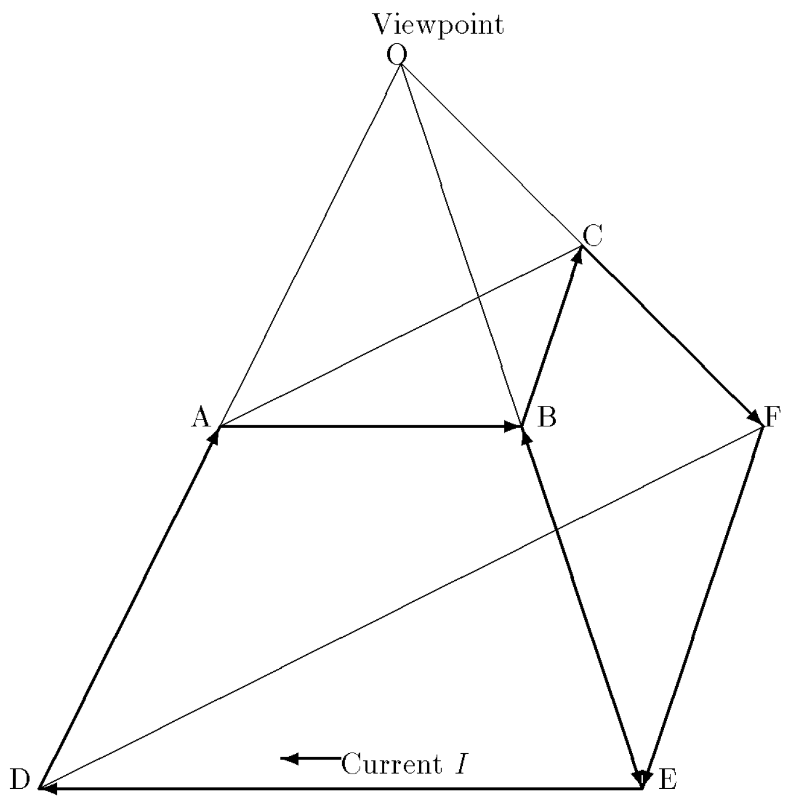

# 量が固有の次元を持つべき条件
## 設計基準としての自然単位の一意性

## 要旨

SI における平面角の次元的地位をめぐる長年の論争は、角度に固有の問題として、有次元か無次元かという二者択一の形で論じられてきた。本稿は、量の種類を横断する設計基準を提案する。すなわち、ある量の種類について、独立した使用者が収斂しうる一意な自然単位があるとき、数値は外から添えられる基準の約束なしに量を同定できる。一意な自然単位がないところ——際立つ候補がないか、同程度に自然な候補が二つ以上競合する——では、数だけでは基準が定まらない。そこでは固有の次元を推奨する。固有の次元は、単位ラベルの脱落を次元の変化にし、種類どうしの取り違えを次元解析で検出できるようにする。候補が競合するかどうかは、候補が構造によって自由なパラメータなしに選び出されるか、そして有理数倍の関係でまとめたとき族がいくつ残るか、の二つの条件で判定する。本稿は、Flater が区別した二種類の誤り——種類の取り違えと単位の取り違え——に加え、同じ種類の別の量どうしの取り違えを第三の型として区別する。これは次元でも単位ラベルでも検出されない。この基準は、物質量(一意な自然単位 *N*A⁻¹ を持つ。モルは正当だが任意である)と、平面角(通約不可能な二候補 rad と Ω₁ = 2π rad を持ち、独立した次元を推奨する。立体角はその二乗として導出された次元を受け継ぐ)とを、単一の枠組みのなかで裁定する。対数量は構造から決まる二つの候補 log e と log 2 を持ち、物理をまったく含まない第三の試験例となる。作用、インピーダンス、電荷は一意な候補を持つ。本稿は SI への変更を提案しない。そのかわりに、反対の選択を採った、実装済みの普遍単位系(UUS)/ハーモニック・システムを SI の傍らに置く。二つを並べると、それぞれの内部では所与に見えるものが選択として見えてくる。SI が単一の s⁻¹ の上に名称と用法規則によって区別している周波数、放射能、崩壊定数は [角度/時間]、[物質量/時間]、[対数量/時間] に分離する。暦時間は平面角の次元を持ち、橋渡し定数を介して物理時間から分離する。電磁気量は互いに独立な五つの次元の上に対称に配置され、場の強さの比と電気抵抗、真空の固有インピーダンスとプランク・インピーダンスは、*h* と *ħ* が平面角の次元だけ異なるのと同じく、立体角の次元だけ異なる量となる。本稿で扱った九つの対のうち六つは、所与の読み方では名称と記号だけで区別されるが、選択として読むと、すべてが次元か単位の区別になる。この比較は、どの単位系もふつう暗黙のうちに行っている設計上の選択を俯瞰させる。UUS は構成的な存在証明でもある。

---

## 1. 序論

1 Hz と 1 Bq は、どちらも 1 s⁻¹ でありながら、互いに置き換えてはならない。SI はこの区別を、次元ではなく名称と用法規則によって維持している [1, Table 4 note (d)]。どの区別を次元に担わせ、どれを名称や単位に任せるか——この選択は、物質量(3 章)、平面角と立体角(4 章)、対数量(5 章)でも、それぞれ向きを変えて問われている。同じ選択は、暦時間と物理時間(6.4 節)、電磁気量(6.5 節)にも及ぶ。本稿はこれらを個別の問題としてではなく、一つの基準のもとで俯瞰する。その見取り図が表 1(6.6 節)である。

国際単位系(SI)における平面角の地位は、SI が存在する限りずっと未決着のままである。ラジアンとステラジアンは、1960 年に当初、それら独自の範疇——*補助単位*——に置かれた。CIPM 勧告 1(CI-1980)は補助単位に対応する量を無次元の組立量と解釈し、1995 年の第 20 回 CGPM 決議 8 はこの範疇そのものを廃止して、ラジアンとステラジアンを無次元の組立単位に再分類した。現行の SI 文書は、ラジアンを平面角のコヒレントな単位とし、その定義から rad = m/m と表せることに触れたうえで、この表し方は本来的なものではなく誤解を招きうる、角度は他の長さの比と同じ種類の量ではないからだ、と注記している [1, Table 4 note (b)]。

この決着は普遍的な同意を得たことがなく、この十年、論争は *Metrologia* 誌その他の誌面で激しさを増してきた。Mohr と Phillips は、無次元単位——角度と計数単位とを問わず——に対する SI の扱いが非コヒレンスを導入しており、それはヘルツの曖昧な地位に例示されると論じた [2]。Mills はラジアンとサイクルの関係を検討し [3]、Quincey、Mohr、Phillips は、角度は本来的に長さの比でも無次元でもないと論じ [4]、Kalinin は平面角を SI の他の量から独立した量とし、立体角をその二乗として導くことを提案した [5]。Quincey は、ラジアンを独立した単位として扱っても周波数やヘルツを定義し直す必要はないと論じ [6]、さらに、値 1 rad を持つ有次元の角度定数 *θ*C を物理方程式に復活させる詳細な提案を提出した [7, p. 1]。これらは批判的なコメント [8, 9] とさらなる精緻化 [10] を呼び、寄稿はなお現れ続けている [11]。その後 Lewis と Coveney は、円の閉包による角度の実際の実現にもとづいて、ラジアンを SI の基本単位として扱うべきだと論じた。彼らは、新たな基本単位を立てるのではなく、立体角を平面角から導いている [12]。彼らの説明では、全円がすでに次元を持つ量 2π rad として現れ、幾何に由来する 2π と、ラジアンで測ることに由来する 2π とが区別されている——本稿が Ω₁(2.3 節)に担わせる区別である。彼らの提案は本稿の Ω₁ と導出された立体角の扱いに重なるが、問うているのは SI をどう変えるかであって、種類を横断する判定規則をどう定式化するかではない。一方、制度のうえでは、2016 年の第 22 回 CCU 会合で、CCL の代表が、ラジアンを SI の基本単位とすることへの支持は CCL の委員からこれまで表明されていないと報告している [13, §3.1.8]。この論争は歴史上の好事ではなく、現代計量学における、活発かつ未解決の問いである。

先行研究は、角度量と計数量における単位 1 の曖昧さを明らかにし [2]、ラジアンとサイクルを競合する基準として論じ [3, 14]、角度量と対数量のコヒレントな単位を併せて検討してきた [15]。単位系のなかで平面角と立体角を扱う選択肢とその得失も整理されている [16]。Flater は、こうした量を「ただの数」として扱うことが、量の計算が単位の取り違えと種類の取り違えに対して与える保護を失わせると論じ、SI 文書の改訂を提案した。そのうえで、どの種類に SI 次元を割り当てるべきかは「まったく別の問題」として切り離している [17]。選択肢を並べて得失を比べることと、どの種類にどの扱いを選ぶべきかを判定する規則を与えることは、別の仕事である。本稿が扱うのは後者、すなわち Flater が切り離したこの別の問いである。物質量と角度は、そのような規則に対する正反対の試験を提供する。

本稿はそのような基準——問題となっている量の種類の*自然単位の一意性*——を提案し、その帰結を検討する。本稿は SI へのいかなる変更も提案しない。提案は、解釈に必要な情報が単位系のどこに置かれるかに関わるものであって、既存の SI の用法規則がそれを伝え損ねているという主張ではない。比較の相手として、普遍単位系(UUS)/ハーモニック・システム [18, 19](以下 UUS)を用いる。これは、まさにこの点について SI と反対の設計選択を行った、実装済みの単位系であり、平面角には独立した次元を保ち、立体角にはその二乗として導出される次元を与える。二つの単位系を並べて置くことで、それぞれのなかで*所与*と見えていたものが、*選択*として見えるようになる。またこの問いは物理量に限られない。基準は量の種類の比構造のみに依拠しており、その最も透明な適用先は純粋に数学的な種類——底を取らない対数——底なし対数(baseless logarithm)——(5 章)——である。

以下、2 章で基準を述べ、3 章で一意性の事例として物質量に、4 章で非一意性の事例として平面角と立体角に、5 章で物理がまったく関与しない第三の事例として対数量に適用する。6 章は、2π や 4π のような因子の選択が単位系のどこに記録されるかを具体例で示す。角度あたりの量(6.1 節)、s⁻¹ の三つの用法(6.2 節)、*h* と *ħ*(6.3 節)に続いて、暦時間と物理時間の次元的分離(6.4 節)と、電磁気量の対称な次元的配置(6.5 節)を扱い、表 1 にまとめる(6.6 節)。7 章は UUS を存在証明として示し、その単位の選び方を基準に照らして述べる。

---

## 2. 基準——自然単位の一意性

### 2.1 単位を単位たらしめるもの

測定単位は標準的に、表現しようとする量と同じ種類[^kind]の量であって、その種類の量を比較する基準として約束によって選ばれたもの、と定義される [1, 20]。この定義には二つの要素があり、どちらも欠かせない。単位とは (a) *量*——自然に属するもの——であり、かつ (b) *約束*——合意する共同体に属するもの——である。したがって単位は、それ自体で自立する自然の対象ではない。量と、それを基準として用いることに合意する当事者とによって、共同で構成される。メートルは単に一つの長さではない。長さ*プラス*合意である。

[^kind]: 以下、「種類」は VIM [20, 1.2] の意味での量の種類の略である。

約束が及ぶのは、基準の選択だけではない。単位が*コヒレント*であるかどうかもまた、選ばれた定義関係の族に相対的である。この相対性は VIM の定義そのものに属している。VIM は量の体系を「量の集合と、それらの量を関係づける無矛盾な方程式の集合」と定義し、コヒレントな組立単位を、「与えられた量の体系と、選ばれた基本単位の集合に対して」1 以外の比例因子を持たないものと定義している [20, 1.3 および 1.12]。しかも、量の体系そのものも選ばれる。クーロンの法則を係数 1 で書くガウス系と、係数 1/(4π*ε*₀) を付けて書く ISQ とでは、二つの電荷は別の量の種類に位置づけられる。有理化は、電磁気の公式における係数の意図的な変更であった [21, p. 4; 22, pp. 45–50]。この違いは、量の体系を*所与*として読めば別の量の種類どうしの違いに、*選択*として読めば定義関係の選択の違いに見える。本稿は後者の読み方をとり、「コヒレント」も一貫してこの相対的な意味で用いる。どの関係を係数 1 で書くかを選ぶ自由度は、電磁気の公式に限られない。Silsbee は、長方形・三角形・円・正六角形の面積の公式の係数 1 : ½ : π : 3√3/2 を挙げ、どの図形の公式を係数 1 で書くか——どの図形を面積の単位にとるか——が約束にすぎないことを示している [21, §4.4, p. 13]。4.4 節の極限による rad² の構成は、平面角と立体角のあいだの定義関係を、この意味で明示的に選び取る行為である。電磁単位系の有理化をめぐる分岐には 6.5 節で立ち返る。

たいていの量の種類では、この二者構造は目につきやすい。数ある長さのなかからメートルを、数ある継続時間のなかから秒を選び出すものは自然のうちに何もなく、まさにその合意を維持するために大がかりな制度が存在している。興味深いのは、自然が共同体の仕事を代行しているように見える場合である。

### 2.2 焦点としての自然単位

ある量の種類のうちに、きわめて際立っていて、事前の意思疎通がまったくなくとも、独立した主体がそれぞれ基準として選ぶと期待できるような量が存在するとしよう。そのような量は、ゲーム理論が協調問題の*焦点*(フォーカルポイント)と呼ぶものとして機能する [23]。候補がすべての当事者にとって際立っている(salient)がゆえに、交渉なしに合意が成立するのである。このような量を、その種類の*自然単位*と呼ぶ[^natural]。

[^entity]: 原子、分子、イオン、電子など、計数される個体。SI 文書の日本語版の「要素粒子」[1] にあたり、Mohr と Phillips の記号 *ent* [2] の名でもある。粒子に限らず、6.2 節の事象のような個体も含めるため、本稿ではエンティティと書く。

[^natural]: ħ = c = 1 とおく自然単位系の単位や、情報量の単位 nat(natural unit of information)とは別の意味である。

特定された量の種類が、当事者にとって際立つ一意な自然単位を持つとき、その種類の量と単位との比は純粋な数となる。その数を伝えるのに、単位の約束を別に述べる必要はない。受け取った側は、同じ基準を補うことで量を復元できるからである。計数がその典型である。黒木が広く流布した指摘で述べたように、「長さは 5 mm だ」から単位を削ると情報は失われるが、「個数は 5 個だ」から助数詞を削っても何も失われない [24]。本稿の語彙で言えば、*エンティティの個数*という種類は自然単位——単一のエンティティ[^entity]——を持ち、それは一意である。物質量はこの構造を受け継いでいる。3 章で立ち返る。

ひとつ注意が必要であり、それは以下で実際に働く。ある量が「きわめて際立っている」という判断は、*主体によって*下される判断であり、際立ちは協調する当事者に相対的である[^salience]。したがって 2.1 節の二者構造は自然単位によって消去されるのではない。黙って満たされているにすぎない。この観察は、一見すると欠陥(主観性)に見えるものを、操作的な試験へと転換する。すなわち、意思疎通なしに協調が成功するかどうかは、際立った候補が*一意である*かどうかによって決まる。際立つ候補が一つもない場合も、同程度に際立った候補が二つ以上ある場合も、焦点は形成されない。当事者は結局のところ意思疎通せざるをえず、候補のあいだの選択はふたたび明示的な約束となる。

[^salience]: ここでの際立ちは、候補の何らかの内在的性質によってではなく、それが協調する当事者のあいだに引き起こす振る舞いのパターンによって特徴づけられる。これが、この試験を操作的なものにし、その失敗を観察可能にしている。2.3 節の条件 (i) は、この際立ちを、共同体が共有する構造の上に置き直す。

### 2.3 基準

ここで基準を述べることができる。以下では、量の種類と、調整が問題となる共同体とを前提とする。SI のような汎用の単位系にとって、その共同体は単位系の使用者全体であり、互いに異なる慣行を持つ下位の共同体を含む。基準の形式は普遍的だが、その評決は共同体に相対的である。「基準の約束なしに」とは、数値に、別途規定された単位の選択が添えられていないことを意味する。

> **(C1)** ある種類が、独立した使用者にとって際立つ一意な自然単位を持つならば、その値は、基準の約束を別に伝えることなく純粋な数で表現できる。独立した次元は任意である。
>
> **(C2)** 一意な自然単位がない——際立つ候補がないか、同程度に自然な候補単位が二つ以上ある——ならば、純粋な数はそれだけでは、どの基準が用いられたかを同定しない。その種類に固有の次元を割り当てることを推奨する。固有の次元は、単位ラベルを 1 に置き換えることを次元の変化にし、基準の記録の脱落を次元の検査で検出できるようにする。

この基準が何のためにあるかを、先に述べておく。単位記号は**ラベル**として働き、ラベルが要るのは、区別しなければならない選択肢があるときだけである。単位は、複数の候補基準のうちどれが選び出されたのかを標示する——そして選べるものが一つしかなかったところには、標示すべきものが何もない。それでも独立した次元は、モルの例が示すように(3 章)、式のなかでその種類を記録するために有用でありうる。ただしそれは、純粋な数にすれば失われるような基準を担っているわけではない。したがって計数単位が記録するのは基準の選択ではなく種類であり、種類は本基準が前提とするものである [17 参照]。基準が量の性質にではなく**一意性**にかかっているのは、このためである。

この基準は、次元だけですべての単位の選択が決まるという主張ではない。それが関わるのは、解釈に必要な情報を単位系がどこに置くか——名称、用法規則、単位ラベルに置くのか(角度についての SI の扱い)、それとも量の方程式の次元の構造のなかにも置くのか(UUS の扱い)——である。推奨の根拠は自然単位が一意でないことにあるのであって、ラベルの付いた数値が本質的に曖昧だという主張にあるのではない。

また、量の種類を分類する静的な判定表でもない。単位系を設計する者が、どこに選択の記録を残すべきかを知るための道しるべである。(C1) は次元を禁じず、(C2) は次元を強制しない。(C2) には二つの型がある。**(C2a)** 際立つ候補がない型(長さ、時間など。7.1 節)では、どの基準を選んでも約束にとどまる。**(C2b)** 同程度の候補が複数ある型(角度、対数。4 章、5 章)では、自然な候補どうしが競合しており、選から漏れた候補を名前のある定数——Ω₁ やビット——として保存することに意味が生じる(7.1 節)。

ある種類が (C1)、(C2a)、(C2b) のどれにあたるかは、論争の記録を見る前に、候補についての二つの条件で判定できる。

> **(i)** それぞれの候補が、対象とする共同体が用いる構造のうち、その量の種類が関わるものによって、自由なパラメータ(径数)なしに選び出されること。すなわち、径数族[^family]の任意の一員ではないこと。
>
> **(ii)** 有理数倍の関係が構造から示される候補を一つの*族*にまとめたとき、族が二つ以上残ること。

[^family]: *径数族*とは、自由なパラメータ——径数——の値を一つ選ぶごとに一つの量を与える、量の集まりである。5 章で見る対数の連続解 {c·ln} は連続な径数族であり、径数 c を選ぶことが単位を選ぶことにあたる。径数は連続である必要はない。log 3 や log 5 は log 2 の有理数倍ではないので、(ii) だけでは素数の数だけ別の族が立つ。しかしそれらは、どの素数を底とするかを径数とする離散的な径数族の成員であり、どの素数かを構造は選び出さない。どの実数の底か、どの物差しか、どの原子か(ボーア半径、リュードベリ波長。これらは範囲の取り決めによっても除かれる)も、同じく径数族の径数である。log 2 は、1 より大きい最小の整数という条件によって、この族から選び出される(5 章)。

条件 (ii) の族とは、有理数倍で結ばれた候補の集まりである。計数では、対もダースもエンティティの整数倍としてエンティティの族に入り、族は一つしか残らないので、(ii) を満たさない(3 章)。平面角では、一回転とラジアンの比 2π が無理数なので、二つの候補は別の族に属する(4.1 節)。族の候補が有限個なら、有理数倍で結ばれた候補には最大公約数と最小公倍数が定まる。計数の族は無限だが、すべてがエンティティの整数倍なので、エンティティが最大公約数、すなわち族の生成元となる(3 章)。有限個の例は、7.2 節の暦の単位に現れる。

三つの評決は、(i) を満たす候補を (ii) の意味で族にまとめたとき、残る族の数で分かれる。一つなら (C1)(物質量、3 章)、二つ以上なら (C2b)(平面角と立体角、4 章。対数量、5 章)、一つもなければ (C2a)(長さ、時間など。7.1 節)である。条件 (i) は、2.2 節で主体に相対的とした際立ちを、共同体が共有する構造の上に置き直すものである。汎用の単位系にとっての共同体は、それを用いる分野の総体である(4.2 節)。記録は判定の根拠ではなく、判定を検証するものである(4.3 節)。

ここで候補として数えるのは、他の種類の定数を介さず、その量の種類自身の構造から決まる量に限る。これは本稿の範囲の取り決めである。他の種類の定数を組み合わせれば、(C2a) の種類にも際立つ量は作れる。プランク長がその例である。範囲の取り決めはそれを候補から除くので、(C2a) の種類の単位は、定義定数の値によって固定される約束にとどまる(7 章)。同じ組み合わせは、(C1) の種類に第二の候補を作ることもある。電荷の候補は、範囲のなかでは電気素量 *e* とその有理数倍(クォークの電荷 *e*/3 など)からなる一つの族だけであり、電荷は (C1) にあたる(6.5 節)。プランク電荷 √(*ħ*/*Z*P) は範囲の外にある。範囲を広げて、こうした量を候補に加えれば判定は変わる。長さや時間はプランク単位を候補として得る。*ħ* と *h*、*G* と 8π*G* のように因子だけ異なる変種は、UUS の読み方では角度や立体角の次元と有理数の因子だけ異なる量となる(6.3 節、6.5 節)ので、族は一つにまとまり、(C1) に移る。電荷では、*e* とプランク電荷とが √α で隔たり、α が有理数であることは構造から示されないので、族が二つ残り、(C1) から (C2b) に移る(6.5 節)。この拡張は、どの自然単位系を選ぶかという別の問題を開くので、本稿では扱わない。

この基準は他の種類でも検証できる。作用の *h* と *ħ* は二つの候補に見えるが、競合してはいない。両者の比 2π は Ω₁/rad であり、角度の二候補が作用に持ち込まれたものである(6.3 節)。作用の量子 *ħ* は、不確定性関係 Δ*x*Δ*p* ≥ *ħ*/2 のように角度の関わらない関係のなかに現れ、角度の正規化に先立って作用自身の構造から決まる一意な候補である。作用は物質量と同じく (C1) にあたる。(C1) が言うのは次元が任意だということであって、次元を外すことを求めるものではない。*ħ* = 1 とおく共同体は次元を外しており、SI は物質量と同じく作用にも次元を残している。慣用の記録として一例を挙げると、Wikipedia の “Natural units” の項に挙げられた自然単位系のうち、プランク定数を定義定数に含むものはすべて *ħ* を 1 とおいており、*h* を 1 とおくものはない。プランク自身は *h* を用いたが、プランク単位系も現在は *ħ* を用いるものと理解されている、と同項は記している [25]。

2019 年の改定は、作用と物質量の二つの種類で、自然な基準との比の扱いを変えた。それ以前、キログラムは国際キログラム原器によって、モルは 12 g の炭素 12 によって定められており、*h* と *N*A は、そうして定めた単位に対して測定される量であった。自然な基準との比は、単位を別の仕方で定めた結果であって、選ばれたものではなかった。2019 年の改定以後、SI はキログラムを *h* の値によって、モルを *N*A の値によって定めており、どちらも自然な基準との比を定義定数として固定したうえで、マクロな単位との連続性を保っている。比の値は引き継がれたが、それはいまや定義定数の値として記録された選択である(3 章)。

条件 (i)(ii) を満たす種類で、意思疎通なしの協調が記録のうえで成り立っていれば、基準は反証される。計数は (ii) を満たさず、協調も成り立っている。角度は両条件を満たし、協調は成り立っていない(4.2 節)。

(C2) のもとで欠けている情報は、明示的な単位ラベルによって補うことができ、文字どおり復元不能なわけではない。以下では、取り違えを三つの型に分けて扱う。**(K)** 種類どうしの取り違え。単位系がその二つの種類に異なる次元を割り当てていれば、次元解析がこれを検出できる。**(U)** 同じ量の単位の取り違え——たとえばラジアンかサイクルか(4.3 節)。量は正しく、数値だけが別の単位で読まれる。これを防ぐのは単位ラベルか、全円周角 2π rad に名を与えた有次元の換算定数(以下 Ω₁ と書く)である。**(Q)** 同じ種類の別の量どうしの取り違え——たとえば半径と直径。(Q) は次元でも単位ラベルでも検出されず、量の名称や記号、文脈によって区別されるほかない。文字はそれぞれ kind、unit、quantity の頭文字であり、(K) と (U) は、Flater が単位 1 の批判のなかで区別している二つ——種類の取り違えと単位の取り違え——にあたる [17]。型が属するのは誤りそのものではなく、誤りと単位系の読み方の組である。同じ対の取り違えが、ある読み方では (Q) であり、別の読み方では (K) か (U) になりうる(表 1、6.6 節)。

ただし、定数因子で結ばれた二つの量を一つの量の二つの単位と読んでよいのは、(a) 同じ対象の同じ性質を測っており、(b) その因子が、その量の定義に入る量の種類の自然な基準と、同じ種類の別の基準との比に一致するときに限る。回転数と角度は同じ回転を測り(4.2 節)、因子 2π は一回転とラジアンの比である。半径と直径は円の別の部分を測り、長さには自然な基準がないので、因子 2 は条件 (b) を満たさず、(Q) に残る。逆に、半径と一回転あたりの円周は同じ円の大きさを測り、因子 2π は一回転とラジアンの比なので、同じ量を m/rad と m/Ω₁ で表したものになる。6.1 節で見る [長さ/角度] の量は、この帰結である。

ひとつ明確にしておく。(C2) が推奨するのは固有の次元であって、基本単位ではない。ある種類の次元が当該の単位系において基本的であるか、それとも他の種類の次元から導出されるかは、単位系の内部の実装上の決定であり、立体角がその例を与える(4.4 節)。したがって本稿が提起する問いは、CCL の代表が支持なしと報告した問い [13, §3.1.8]——ラジアンを SI の基本単位とすべきか——ではなく、それに先立つ問い、すなわちラベルのない角度の数値表現が、基準の約束を別に伝えることを要するかどうか、である。

この区別を置いたうえで、「平面角は有次元か無次元か」という問いは、その種類の構造についての事実の問いとなる。すなわち、*平面角は一意な自然単位を持つか*。本稿は、持たないと論じる(4 章)。角度が二つの自然単位を持つという観察は、論争のなかでは困難の記述として現れてきた [3, 14]。本稿はこれを*基準*へと格上げする。

角度について (C2b) を採用することの帰結は二つあり、6 章で展開する。第一に、有次元の角度に対して提起されてきた実務上の反論——半径型の長さが m/rad という単位を持つこと、馴染みの公式で次元解析が破綻するように見えること——は、(C2b) に沿って組まれた単位系では変則ではない。[X/角度] の量は、橋渡し定数という、実務が昔から用いてきた範疇をなす(6.1 節)。第二に、付加された次元は、SI では同じ次元に置かれる量の対を分離し、名称や記号に任されていた区別の一部を次元か単位の区別に移す(6.2〜6.6 節)。

---

## 3. 一意性の事例——物質量

物質量は SI の基本量であり、2019 年の改定以降、その単位モルはアボガドロ定数を固定することによって定義される[^avogadro]。1 モルはちょうど 6.022 140 76 × 10²³ 個の要素粒子を含む [1]。この量の種類は、この定義によって、指定されたエンティティの*計数*に比例する。

[^avogadro]: 厳密には、アボガドロ*数*(無次元)とアボガドロ*定数* *N*A(次元は [物質量]⁻¹)とは別物である。本稿では一貫して有次元の読みを採る。

2.2 節の試験を適用しよう。この種類は自然単位を持つだろうか。持つ。*単一のエンティティ*である。物質量を数として表現しようとする者は誰であれ、何らかの基準量で割らなければならない。そして一個のエンティティに対応する量 *N*A⁻¹ は、計数という構造そのものによって際立っている。それは分割不可能な刻みであり、この種類の生成元である。他に考えうる基準のうち、対、ダース、グロスはエンティティの整数倍としてエンティティの族に入り、際立ちを持つとすればそれをエンティティ*から*得ている。モルの大きさは、もともと 12 g の炭素 12 に含まれる原子の数として、質量の単位を介して選ばれたものであり(2019 年の改定はその値を引き継いでいる)、物質量自身の構造ではなく別の量の種類の単位によって際立つ。条件 (i) の意味での候補ではない。焦点は一意である。

したがって基準は (C1) を返す。種類と計数されるエンティティが与えられれば、物質量の値は、単一のエンティティを基準として別に規定することなく純粋な数として表現できる。これは 2.2 節で引いた黒木の観察の内容であり、モルの単位としての地位に対して長く向けられてきた懐疑が、ある精密な意味で根拠を持つ理由でもある。モルはメートルが*必要*であるようには必要でない。ここでは、エンティティの数 *N* と物質量 *n* = *N*/*N*A を、同じ量を二つの単位(エンティティとモル)で表したものとして読む。ISQ はこの二つを別の量として立てるが、それは所与の読み方である(2.1 節、表 1)。

ただし (C1) が言うのは、独立した次元が*任意である*ということであって、それが誤りだということではない。物質量に基本単位を与えるという SI の決定は、この選択権の正当な行使であり、実務上の便宜を根拠としている。化学はマクロなスケールで営まれており、ヨクトグラムではなくグラムに見合った大きさの単位は、日々その存在価値を示している。(C1) が排除するのは、その次元が強制されているという主張だけである。この分析によれば、「単位」と単なる「助数詞」(日本語その他の類別詞言語における助数詞 [26])とのあいだには、明確な境界はなく、約束の明示性のグラデーションがあるにすぎない [27]。モルはそのグラデーション上に、必然によってではなく選択によって位置している。

2.3 節で見たとおり、2019 年の改定はモルの大きさを引き継ぎながら定義の向きを逆にし、自然単位 *N*A⁻¹ との比を定義定数として固定した。SI はこの自然単位を名では呼ばないが、モルを、その固定された倍量として定めているのである。

SI における計数量の扱いそのものは、Mohr と Phillips によって非コヒレンスの源として同定されており、彼らは計数単位を角度の単位と並べて論じている [2]。彼ら自身の処方は、本章の評決に別の方向から到達している。彼らはエンティティに対して記号 *ent* を提案し、モルをその倍量として書く [2]。上で同定した焦点をこの種類の単位として選出し、モルを、独立した標準ではなく自然単位に名を与えた倍量として残しているのである。2019 年以降の厳密値でいえば、1 mol = 6.022 140 76 × 10²³ ent となる。本稿の基準は、計数と角度を線の反対側に位置づける。計数は一意性の試験を通過し、角度は——以下で論じるように——失敗する。

---

## 4. 非一意性の事例——平面角と立体角

### 4.1 二つの候補、二つの構造

平面角については二つの候補基準が現れ、そのそれぞれがきわめて際立っている——ただし、この種類が関与する*異なる構造*のなかで際立っているのである。

第一の候補は**ラジアン**である。その際立ちは解析的である。ラジアンは、弧長の関係が数係数なしに *s* = *rθ* と書ける単位であり、d(sin *θ*)/d*θ* = cos *θ* となる単位であり、テイラー級数とオイラーの公式が飾りのない形をとる単位である。この種類の解析的構造のうちでは、ラジアンは多くの選択肢のひとつではない。*その*選択である。

第二の候補は**全円周角**、すなわち一回転である。SI の言葉でいえば値 2π rad の角度であり、2.3 節の Ω₁ がこれである(Ω₁ を「サイクル」と読むのは UUS の約束である [19])。その際立ちは位相的かつ周期的である。回転数(winding number)は Ω₁ を単位として数えられ、回転の速さは単位時間あたりの回転数として述べられる。度——数千年にわたる実用的な角度測定の作業単位——は、ラジアンの分割ではなく Ω₁ の分割(1/360)として定義されている。ヘルツは、実際の用法においてはサイクル毎秒を意味する。この種類の周期的構造のうちでは、Ω₁ が*その*選択である。Kalinin も、知られているあらゆる平面角の単位——度、ラジアン、グラード、回転——が、二次元幾何学の自然定数と彼が呼ぶ、一回転の角度 Φ の値を固定することによって定義されている、と観察している [11, §2]。

この状況を 3 章の計数の場合から区別する特徴が二つある。第一に、比 Ω₁/rad = 2π は無理数であり、二つの候補を一つの族にまとめる有理数の関係はない。いずれの候補も、ダースがエンティティから派生するような仕方で他方から派生してはいない。第二に、際立ちの根拠どうしを比べる共通の尺度がない。解析的構造も周期的構造も、角度とは何であるかを真に構成しており、一方が他方に優越すると定める中立な立脚点はない。焦点は一意たりえず、(C2b) により、平面角には独立した次元を割り当てることが推奨される。そのとき作業単位の選択は明示的な約束となる。UUS は、上に述べた解析的な理由からラジアンを作業単位に選んでいる [18]。作業単位をラジアンとすれば、選から漏れた候補である一回転は、値 2π rad の有次元定数 Ω₁ として残る。弧長の関係 *s* = *rθ* を係数 1 で書く定義関係のもとでは、2.1 節の意味で、その値はコヒレントな単位ではない。

### 4.2 最も強い反論——ラジアンは*本当は*一意ではないのか

無次元の角度を擁護する者は、二つの候補は同程度に自然ではないと反論するだろう。ラジアンの解析的特権は客観的な数学であるのに対し、サイクルの際立ちは単なる習慣である、と。ラジアンが真の焦点であるなら、一意性は結局成り立ち、(C1) が適用されることになる。

しかし周期的構造の側にも、習慣に還元できない根拠がある。角度は、長さや継続時間と違って本来的に円の上の量であり、Ω₁ はその円の周長をこの種類自身の言葉で表したものである。回転数——整数であり、数学において最も頑健な不変量のひとつ——は、ラジアンではなく Ω₁ の個数である。位相が物理的に意味を持つのは 1 rad を法としてではなく Ω₁ を法としてである。位相のように周期的な量で情報を担うのは、一回転の整数倍を除いた端数の部分なのである。身近な例がこの点を具体的にする。人間の生活において最も古く最も普遍的な角度量は、日——太陽に対する地球の一回転——である。日は、解析の実践をラジアンの上に築いている者にとっても、2π rad の倍数としてではなく一回転を単位として測られ、時刻はその端数として表される(6.4 節はこの事実を体系的に用いる)。現象そのものが周期的であるところでは、ラジアンを作業単位とする者にとってもサイクルが際立つ。

二つの候補の競合は、純粋数学の内部にも見られる。基本的な円周定数は π か τ = 2π かという繰り返される議論 [28, 29] は、どちらの構造がその定数に名を与えるかをめぐるものである。τ の側は周期から(全回転を基準として)論じ、π の側は π が飾りなしに現れる解析的恒等式の蓄積から(π*r*²、eiπ + 1 = 0、Γ(½) = √π)論じる [29, §§2.3, 3, 4.2]。双方がそれぞれの公式を並べうること、そしてこの議論が決着を見ないまま繰り返されていることは、際立ちの根拠を比べる共通の尺度がないことの一つの姿である。

ISQ に立つ読者は、さらに強い形で反論するだろう。回転数 *N* は計数であり、一回転という一意な自然単位を持つ (C1) の量である。角度 *φ* = 2π*N* rad はそれとは別の量であり、その自然単位はラジアンである。非一意に見えるのは、二つの量を一つの種類に畳み込んだからだ、と。しかし一回転は計数の単位ではない。エンティティは分割できない生成元であり、半分のエンティティは意味を持たない。一回転は分割でき、しかも周期的な量では、上で見たとおり、端数の部分にこそ使い道がある。位相は一回転の端数であり、度は一回転の 1/360 であり、時刻は日の端数である。閉じた経路の回転数が整数になるのは、経路が閉じているからであって、一回転が分割できないからではない。回転数として数えられる値は、連続量を一回転という単位で表した数値であって、計数ではない。実際、ISO 80000-3 は回転 *N* を *N* = *φ*/2π と定義し、必ずしも整数とは限らないと注記している [30, 3-14]。したがって *N* と *φ* を別の量として立てるのは、所与の読み方(2.1 節)での (Q) であり(表 1)、選択として読めば、条件 (a)(b) により、同じ量の二つの単位 Ω₁ と rad のあいだの選択 (U) となる。対数についての同じ反論——倍加の回数は計数であり、自然対数の比は別の量だ——にも、同じ答えが当てはまる(5 章)。

Grötschel らは、直角や平角のような特別な意味を持つ角度はあるが、ユークリッド幾何学には特別な長さがない、という観察から、角度の測度は数であると結論した [31]。角度に特別な基準があるという観察は、本稿も共有する。しかし彼らが挙げる特別な角度は、直角が Ω₁/4、平角が Ω₁/2 であるように、どれも一回転の有理数倍、すなわち Ω₁ の族に属し、数とされる測度(直角なら π/2)はラジアンで測った値である。同じ論拠のなかに、二つの族の基準が並んでいるのである。

より根本的には、一意性は候補の内在的な優劣によって決まるのではない。2.2 節で述べたとおり、際立ちは候補と協調する当事者とのあいだの関係であり、一意性の操作的な検証は、意思疎通なしに協調が現に成功するかどうかである。これらの量が測定されるようになって以来、二つの実践共同体が併存し、それぞれが異なる候補を自明としてきた。どちらの共同体も、その内部だけをとれば焦点は一意でありうる。解析的構造を強く優先する実践の内部で、ラジアンへの協調が困難なく成り立ちうるのはこのためである。しかし SI のような汎用の単位系が調整しなければならないのは、両者を合わせた共同体であり、そこでは 2π の取り違えが公刊された記録に現れている(4.3 節)。条件 (i)(ii) が与える評決を、協調の記録が検証するのである。この論争の持続は、焦点が一意でないことと整合している。

この説明は、ラジアンを作業単位に選ぶことへの批判を含まない。ラジアンを作業単位として選ぶ解析的な根拠は優れており、UUS もそのように選んでいる(4.1 節)。基準が主張するのは、この選択が、前提としてよい発見ではなく、記録しておくことが推奨される約束——単位の指定によって、あるいは角度の次元を保つ単位系では有次元定数によって——だということだけである。

### 4.3 非一意性は記録されている

Quincey は、なお無次元の扱いを擁護していた時期に、問題の核心には角度について二つの自然単位があるという事実が横たわっている——数学者と理論物理学者にとってはラジアン、それ以外のすべての人にとっては一回転——と書いた [14]。そうした文献では、この観察は困難の記述として、すなわちこの分野が混乱している理由の説明として現れ、より慎重な言い回しによって、あるいは後の Quincey 自身の立場においては有次元の角度定数を復活させることによって [7]、対処されるべきものとされている。2.3 節で述べた格上げとは、この観察を基準として読むことにほかならない。二つの焦点が競合するとき、ラベルのない純粋な数は、どちらの基準が用いられたかを受け手に伝えない (C2)。

基準を暗黙のままにしておくことの危険は、仮想のものではない。Mohr と Phillips が示したように、どちらの無次元単位が黙って数 1 に置き換えられたかに応じて、同一の物理的状況が 1 Hz とも 2π s⁻¹ とも記述され、2π 倍の誤りが生じうる [2]。このような誤りは公刊された記録にも現れる。以下の二件が示すのは、こうした誤りが起きているということであって、その頻度ではない。ある正誤表は、定式化に用いた角周波数 ω とデータの周波数 ν とのあいだの 2π の換算が「誤って落とされた」ことを報告し [32]、別の訂正記事は、抵抗の計算で *h* の代わりに *ħ* を用い、値を 2π 倍小さく見積もったことを報告している [33]。UUS の読み方では、二つは異なる型に属する。Ω₁/s と rad/s は次元を共有するので、両者のあいだの 2π は、次元ではなく単位の表記によってしか記録できない(U)——第一の正誤表はこの種の誤りであり、次元の整合だけでは捕まらない。これに対して、*h* と *ħ* を角度の次元だけ異なる量とする割り当て(6.3 節)のもとでは、*R* = Ω₁·*h*UUS/*e*² の形の抵抗が現れる。*h*UUS は角度あたりの作用だからである。*h*UUS の代わりに *ħ* を入れれば角度の因子が一つ余り、第二の訂正記事が報告する取り違えは、次元解析が検出しうるものとなる(K)。

Mohr と Phillips は、非コヒレンスを計数の側にも見いだしている [2]。しかしそれは、計数の内部の非一意性から生じているのではない。計数と角度が同じ無次元の単位 1 に畳み込まれていることから生じている。曖昧さを担っているのは畳み込みであって、計数ではない。

### 4.4 立体角

立体角は、次元をひとつ上げたところで同じ構造を示す。解析的な候補はステラジアンである。閉包の候補——一周に当たる候補——は全球面立体角、SI の言葉でいえば 4π sr であり(以下 Ω₂ と書く)、内部の一点のまわりの閉曲面が張る立体角として、積分定理(ガウス)と等方性によって際立っている。

電磁単位系が有理化された族と有理化されていない族とに一世紀にわたって分かれてきたことは、この 4π の置き場所に関わる [21, p. 4]。有理単位を提案した Heaviside 自身、4π を「力が広がる球面の面積」に帰し、球の問題でそれが現れるのは「4π が単位球の面積なのだから、まったく自然である」と述べている [34, p. 199]。Heaviside の言葉は面積であり、それを Ω₂ と読むのは本稿の解釈である。本稿の次元的な読み方では、Ω₂ = 4π sr がその幾何学的因子を明示する。これは約束どうしを比較するための見方であって、それらの歴史的な動機がすべて立体角の単位の選択に帰着するという主張ではない [35]。立体角も一意性の試験に失敗し、評決も同じである。

ただし、この評決を尊重するのに第二の基本次元は必要ない。立体角を平面角から導かれる量とし、ステラジアンをラジアンの二乗とする扱いは、Kalinin も提案している [5]。このとき Ω₂ = 4π sr = 4π rad² である。UUS では、超球面の全立体角も平面角の整数冪で書かれる。*k* 次元超球面の全立体角は Ω*k* = (2π(*k*+1)/2/Γ((*k*+1)/2)) rad*k* であり、Ω₁ = 2π rad、Ω₂ = 4π rad²、Ω₃ = 2π² rad³ などとなる [19]。基準は平面角に対して一度だけ適用され、その後は付加された単一の次元が、あらゆる次元 *k* の球面幾何を賄う。超球面へと上っていくときに、角度の次元が際限なく増えることはない。立体角は平面角からその次元(rad²)を受け継ぎ、非一意性もまた受け継ぐ。対 (sr, Ω₂) は立体角に対して、対 (rad, Ω₁) が平面角に対して立つのとまったく同じように立ち、Ω₂ は値 4π rad² の有次元定数として体系に入る。その電磁気学上の帰結は 6.5 節で見る。

二つの平面角の積は、次のように定義できる。そもそもどのような意味で二つの平面角を掛け合わせられるのか、と問うのは正当だからである。球面上では、有限の図形がこの積を厳密に実現することはない。有限の辺 *θ* を持つ球面正方形の立体角は、曲率の項のぶんだけ *θ*² からずれる [19, eq. (18)]。しかし辺 *θ*/*n* の球面正方形の立体角の *n*² 倍では、*n* → ∞ でそのずれが消える。この極限を *θ*² と定義すれば [19, eq. (19)]、sr = rad² は表記上の取り決めではなく、定義された積についての等式となる。これは、2.1 節で見た、どの図形の公式を係数 1 で書くかという選択を、微小な球面正方形について行うことにあたる。これは立体角に特有の弱点ではない。角度の次元の合成を、ラジアン自身の解析的特権(4.1 節)と同じ地盤に置くものであって、後者もまた、この種類の無限小における平坦な構造についての言明なのである[^rectification]。次元解析が要求するのは、種類が乗法的に合成されることだけであり、極限による構成は、その合成の幾何学的な実現を与える。立体角は (C2b) の評決を受けるが、その固有の次元は新しい基本次元である必要はなく、幾何学的関係によって [立体角] = [平面角]² として導出される。2.3 節で区別した、次元と基本次元の違いの例である。

[^rectification]: 弧長の求長も小角度の恒等式も、どちらも極限についての言明である。平面角は、円の対称性を介して、厳密な有限の関係 *s* = *rθ* をひとつ保持しているが、立体角にはこれに対応するものがない。

---

## 5. 第三の試験例——対数量

基準は量の種類一般について定式化されたのであり、その非自明な適用先が角度だけであったなら、それは疑わしいことであろう。第三のものがあり、それが教えるところは大きい。物理がまったく関与しないからである。

対数を考えよう——特定の底を持つ対数ではなく、関数方程式 log(*xy*) = log *x* + log *y* によって定義される対象である。この方程式は構造(乗法から加法への準同型)を定めるが、正規化は定めない。その連続解は一径数族 {c·ln} をなす。この定義は量の種類を与えたところで止まり、そのなかの一員を選出するには至らない。著者はこの対象を*底なし対数*と呼び、UUS の最初の提案の付録において、それが純粋に数学的な存在でありながら、数ではなく、数値が単位の選択に依存する量であると論じた [19, App. A.2]。log 2 = 0.3010… log 10 は量のあいだの等式であって、同じ種類の選ばれた一員で両辺を割ることによってのみ、数のあいだの等式になる。

その除算は、底の変換公式 log *x* / log 2 = lb *x*(lb は二進対数 [36, 2-13.7])を読み直したものである。底を取ることは*まさに*単位を選ぶことであり、数値 lb *x* が量 log *x* に対して立つのは、数 5 が長さ 5 m に対して立つのとまったく同じである。同じ読みは角度の場合にも当てはまる。Kalinin は、有次元の平面角 *φ* と、物理の方程式に入る無次元の組み合わせ *θ* = *φ*/(*Φ*/2π) とを区別し、後者を、計量学がラジアンで表した角度の数値と呼ぶものと同定している [11]。本稿の意味での、選出された単位で割られた量である。したがって、対数を無次元とみなす標準的な理由——「lb *x* はただの数だ」——は、それだけでは何も示さない。有次元の量はいずれも、単位で割れば数を与えるからである。純粋に数学的な設定が付け加えるのは、適用範囲の証明である。2.1 節の二者構造も 2.2 節の一意性の試験も、種類の比構造のみに関与するのであって、物理的な装置による測定可能性には関与しない。VIM の量の定義は現象・物体・物質の性質について語っている [20, 1.1]。数学的対象への拡張は意図的なものであり、基準の機構は比以上のものを何ひとつ用いないので、ここでは差し障りがない。

試験を適用しよう。構造から決まる候補は二つあり、それぞれが異なる構造のうちで際立っている。**log e**(ネーパ)は解析的に際立つ——d(log *x*)/d*x* = 1/*x*、log(1 + *ε*) ≈ *ε* となる正規化である[^lognum]。**log 2**(ビット)は倍加によって際立つ——1 より大きい最小の整数の対数であり、倍加の単位である。log e は、e が超越数であるがゆえに log 2 の有理数倍ではなく、log 2 の族には入らない。**log 10**(ハートレー、ベル系)は位取り記数法によって実務に定着しているが、底の 10 は構造ではなく慣習であり、条件 (i) の意味での候補には数えない。lb 10 は素因数分解の一意性により無理数なので(2*p* = 10*q* となる正の整数はない)、log 10 はどちらの族にも入らない慣用の第三の単位として残る。焦点は一意たりえず、(C2b) は角度の場合と同じ評決を返す。

[^lognum]: これらの式は、ネーパで表した数値についての式である。

Mills、Taylor、Thor は、ラジアンとの並行性から、ネーパが対数減衰のコヒレントな単位として最も筋が通ると論じた [15]。二つの種類を同じように扱うべきだという点では、本稿の基準も彼らと一致する。異なるのは、その扱いを何が決めるかである。構造上の並行関係が示すのは、一方の種類について言えることは他方についても言うべきだということであって、何を言うべきかではない。本稿ではそれを、それぞれの種類に別々に適用した一意性の試験が決める。しかも並行関係はすべてを運ぶわけではない。複素対数において Ω₁ は虚部の周期 2π にあたり、実部にはそれに相当する周期がない。log 2 の際立ちは 1 より大きい最小の整数から来ており、角度の側に対応物を持たない。そして角度には二乗の種類、すなわち立体角があるが、対数の側にはそれに対応するものがない。二つの種類は独立に試験に失敗し、同じ評決を受ける。種類は基準の前提であり(2.3 節)、種類のあいだの解析的な並行関係は、評決を移すことはできても、評決を決めはしない。

この評決は歴史の記録によって裏づけられる。Shannon は情報理論の創始論文の冒頭で、対数の底の選択を情報の単位の選択と同定し、ビット、十進桁、自然単位を一息に挙げた [37]。SI はネーパ、ベル、デシベルを SI 単位とせず、専門技術分野の非 SI 単位として名のまま掲げ、それらの値が自然対数と常用対数のどちらに基づくかを明記して、量と基準値の明示を求めている [1, Table 8 note (m); 15]。純粋な数に畳み込めば失われるはずの底の選択を、名が担い続けているのである(U)。ISO 80000-3 も、1 Np = 1 であっても単位を必ず書くよう求め、ネーパとベルの関係をラジアンと度の関係になぞらえている [30, 0.5]。情報の単位も複数のものとして標準化されている(シャノン、ハートレー、自然情報単位)[38]。

ネーパとベルは、その定義式が因子 2 だけ異なることを根拠に、二つの異なる量の種類——前者は振幅比に、後者は電力型の比に——に属するとされることがある [39]。SI 文書自身は、Np による値は通常振幅比に、B と dB による値は通常電力比に適用される、と適用の慣行として書いている [1, Table 8 note (m)]。本稿の読み方では、この因子は対数という種類そのものにではなく、対数の引数に属する。変わるのはどの比を取っているかであって、どの種類の量が結果するかではない[^levels]。

[^levels]: 通常の記法では、電力のレベルは 10 lg(*P*/*P*₀) dB、電圧のレベルは 20 lg(*U*/*U*₀) dB = 10 lg(*U*²/*U*₀²) dB と書かれる。因子 2 は、二乗として引数の側に入っている。SI 文書も dB による値を *m* = 10 lg(*X*/*X*₀) と解釈し、*X* が平均二乗信号または電力型の量のとき電力レベルと呼ぶ [1, Table 8 note (m)]。ISO 80000-3 は、どちらのレベルも場の量の比の自然対数として一つの量 *L* に定め、電力には平方根を入れて *L*P = ln √(*P*/*P*₀) = ½ ln(*P*/*P*₀) とする [30, 0.5]。そこでは因子 ½ が、単位どうしの関係 1 B = ½ ln 10 Np に吸収される。UUS は単位を純粋な対数(1 B = log 10 = (ln 10) Np)に保ち、因子を基点の側に置いて、二項演算子 ° で書く [18, App. A.1 (8)]。° は(°C や dBm に見られるように)尺度間隔と基点を組み合わせる演算子であり、左引数は単位、右引数は基点で、基点は既存の記法の定めるやり方で左引数である対数の次元に移される。したがって dBW(dB°W)は deci log 10 ° log(W)、dBV(dB°V)は deci log 10 ° log(V²) であり、電圧に当てたネーパ(Np°V)は log e ° log(V) である。倍増を例にとる。2 W の電力は 3.01 dB°W と読まれ、その量は log(2 W) − log(W) = log 2、すなわち 1 ビットである。2 V の電圧は 6.02 dB°V と読まれ、その量は log((2 V)²) − log(V²) = log 4、すなわち 2 ビットである。同じ 2 V を log e ° log(V) で書けば 0.693 Np°V と読まれ、その量は log 2 である。対数としての単位は終始変わらず(どこでも 1 ビット = log 2 = 3.01 dB)、因子 2 は右引数の側にある。よく知られた 1 B = (ln 10)/2 Np は、同じ電圧の倍増に対する二つの慣用のレベル表示(6.02 dB と 0.693 Np)を等置したものであり、本稿の対数量としては log 4 と log 2 にあたる。数値の読み方は SI 文書とも ISO 80000-3 とも一致しており、違うのは量の立て方だけである。

対数の次元を入れた後の方程式も、角度の場合と同じ形で書ける。底なし対数の逆関数 log⁻¹(1/log ではない)を対数量の上で定義すれば、指数的な減衰は *N*/*N*₀ = log⁻¹(−*λt*) と書け、換算定数は要らない。崩壊定数 *λ* は [対数量/時間]、*λt* は対数量である。慣用の *N* = *N*₀ e−*λt* は、*λt* をネーパで表した数値を指数関数に渡したものにあたる。微分の形では d*N*/d*t* = −*λN*/Np となる。因子 1/Np は、角度に次元を持たせた単位系で d(sin *θ*)/d*θ* = (cos *θ*)/rad に現れる 1/rad と同じ役を果たす。角度について、次元を持つ引数をとる関数を区別して書く方法は [7, 10] にある。放射能 *A* = −d*N*/d*t* = *λN*/Np が、6.2 節で見る [物質量/時間] の次元を持つのはこのためである。UUS は対数の次元を持ち、ネーパを作業単位に選び、選から漏れた候補をビットを含む有次元定数として収めている(7 章)。

もうひとつ記録しておきたい事実がある。2026 年——[19] の二十四年後——に、同じ対象が独立に、しかも「baseless logarithm(底なし対数)」という同じ名のもとに、Kritchevsky のエッセイで形式化された [40]。そのエッセイは、底の変更は単位の変更であるという同じ描像を、一般の読者に向けて展開している。この収斂は、UUS の Ω₁ と SI 側の提案の *θ*C [7] とのあいだの収斂(8 章)と同じ構造を持つ。異なる関心から出発し、互いを知らない二者が、同じ構成に到達するという構造である。繰り返し再発見される構成は、少なくともそれが一人の著者の表記の産物ではないことを示している。

---

## 6. 選択はどこに記録されるか

本章では、単位系が 2π や 4π などの因子の選択をどこに記録しているかを、具体例で見る。記録するのは次元のこともあれば、単位ラベルや名前を持つ定数のこともある。2.3 節の型で言えば、固有の次元は種類どうしの取り違えを式のなかで検査可能にし (K)、名前を持つ単位と定数は同じ種類の単位のあいだの換算を記録する (U)。以下の事例は両方を示すが、次元だけですべての換算の誤りが検出されると主張するものではない。6.1〜6.3 節は個々の量と定数を扱い、6.4 節と 6.5 節は、角度と立体角に次元を与えたことが単位系の設計を実際に変える、より大きな事例である。6.6 節で全体を表 1 にまとめる。

### 6.1 角度あたりの量——橋渡し定数

(C2b) は角度に次元を与えることを推奨するが、そのあとの取り回しまでは、それ自体では決めない。取り回しに関わる問いはよく知られており、2015 年に、自身の立場が変わる以前の Quincey によって列挙され [14]、Křen によって改めて提起された。角度 *θ* が次元を担うならば、弧長の関係 *s* = *rθ* のもとで「半径」は m/rad という単位を担うことになり [14]、時間についても同じことが s/rad という形で起こる [8]、という異議である。扱いにくくなる場所として、ボーア半径、π*r*² のなかの *r*²、慣性モーメント、そして次元解析の日常的な実践(ストークス抗力の議論)が挙げられてきた。これらは、角度に次元を与える単位系にとっての設計課題である。そうした単位系は、[X/角度] の次元を持つ量がどう振る舞うかについて、公式ごとの継ぎ当てではない体系的な説明を負う。問いも新しくなければ、答えもまた新しくない。Eder は 1982 年に、平面角は有次元であるという明示的な仮説のもとでこれらを体系的に探究し、三角関数、回転体の体積、極限と級数展開への帰結を導き、SI のいくつもの組立単位の表現の改訂を提案している [41]。困難の一覧として挙げられてきたものは、Eder にとっては展開されるべき帰結の一覧であった。Quincey と Brown は、半径に [長さ/角度] の次元を与えるこの扱いを、場当たり的な次元の規則を要するとして退け、換算定数 *η* = 1 rad⁻¹ を式に入れる道を選んだ [42]。力学側の勘定(トルク、角運動量、慣性モーメント)は論争のなかで現在もやりとりが続いており [7, 9, 10]、ここでは立ち入らない。本節は UUS が与える説明を述べる。そこでは [X/角度] の量が、意図的に名を与えられた範疇をなしている。

中心となる観察は、[X/角度] の次元を持つ量が、角度の有次元化によって呼び出された珍しい存在ではない、ということである。実務の計量学はつねにそれらを含んできた。無次元の角度という約束は、それらから目に見える単位を外しているにすぎない。

海里を考えよう。海里はもともと、子午線に沿った緯度一分の弧の長さとして構想された。すなわち、角度(一分角)と、長さ/角度の次元を持つ換算定数——張る角度あたりの子午線の長さ——との積である。1929 年以降、国際海里はちょうど 1852 m に固定されているが [1]、これはその歴史的な定義との一致を理由に選ばれた値である。固定が変えたのは定義であって、実務ではない。緯度差を航走距離に換算する航海者は、角度に m/rad という単位の定数(SI の言葉でいえば約 6.37 × 10⁶ m/rad)を掛けてきた。メートルそれ自体の当初の定義——パリ子午線の四分の一の一千万分の一——も、同じ形の言明である。子午線の定数を介して角度(四分の一回転)から得られた長さ、である [43]。

UUS はこの定数に名を与え、体系の定数とする。**メリディアン** *m*E は、全円周角あたりの地球の子午線円の長さであり、次元は [長さ/平面角]、SI の言葉でいえば約 6.37 × 10⁶ m/rad である [44]。*m*E·rad は地球の代表半径を与える。UUS がこの定数に子午線の名を当てたのは、2.3 節で見たように、半径と一回転あたりの円周が同じ量——同じ円の大きさを m/rad と m/Ω₁ で表したもの——だからである。子午線の全周を一回転で割ったものと、代表半径をラジアンで割ったものは、一つの量の二つの表し方にすぎない。角度が有次元である単位系において、半径型の長さは我慢すべき欠陥ではなく、名を持つ成員を擁する、物理的に意味のある範疇なのである。円の半径は、中心角を弧へ変換するものとして、この範疇の量である。子午線の定数は、その惑星規模の代表例である。

この範疇は長さに限られない。UUS は第二の地球局所定数、**ソーラー** *s*E を定義する。全円周角あたりの地球の平均太陽自転周期であり、次元は [物理時間/平面角] である [44]。常用日——平均太陽に対する地球の一回転——が *s*E に対して立つのは、海里が *m*E に対して立つのとまったく同じである。橋渡し定数を介して継続時間として表された角度、である(6.4 節)。*ひとつ*の範疇 [X/角度] があり、その成員は長さ(*m*E、およびあらゆる曲率半径)にも時間(*s*E、およびサイクルあたりのあらゆる回転周期)にもあり、いずれも周期的な変数を線形な変数へと変換する。二種類の長さとして問題にされてきたものは、量とその角度あたりの蓄積率との一般的な区別として記述する方が適切である。SI はこの区別を記録せず、UUS はそれを述べることができる。

この二つの角度あたりの定数は、より広い一族の、角度に関わる成員である。UUS の地球局所の橋渡し定数は四つ組をなす。メリディアン *m*E(地球の角度あたりの長さ)、ソーラー *s*E(暦の角度あたりの物理時間)、ジー *g*E(質量あたりの地球上の重量)、そして基準温度 *T*E(熱力学温度に対する日常的な地球の温度)であり、いずれも局所的に際立つ量を普遍的な種類に関係づけている [18, Table 8]。より一般に、橋渡し定数とは、ある種類の量を別の種類の量に関係づけることを職務とする有次元定数のことである。角度あたりの定数と地球局所の四つ組はその最も馴染み深い成員であり、普遍的な成員としては、プランク定数が角度あたりの一族に加わり(6.3 節)、6.5 節ではさらにプランク力 *F*P と Ω₂ を見ることになる。

有次元の角度に対する懐疑は、原理よりも実務に関わるものであった。物理学のいくつもの分野を混ぜ合わせた現実の公式は、それでも釣り合うのか。手頃な試験例は、惑星の重力半径と、所定の基準に従って定めた代表重力加速度との関係である。UUS において、自転する惑星 *X* は惑星局所定数の四つ組——上の一族を一般の形にしたもので、メリディアン *m**X*、ソーラー *s**X*、ジー *g**X*、基準温度 *T**X*——によって特徴づけられ、*g**X* と *m**X* は次の恒等式によって結びつけられている。

  *g**X* = *c*₀² *r**X* (*m**X* rad)⁻²

ここで *r**X* = G*M**X*/*c*₀² は質量 *M**X* の惑星の重力半径(シュヴァルツシルト半径の半分。地球では ≈ 4.4 mm)である。これは UUS の仕様が *g*E を与える仕方そのものである [18, Table 8。この恒等式は体系の一般関係 *g* = *c*₀² *r**X*/*r*²(App. C, eq. (8))を所定の代表半径で評価したものである]。次元を追ってみよう。*m**X* rad は [長さ/角度]·[角度] = [長さ]、子午線の定数から再構成された代表半径である。そして *c*₀² *r**X* (*m**X* rad)⁻² は [長さ³ 時間⁻²]·[長さ⁻²] = [長さ/時間²] である。測地学から重力、相対論へと横断する連鎖が、角度の因子を書き出したまま次元的に閉じる。明示された rad は、周期的な量(角度あたりこれこれの長さとしての子午線)が線形な量(距離としての半径)へ変換される、まさにその一点を記録している。

この恒等式は二つの異なる問いに答えている。惑星を特徴づける四つ組への所属は役割の問題である。*g**X* が所属するのは、それが橋渡しをするからである。試験質量 *m* を、定められた代表重力加速度のもとでの基準重量 *W* = *m* *g**X* へと橋渡しする。*m**X* と *s**X* がそれぞれの種類において橋渡しをするのと同じである。重力半径 *r**X* は何も橋渡しをしないただの長さであって、その重要性にもかかわらず成員ではない。UUS において *r**X* は天体の質量それ自体を表現する仕方であり [18, App. C]、地球局所の橋渡しではなく普遍的な物理である。これに対して、値の評価は測定可能性の問題である。最も高い精度で知られている二つの量は、*r**X*(*GM* が軌道力学からきわめてよく決定されるため)と、*m**X*(測地学がつねに測量してきた子午線弧)である。したがって実務上、この恒等式は右から左へ読まれ、最もよく測定された二つの入力から橋渡し定数が計算される。UUS が基準として選ぶのは、赤道半径や極半径、特定緯度の半径ではなく、子午線全周である。*m**X* rad は、この指定から得られる整長半径にあたる(地球では ≈ 6 367.45 km [44, §12])。これは基準の選択ではあるが、観測緯度の選択を要しない。その半径を逆二乗の関係に代入すれば、同じく緯度に依存しない代表重力加速度が得られる。ただし、それは地表のすべての地点で測られる実効重力ではない[^reference-gravity]。[長さ/角度] の定数は、局所重力が一様だと仮定せずに、緯度に依存しない基準を明示できるのである。

[^reference-gravity]: 地球について、この指定は *g*E ≈ 9.831 m/s² を与える。これは基準半径における引力のみの値であり、代表値である。遠心項と扁平の効果も含む局所の実効重力ではなく、第 3 回 CGPM(1901)が採択した標準重力加速度 9.80665 m/s² を導くものでもない。

この区別は、かつてメートルの候補となった子午線と秒振り子との比較に関わる [43]。特定の場所で振らせた振り子は局所の実効重力に応答し、その周期は緯度に依存する。記号の選択によって、実際の振り子を地点によらない標準に変えることはできない。これに対して子午線に基づく指定は、測定地点に依存しない代表重力加速度を与え、局所の測定と比較する基準になる。UUS の四つ組のなかで、この代表値 *g**X* は、重力半径とメリディアンから計算されるのであって、別に規定されるのではない。

角度あたりの量を区別することの利得は (K) である。次元の方法がその力を得ているのは、次元が課す制約からである。種類の区別があるところに次元を一つ加えれば制約が加わり、検査を通過する公式の範囲は狭まる。無次元の角度を持つ単位系では、角速度を他の種類の速さと取り違えた式や、トルクとエネルギーを取り違えた式も、次元のうえで釣り合ってしまう。それらの種類に異なる次元を割り当てれば、そうした取り違えは型の誤りになる(K)。これに対して、サイクル毎秒の *ν* とラジアン毎秒の *ω* は、UUS では同じ角度の種類の速さである(6.2 節)。両者の単位のあいだで 2π の因子が抜けても、次元解析だけでは検出できない。その換算を担うのは明示的な単位表記か Ω₁ である(U)[2; 19, §A.3]。「次元解析が破綻する」と記録されてきたものは、角度の因子を消去する約束のもとで書かれてきた公式が、消去された因子が復元されるまで、より強い検査に落ちるという経験である。移行に一度かかる費用であって、移行先の欠陥ではない。より正確に言えば、それは新しい次元の割り当てを、古い定義関係の集合に対して試すという経験である。コヒレンスは選ばれた関係の族に相対的なのだから(2.1 節)、次元の再割り当ては、選び直された関係の族とともにあって初めて完結する。UUS が示しているのは、その選び直された族が現に書き下されており、そのなかで計算できるということである。電磁気学については 1997 年に [35]、重力については 2002 年までに [19, App. C] そうなされた。

### 6.2 s⁻¹ の三つの用法

SI は周波数 *ν* と角周波数 *ω* を Hz と rad/s で書き分ける。UUS は両者を、次元 [角度/時間] を持つ一つの種類の、二つの単位による表現として読む。2π は、度とラジアンのあいだの 180/π と同じ単位換算となり [19, §A.3, p. 18]、SI が裸の 2π として書くものは全円周角 Ω₁ である。

SI の内部での Quincey の提案 [7, p. 1 および Table 1, p. 5] は、同じ曖昧さを別の手で扱う。値 1 rad の有次元定数 *θ*C(旧称 *θ*N)を用いて *ω* = 2π*θ*C·*ν* と書き、*ω* を [角度/時間]、*ν* を [1/時間] とする。二つの扱いは、区別の所在を異なる場所に置く。二つの種類か、二つの単位を持つ一つの種類か、である。この違いは、それぞれが置かれた条件に由来する。SI の内部での提案は、SI における周波数と角周波数の既存の区別を保つことを前提とし、その条件のもとで、完全な式に角度定数を戻すという解をとる。SI 文書は両者の数値が定義上 2π 倍異なると述べ [1, §2.3.4]、メートルの実現文書は干渉測定の説明で *ω* = 2π*f* と明記している[^si-frequency]。これに対して、定義関係の族そのものを選び直せる UUS は、cycle/s と rad/s が一つの角度の種類の単位となる関係の族を選ぶ(2.1 節)。ただし Quincey の式は、SI の約束どおり *θ*C = 1 と読めば数値の上で *ω* = 2π*ν* と変わらず、*θ*C を値 1 rad の有次元定数として扱う読み方をとったときにだけ、*ν* と *ω* は異なる次元を持つ。この提案は、選択を見えるようにしたうえで、それを決めることを読み手に委ねる設計になっている。UUS は同じ選択を、単位系の側で決めている。それでも二つの扱いは、基準にとって本質的な点では一致している。SI が裸の 2π として書くものは、全円周角 Ω₁ なのである(8 章)。

[^si-frequency]: BIPM, *Mise en pratique for the definition of the metre in the SI*, SI Brochure, Appendix 2, v1.2 (19 June 2026), §3b, p. 4, https://www.bipm.org/documents/20126/41489670/SI-App2-metre.pdf。本体の文書は 2π の関係を説明し、実現文書には慣用の関係式が明記されている。

基準はさらに先へ押しやる。任意の「s⁻¹」に対して、あらゆる単位が答えねばならない問いを発してみよう——毎秒、一つの*何*か。周期的現象においては、その個体はサイクルであり、サイクルは位相の閉包、Ω₁ 一つぶんによって構成されている。サイクルを数えることは蓄積された位相を測ることであって(4.2 節)、その率は次元 [角度/時間] を持つ。確率過程においては、その個体は事象——一つのエンティティ——である。SI がベクレルで表現している放射能を、UUS は単位時間あたりの ♮mol、すなわち SI でいう *N*A⁻¹/s で表現する [44]。♮mol(3 章の自然単位 *N*A⁻¹)が、単一の事象の単位として働く。ただしこれは基準から自動的に従うものではない。事象の個数は計数であり、一意な自然単位(一事象)を持つので (C1) にあたり、無次元のままでもよい。それを物質量の次元に写すのは、事象の計数とエンティティの計数を同じ計数の構造として扱うという、(C1) の選択権の UUS による行使である。指数的な減衰においては、「崩壊定数」は対数の傾きであり、次元 [対数量/時間] を持つ(5 章)——減衰の実務におけるネーパ毎秒である [30, 3-23]。

本稿で扱った用法に限れば、SI は単一の次元 s⁻¹ の上に三つの用法を維持している——周期的なものにはヘルツ、確率的なものにはベクレル、指数的なものにはネーパに基づく係数——そして、次元がそれを言えない以上、どの名がどこに属するかについての指示を伴って維持している。ヘルツは「周期的現象に対してのみ用いられなければならず、ベクレルは確率過程に対してのみ用いられなければならない」のであり [1, Table 4 note (d)]、SI 文書は「異なる名称を用いることは、当該の量の性質が異なることを強調する」と説明している [1, §2.3.4]。さらに、周波数あるいは角周波数と呼ばれる量には「つねに Hz または rad/s という明示的な単位を与え、s⁻¹ を用いない」ことを勧告している。2π の因子を無視すると「2π の誤りを引き起こしうる」というのがその理由である [1, §2.3.4]。本稿の枠組みにおいて、この三つの用法は本稿の三つの事例の次元、[角度/時間]、[物質量/時間]、[対数量/時間] へと分離し、この三つの事例に関する限り、残余の純粋な s⁻¹ は必要とされない。SI が名称と用法規則によって伝えているものを、UUS は次元によって伝える(K)。Hz と Bq は、周期的なサイクルと放射性核種の事象という暗黙の基準を、SI が名称と用法規則によって伝える二つの例である。ただしこの比較は、単位時間あたりの一回転や *N*A⁻¹/s が、Hz や Bq を定義する SI 単位だという主張ではない。

同じ分離は、慣用的な対がひとつの量に二度名を与えている場合、それらを合流させもする。減衰する集団の平均寿命と半減期は、次元 [時間/対数量] を持つ単一の崩壊の遅さ——集団が対数の一単位ぶん変化するのに要する時間——となり、秒毎ネーパおよび秒毎 log 2 として読まれる(6.6 節)。5 章の対数の次元がその存在価値を示す場面である。

### 6.3 *h* と *ħ*

対が真に二つである場合、分離はそれらを整理する。SI が *h* = 2π*ħ* と書く関係を、UUS は *h* = 2π*ħ*/Ω₁ = *ħ*/rad と書く [19, §A.3, p. 19, eq. (30)]。SI の単位でいえば、*ħ* は J s、*h* は J s/rad に相当する。したがって UUS の *h* は SI の *h* と同じ量ではなく、両者は *h*UUS = *h*SI/(2π rad) で対応する。周波数についても *ν*UUS = 2π rad·*ν*SI なので、*h*UUS*ν*UUS = *h*SI*ν*SI となり、*E* = *hν* はどちらの単位系でも同じエネルギーを与える。*ħ* はただの作用であり、*h*SI もただの作用である。*h*UUS は角度あたりの作用であり、*ħ* と *h*UUS はちょうど角度の次元だけ異なる。したがって *h*UUS が *ħ* に対して立つのは、トルクがエネルギーに対して立つのとまさに同じであり、プランク定数は 6.1 節の角度あたりの一族に、角度あたりの長さ(メリディアン)や角度あたりの時間(ソーラー)と並んで加わる。*ω* を単位時間あたりのラジアンで表せば、同じエネルギーは *E* = (*ħ*/rad)·*ω* と書ける。馴染みの *E* = *ħω* は、この実務表記から rad を黙って消去したものであり、ラジアン規約 [7] の働きである。これは SI の周波数の定義を変える提案ではない。量の体系を選択として読んだとき(2.1 節)の対応であり、表 1 の *ν* と *ω* の行の右の欄にあたる。周波数の読み方は SI の内部の提案のあいだでも分かれており [2, 42]、角度の次元を *h* と *ħ* のどちらが担うかもそれに連動する。Quincey と Brown の選択肢では *ħ* が [42]、UUS では *h* が [19] 角度あたりの作用となるが、どちらの読み方でも、両者はちょうど角度の次元だけ異なる。UUS の割り当てでは *ħ* はただの作用にとどまるので、Δ*x*Δ*p* ≥ *ħ*/2 のような角度の関わらない関係はそのまま成り立つ。

### 6.4 暦時間と物理時間

天文学は古くから二つの異なる時間概念を運用してきた。ひとつは物理法則が表現される一様な時間——歴史的には暦表時、今日では地球時(TT)——である。もうひとつは地球の回転角を追う時間——世界時(UT)、日の出と日の入りと市民暦の時間 [45]——である。この二つは通常、同一の量の種類の二つの*尺度*として扱われ、いよいよ精密な較正によって整合させるべきものとされる。うるう秒はその整合作業の目に見える徴候である。2026 年の第 28 回 CGPM は、2027 年 5 月 20 日以降、UT1 と UTC の差の許容幅を 1 時間に広げることを決めた。UTC の不連続な調整はまれになるが、なくなるわけではなく、整合という枠組みそのものは保たれている [46]。

この整合は、実務上だけでなく原理的にも不安定である。潮汐摩擦は地球の自転を永年的に減速させ [47, §2.4]、どれほど精密に確立された同期であっても千年の尺度では存続しない。しかも歴史的な日食の記録は、この減速が永年的であるだけでなく不規則でもあることを示している。紀元前 500 年以降の一日の長さの増加の観測平均は毎世紀 +1.7 ms であり、潮汐摩擦だけならば与えるはずの毎世紀 +2.3 ms に届かず、観測曲線は傾向線のまわりを揺れ動いている [47, Fig. 14.7]。TT と UT の差は、較正して消し去るべき誤差ではなく、種類の違いとして読むことができる。その後の制度の歴史は、この読み方と整合する。回転時間をより一様にしようとする試み——UT1 から季節項を平滑化した UT2 [48]——は、1972 年の報時の再定義とともに放棄された。その決定の構造自体が役割の分離である。当の勧告は、いっさいの周波数オフセットの廃止と SI 秒への準拠とを求めながら、同時に「多くの利用者が世界時を必要とし続けていること」を認めている [49]。一様な時間は一様なまま保ち、回転の時間は別に保つ、という形であり、両方を兼ねる単一の尺度を求めるものではない。そして回転の側が角度的性格を持つことは、いまや定義に書かれている。IAU 2000 年決議以降、UT1 は地球回転角の慣用的な一次関数として定義されている [50]。その慣用的な係数は、まさに *s*E 型の橋渡し量である。

UUS はこの違いを次元で表現する。*暦時間*には平面角の次元が割り当てられる。平均太陽日一日は、平均太陽に対する地球の一回転 Ω₁ である[^coordinate]。*物理時間*は時間の次元を保つ。この二つの種類は、6.1 節のソーラー *s*E——全円周角あたりの自転周期、次元 [時間/角度]——によって橋渡しされる [18]。物理的継続時間 = 暦的継続時間 × *s*E であり、弧長 = 角度 × メリディアン型の定数(6.1 節)と厳密に対応している。

[^coordinate]: 本稿を通じて、次元は変位——経過角度、経過時間——に付随する。時計の読みと暦の日付は、対応する周期的構造またはアフィン構造の上の座標である(だからこそ位相は Ω₁ を法として意味を持つ。4.2 節)。座標と変位の区別は次元の区別と直交しており、次元の区別はこれを前提としている。

帰結は二つある。

**(a) 可搬性。** 暦の一日が角度であるがゆえに、「平均太陽日一日 = 一回転」は地球でも、火星でも、いかなる自転する天体でも同一に成り立つ。変わるのは局所の橋渡し定数 *s* だけである [45]。暦の構造は惑星固有の物理から切り離される。

**(b) 周波数オフセット方式の時刻管理は次元のうえで自然である。** 1972 年以前、放送される時刻信号は、搬送波を秒の原子的定義から意図的に、かつ公示された量だけずらした周波数で運用することによって、UT2 に近く保たれていた。暦時間と物理時間が次元を共有する体系では、そのようなオフセットは時計を「間違った」速さで走らせることとしか読めず、微妙に異なる二つの時間のどちらが*本当の*時間なのかという、答えようのない問いを招く。この方式は 1972 年に放棄されたが(CCIR 勧告 460 [49]。その第一の考慮事項は「公称値からのいっさいのオフセットを廃止することが望ましいこと」である)、それはまさにこの居心地の悪さのただなかでのことであった。UUS の読み方では、この問いは生じない。時計の速さ——暦時間に関する物理時間の微分——は次元 [時間/角度] を持つ量であり、数値としては *s*E の現在値である。これを調整することは誤りの訂正ではなく、自然そのものが緩やかに変えつつある橋渡し定数の保守である[^constant]。どちらの時間も「間違って」はいない。同じ種類の時間ではないからである。歴史的に実践された方式は、こうして次元のうえの基礎を与えられ、それを終わらせた居心地の悪さは、方式の産物ではなく、次元を共有していたことの産物として説明される。

[^constant]: *s*E が時間とともに変化することは、これを定数と呼ぶ妨げにはならない。「定数」という語は、ある時点で一つの値をとり、方程式には変数ではなく固定したパラメータとして入る量に対して、古くから用いられてきた。ハッブル定数 *H*0 は宇宙の時間とともに変化するハッブルパラメータの現在値であり、太陽定数は太陽活動周期にわたって約 0.1 % 変動する。橋渡し定数はこの意味での定数である。*s*E が橋渡しするもの——一回転 Ω₁——は定義によって固定されており、その値は回転する天体の現在の状態を記録している。

この分離は、所与の読み方では同じ種類(時間)の二つの尺度の名前でしか区別されていなかった対を、次元の区別に移す(表 1)。暦の単位をどう選ぶか——年と日という、経験的に与えられ、しかも (i) の意味での候補ではない量のあいだで——は、7 章で UUS の単位の選び方として述べる。

### 6.5 電磁気量の対称な配置

第二の大きな事例は電磁気学に関わる。その次元的な配置は 1997 年に著者によって提示されたものであり [35]、本稿の新しい結果ではない。ここではそれを、2.3 節の二つの型——種類どうしを次元の地図のなかで分離すること (K)、電磁気学の約束どうしを比較する際に全球面立体角の定数を見えるようにすること (U)——の例として読む。立体角に関する近年の SI 側の提案 [5, 51] は、Lewis と Coveney のもの [12] を含め、関連する問いを扱っている。立体角と 4π の因子との結びつきそのものは古く、磁気スカラーポテンシャルは回路が張る立体角から導かれてきた [52]。

電磁単位系の有理化された族と有理化されていない族との分岐は、4π の因子——すなわち全球面立体角——の置き場所をめぐるものである(4.4 節)。1997 年の研究は、Ω₂ を次元の表現そのもののなかで目に見えるようにし、二つの約束に対して電磁気量がどこに位置するかを俯瞰することを目指した。二つの手が打たれる。立体角 Ω₂ を次元の表現に明示的に含めること、そしてプランク・インピーダンス *Z*P = *Z*₀/4π(UUS の ♮Ω)を、電流の代わりに次元の要素として導入することである。こうして得られる枠組み MKS*Z*PΩ₂ は、MKSA の四つの基本次元に対して、互いに独立な五つの次元を持つ。立体角は UUS 全体のなかでは平面角から導かれる次元である(4.4 節)が、電磁気量の配置のなかでは、他の四つから独立した次元として働く。原論文がそうしているように、これが何で*ない*かを強調しておく。これはマクスウェル方程式の変更ではなく、ガウス単位系のような縮約でもない。*再配置*であって、あらゆる公式はその SI 形と数学的に等価なまま保たれる。次元の表現から *ε*₀ と *μ*₀ が消えるのは副産物であって、目的ではない [35]。

そこに現れるのは——原研究においては予期せぬことに——主要な電磁気量のきわめて対称的な配置である。場の強さ (*E*, *H*)、ポテンシャル (*V*, *V*m)、束 (*Φ*, *Ψ*)、密度 (*B*, *D*, *ρ*, *j*) が、*Z*P と Ω₂ を介して結ばれた電気/磁気の平行な位置に収まる [18](図 1)。四つの基本次元の体系では同じ次元に置かれる量の対のうち、二つが分離する。電場と磁場の強さの比と、電気抵抗とは、SI では単位 Ω を共有しているが、立体角の次元だけ異なる別々の次元を持つ。図 1 は、この (K) を位置の違いとして示している。横の矢印はインピーダンスと立体角を介した関係を、縦の矢印は長さ、時間、面積を介した関係を表す。矢印そのものは、立体角の単位として sr と Ω₂ のどちらを選ぶかを決めはしない。その選択 (U) は、Ω₂ をただちに 4π に還元せず、名前を持つ有次元定数として保つとき、以下の公式のなかで見えるようになる。

![**図 1.** 電磁気量の対称な次元的配置(1997 年の研究 [35] にもとづく)。添えられた公式が sr と Ω₂ のあいだの選択を記録する。](../fig/Figure_1.png)

この分離のもっとも身近な例が、真空のインピーダンスである。慣用の「真空の固有インピーダンス」*Z*₀ ≈ 376.73 Ω は、真空中の平面波の *E*/*H* であり、UUS では 4π♮Ω/Ω₂ = ♮Ω/sr と書かれる。電気抵抗の自然な基準 ♮Ω(= *Z*P ≈ 29.98 Ω)とは、ちょうど立体角の次元だけ異なる。これは 6.3 節の *h* と *ħ* と同じ形である。*h*UUS = *ħ*/rad が角度あたりの作用であるように、*Z*₀ は UUS では立体角あたりのインピーダンスであり、SI の *Z*₀ に当たる量は Ω₂·♮Ω/sr = 4π♮Ω と書かれる。*h* と *ħ* の比 2π が平面角の二つの候補 Ω₁ と rad を作用に持ち込んだものであったように、*Z*₀ と *Z*P の比 4π は、立体角の二つの候補 Ω₂ と sr をインピーダンスに持ち込んだものである。したがって二つは競合する候補ではなく、インピーダンスは作用と同じく (C1) にあたる。*Z*P は、微細構造定数の関係 α = *Z*P*e*²/*ħ* のように立体角の関わらない関係のなかに現れる。

電荷についても同じ問いを立てることができる。範囲の取り決め(2.3 節)のもとで、電荷の候補は電気素量 *e* の族だけである。電荷は量子化されており、クォークの電荷 *e*/3 や 2*e*/3 も *e* の有理数倍として同じ族に入る。したがって電荷は (C1) にあたる。UUS はそれでも *e* を電荷の単位とせず、*Z*P と *ħ* から組み立てた √(*ħ*/*Z*P) を用いる。これは SI がモルを用いるのと同じく、(C1) の選択権の行使である。UUS がそう選ぶのは、♮Ω をインピーダンスの単位に保ち、Ω₂ とともに電磁気の関係を対称に書くためである。*e* を電荷の単位に採ることもできるが [18, 注 47]、そのときインピーダンスの単位は *ħ*/*e*² の側に移り、♮Ω は単位の量ではなくなる。*e* = √α·√(*ħ*/*Z*P) であるから、この選択は、√α をどこに記録するかの選択である。UUS は √α を *e* の値の側に、*e* を単位とする選択は α をインピーダンスの側(♮Ω = α·*ħ*/*e*²)に記録する。

範囲を広げると、この関係は対称な形をとる。プランク電荷 √(*ħ*/*Z*P) を候補に加えれば、電荷には *e* と √(*ħ*/*Z*P) の二つの族が立ち、両者は √α で隔たる。α が有理数であることは構造から示されないので、電荷は (C2b) に移る(2.3 節)。インピーダンスにも、*Z*P の族と *ħ*/*e*² の族の二つが立ち、両者は α で隔たる。フォン・クリッツィング定数 *R*K = *h*/*e*² は後者の族に入る。UUS では Ω₁·*h*UUS/*e*² と書かれ(4.3 節の抵抗の形)、数値としては 2π·*ħ*/*e*² = 2π*Z*P/α である。範囲の外では、電荷とインピーダンスはともに (C2b) となる。*ħ* を作用の単位とするかぎり、電荷の単位とインピーダンスの単位は一方を選べば他方が決まり、√α と α は、選ばなかった側の候補の値に記録される。電荷とインピーダンスは、この √α の記録について裏表の関係にある。範囲の中で両者が (C1) にとどまるのは、プランク電荷と *ħ*/*e*² が、どちらも他の種類の定数を組み合わせて作る量だからである。

図 1 の配置の対称性には幾何学的な錨があり、それが直観を供給する。電流ループの磁気スカラーポテンシャルは、与えられた視点において、電流とそのループが張る立体角との積である。アンペールの磁気殻の理論にまで遡る古典的な結果であり、教科書が磁気スカラーポテンシャルの多価性を説明するのに長く用いてきたものである。視点が回路を一周すると、張られる立体角は Ω₂ だけ跳ぶ [52]。次元による扱いがこの教科書的な洞察に付け加えるのは、恒常性である。図のなかにある説明は、図が紙面にあるあいだしか利用できない。次元 [電流 × 立体角] のうちに記録されれば、それはあらゆる公式のなかで働く。立体角が無次元である体系では、この公式は次元のうえで何も語らない。ポテンシャルは裸の電流に見え、電位との対称性は見えない。Ω₂ が有次元であれば、この古典的な公式は次元のうえで透明になる。磁気ポテンシャル*とは*電流 × 立体角であり、配置における *V* と *V*m の平行な位置取りは、規定されるのではなく説明される [18](図 2)[^turn]。ここで電磁気学について新しいことは何も主張されていない。教科書的な結果を、それにふさわしい次元の分解能で読んでいるのである。これは 1 章の Hz と Bq の例に対応する電磁気学の側の例となる。慣用の次元の勘定では、回路の磁気スカラーポテンシャルに関わる立体角は独立した次元として現れないが、UUS の読みでは Ω₂ を保つことで全球面という基準を明示できる [35, 52]。

[^turn]: UUS では、この Ω₂ を「ターン」とも呼ぶ [18]。名は起磁力の慣用の単位アンペア回数(アンペアターン)に由来する。回路を一巻きするごとに、張られる立体角が Ω₂ だけ跳ぶからである。これは、SI が各電磁気量に「ターン」という隠れた単位を定義しているという意味ではない。

この勘定は電磁気学に限られない。UUS において、電磁場のエネルギー密度は *u* = (1/2Ω₂)(*E*·*D* + *H*·*B*) と書かれ [35; 19, App. B, p. 22]、アインシュタイン方程式は *T**ik*/*F*P = (1/2Ω₂)(*R**ik* − ½*R* *g**ik* + *Λ g**ik*) と書かれる [18, App. C, eq. (9)]。ここで *F*P = *c*₀⁴/*G* はプランク力である。二つの基本的相互作用の双方に、まったく同じひとつの係数が現れ、慣用形の 8π(ガウス単位系のエネルギー密度における 1/8π、重力における 8π*G*)がひとつの有次元定数であることを明かしている (U)。慣用形の 8π*G* は UUS では 2Ω₂*G* にあたり、プランク単位を *G* で組むか 8π*G* で組むかの違いは、立体角の次元と有理数の因子 2 の違いになる(2.3 節)。これらの公式の次元的な読み——[18] においては暗黙であり、[44, §8] において述べられている——が示すように、二つの橋渡し定数が仕事を分担しており、しかもそれぞれが自らの次元によってそうしている (K)。*F*P は物質の側と幾何の側とを、Ω₂ は立体角の側と幾何の側とを橋渡しする。*F*P は力であることによって、物質の側——応力エネルギーテンソルはエネルギー密度であり、すなわち面積あたりの力である——を純粋に幾何学的な [長さ⁻²] へと変換する。一方 Ω₂ は曲率の側——その本来の次元は [立体角/長さ²] である(その操作的な意味がホロノミーである量、すなわち囲まれた面積あたりに蓄積された角度[^curvature]であることを思えば、ふさわしい次元である)——を、その同じ [長さ⁻²] へと変換する。宇宙定数はこうして、裸の逆面積ではなく曲率として提示されることになる。

[^curvature]: 次元 [sr/m²] は ([rad/m])² と因数分解できるが、因子 [rad/m] だけに対応する単一の測定は存在しない。次元の表現は量の成り立ちを保存すべきである。素過程(リーマン)は [平面角/面積]——一周する回路あたりの回転——であり、リッチ曲率とスカラー曲率において [立体角/面積] へと上がるのは、方向にわたって積分することから来る。この精緻化は [18] にも [44] にも述べられておらず、ここで明示するものである。

有理化を動機づけた実務上の不満——有理化されていない公式は計算に 4π を散らばらせて負担をかける——も、同じ動きのなかで解消する。Ω₂ が有次元であれば、記号のまま計算することになり、有次元定数がそうであるように分子と分母のあいだで相殺する(*ħ* や *c*₀ を記号のまま持ち回ることに誰も悩まされはしない)。そして数 4π が代入されるのは最後だけ、それもする場合に限られる。有理化の歴史は、4π が置き場所を探している数であることを前提していた。本稿の読み方では、それは名前を持つ定数である (U)。係数は立体角の物理があるところに位置し、そこに留まる。

これらの係数の共通の出自が慣用の表記では見えにくいこと自体、4.3 節で見た機構の一例である。MKSA は Ω₂ を暗黙のままにし——ラジアン規約が *θ*C をそうする [7] のとまったく同じように、黙って 1 と置き——、無次元の 8π は出自を担わない。ある数が二度現れるのは偶然でありうる。名前を持つ定数が二度現れることは、検証できる仮説である。

### 6.6 因子の置き場所

本稿で扱った対を表 1 にまとめる[^table1]。行は本文での登場順に並べた。

**表 1.** 量の体系を所与として読むか、選択として読むか——因子はどこに記録されるか

| 対 | 量の体系を所与として読む、または SI の慣行 | 型/記録 | 量の体系を選択として読む、または UUS | 型/記録 |
|---|---|---|---|---|
| エンティティの数と物質量(3 章) | 別の量、別の次元(*n* = *N*/*N*A) | K/次元 | 同じ量、別の単位(*N*A⁻¹ と mol) | U/単位ラベル |
| 回転数と角度(4.2 節) | 別の量(*N* と *φ* = 2π*N* rad) | Q/量の名称と記号のみ | 同じ量、別の単位(Ω₁ と rad) | U/単位ラベル |
| *ν* と *ω*(6.2 節) | 別の量、同じ次元 s⁻¹(*ω* = 2π*ν*) | K/名称(Hz と rad/s)とその用法規則 | 同じ量、別の単位(Ω₁/s と rad/s) | U/単位ラベル |
| 周波数と放射能(6.2 節) | 別の量、同じ次元 s⁻¹ | K/名称(Hz と Bq)とその用法規則 | 次元が違う([角度/時間] と [物質量/時間]) | K/次元 |
| 半減期と平均寿命(6.2 節) | 同じ種類(時間)の別の量(*T*½ = *τ* ln 2) | Q/量の名称と記号のみ | 同じ量 [時間/対数量]、別の単位(s/log 2 と s/log e。半減期 10 s は 10 s/log 2 = 14.43 s/log e) | U/単位ラベル |
| *h* と *ħ*(6.3 節) | 同じ種類(作用)の二つの定数(*h* = 2π*ħ*) | Q/量の名称と記号のみ | 次元が違う(*h*UUS = *ħ*/rad。*h*SI に当たる量は Ω₁·*h*UUS と書かれる) | K/次元 |
| 暦時間と物理時間(6.4 節) | 同じ種類(時間)の二つの尺度(UT と TT) | Q/時系の名称のみ | 次元が違う(暦時間は [角度]、物理時間は [時間]。*s*E が橋渡しする) | K/次元 |
| 場の強さの比と電気抵抗(6.5 節) | 同じ次元、同じ単位 Ω(*E*/*H* と *R*) | Q/量の名称と記号のみ | 次元が違う(*E*/*H* は [インピーダンス/立体角]) | K/次元 |
| *Z*₀ と *Z*P(6.5 節) | 同じ種類(インピーダンス)の二つの定数(*Z*₀ = 4π*Z*P) | Q/量の名称と記号のみ | 次元が違う(*Z*0,UUS = ♮Ω/sr。*Z*0,SI に当たる量は Ω₂·*Z*0,UUS と書かれる) | K/次元 |

所与として読む列で因子の区別を担っているのは、物質量の行を除き、名称、記号、用法規則であり、量の計算そのものはそれを検査しない。九行のうち六行は (Q) であり、取り違えを防ぐのは量の名称と記号だけである。選択として読むと、すべての行が (K) か (U) のどちらかに収まる。名称と記号に任されていた量の区別の一部が、次元または単位の構造に移されるのである。

右の列の (K) と (U) は、因子の性格によって分かれる。(U) になる四行では、因子は同じ種類の二つの基準の比である。Ω₁/rad、log 2/log e、mol/*N*A⁻¹ がそれにあたる。(K) になる五行では、対の二つはもともと種類が違う。周波数と放射能では、名称が担っていた違いがそのまま次元の違いになる。*h* と *ħ* では 2π = Ω₁/rad が平面角の次元を作用に持ち込み、*Z*₀ と *Z*P では 4π = Ω₂/sr が立体角の次元をインピーダンスに持ち込む。この二行は、一方が平面角について、他方が立体角について、同じ形をしている。場の強さの比と電気抵抗の行は、*Z*₀ と *Z*P の行の一般形である。*Z*₀ は真空中の平面波の *E*/*H* だからである。暦時間と物理時間では、因子 *s*E は橋渡し定数であり、平面角と時間という二つの種類を結ぶ。UUS は区別を一律に次元へ移すのではなく、種類の違いに当たる因子を次元に、同じ種類のなかの選択に当たる因子を単位に置き分けている。どちらの単位系も、すべての因子を次元に担わせているわけではない。

右の列で (U) となる行は、いずれも角度、対数量、物質量が次元を持つこと、すなわちそれらを無次元の数から区別する (K) を前提としている。*ν* と *ω* の行では SI が名称と規則で、エンティティの数と物質量の行では SI が次元で記録していた (K) が、対の水準から、その種類と数とのあいだの水準へ移っている。周波数と放射能の行では、SI が名称と規則で記録していた (K) が、次元の記録に移る。1 章の Hz と Bq の問いへの、本稿の答えである。

SI の内部での Quincey の提案(6.2 節)を *θ*C = 1 と読めば、*ν* と *ω* の行の左の欄はそのままである。*θ*C を値 1 rad の有次元定数として扱う読み方をとったときにだけ、左の欄の記録は「次元」に移る(型は K のまま)。4.3 節の第一の正誤表は *ν* と *ω* の行に、第二の正誤表は *h* と *ħ* の行に当たる。

[^table1]: 「所与として読む」列は量の体系を所与のものとして読んだもの、「選択として読む」列は選ばれるものとして読んだものである(2.1 節)。「または」の後は、その読み方をとる単位系の例である。「型」はその対の取り違えが (K)、(U)、(Q)(2.3 節)のどれに当たるかを、「記録」は取り違えたときにそれを防ぎ、あるいは検出するものを示す。所与として読む列では、因子があるとき、それは括弧内の量方程式に置かれている。第一行の mol は、構造が選び出す候補ではなく(3 章)、条件 (b) の「同じ種類の別の基準」に当たる。

---

## 7. 存在証明としての UUS/ハーモニック・システム

以上の分析は、問いを一つ残す。(C1)/(C2) に従って組織された単位系を、首尾一貫したものとして構成できるのか。UUS は、文書化され実装されてきた単位系として [19, 18]、この問いに、構成によって肯定で答えている。ここでいう存在証明は、そうした単位系が構成可能であることの証明であって、広い利用実績の主張ではない。また UUS は本稿の基準より先に設計されたものであり、基準から導かれたのではない。基準は、UUS の選択を後から説明し、それと整合することを示すのである。

この構成は外から検査できる。UUS の定義は機械可読な形で公開されており、SI を含む各単位系の単位を基本単位と定数の式として書いた表は、換算データとすべての変種で一致することが機械的に検査される。SI の単位が定数を暗黙に 1 とおいている次元も一覧として示されており、6.2 節の Hz と Bq はそこに含まれる [18, 付録 A.1 (9)]。表 1 の右の列は、この単位系での読み方である。

### 7.1 単位表の三つの範疇

UUS の単位表 [18, Table 4] は、基本単位を二つの範疇に整理している。*自然単位である基本単位*と、*そうでない基本単位*である。これらと並んで第三の範疇、*非コヒレントな補助定数*が立っている。この三つの範疇は、基準の評決に次のように対応する(表 2)。

**自然単位である基本単位。** ここには四つの次元が現れる。物質量(エンティティ、*N*A⁻¹、♮mol)、インピーダンス(♮Ω = *Z*P ≈ 29.98 Ω)、平面角(rad)、対数量(ネーパ)である。前の二つは (C1) の種類であり(3 章、6.5 節)、UUS はその一意な自然単位を基本単位としている。物質量について UUS は自然単位そのものを、SI はマクロスケールのモルを選んでおり、どちらも (C1) の選択権の行使である。インピーダンスの ♮Ω は、真空の固有インピーダンス *Z*₀ = ♮Ω/sr とは立体角の次元だけ異なる(6.5 節)。後の二つは (C2b) の種類であり、UUS は競合する候補のうちの解析的なもの——ラジアンとネーパ——を作業単位に選んでいる(4.1 節、5 章)。

**選から漏れた候補 → 非コヒレントな補助定数。** (C2b) の種類では、選ばれなかった候補は消えない。体系の非コヒレントな定数として残る [18, Table 4]。角度の次元では、Ω*k* = (2π(*k*+1)/2/Γ((*k*+1)/2)) rad*k* が閉包の候補を収める(Ω₁ = 2π rad「サイクル」、Ω₂ = 4π sr「ターン」。4.4 節)。対数の次元では、℧*k* = log 2*k* が、*k* が整数のとき log 2 の族を与える。℧₁ がビット = log 2 である[^bit]。UUS は添字に実数も許し、℧lb 10 = log 10(ISO 80000-13 のハートレーに相当 [38])と書くこともできる。しかし lb 10 は無理数なので、これは log 2 の族の成員ではなく、族の外にある慣用の単位を ℧ の記法で書いたものである(5 章)。4 章と 5 章の描像——一つの候補の選出と、有次元の定数として残る他の候補——が、ここでは指し示すことのできる一つの表になっている。

**そうでない基本単位 → 定義定数によって固定される慣用の単位。** 長さ、時間、エネルギー、熱力学温度の単位は、定義定数 *R*∞, *c*₀, *ħ*, *k*B の値によって固定される [18]。定数の値によって単位を固定する点では 2019 年の SI と同じ方法をとるが、採る定数は異なる。*R*∞ と *ħ* は SI の定義定数ではない [1]。これらの種類では、範囲の取り決め(2.3 節)のもとで (i) を通る候補がない。際立つ量は作れるが、それはプランク長のように他の種類の定数を組み合わせて作る量であり、候補から除かれる。UUS の単位も、その意味では他の種類の定数の組み合わせから作られており、そのことは単位が約束にとどまることを変えない。(C2a) が言うのはこのことである。

一意性の事例の次元にも、便宜のための定数がある。「ユニバーサル・モル」≈ 132 mol であり、SI においてモルが果たす実用規模の役割を、UUS において果たしている [44, §9]。この量は、モルと同じく、物質量自身の構造ではなく、単位質量の物質に含まれる核子の数の近似値として、質量の単位を介して実用のスケールとなるよう選ばれたものなので、(i) の意味での候補ではない(3 章)。物質量の評決は (C1) のままである。

電荷について、UUS は (C1) の種類でありながら一意な自然単位 *e* を基本単位とせず、√(*ħ*/♮Ω) を用いている。6.5 節で見たとおり、これは ♮Ω をインピーダンスの単位に保つための、(C1) の選択権の行使である。

[^bit]: ビットが対数という種類の単位として働くことは、「情報」と「対数」との混同ではない。等確率の場合、情報は、その情報が絞り込む場合の数の対数によって測られ、UUS においては端的に対数という種類の量である——5 章でその単位を論じた、まさにその種類である。ただし、エントロピーと同じく、対数量に *k*B を掛けたものを情報量とみなす読みもありうる。[18] の Table 7 は該当箇所を [ ] で括り、この点を保留している。

**表 2.** 基準の評決と UUS の単位の選び方

| 種類 | 基準の評決 | UUS の基本単位/作業単位 | 有次元定数として残る他の候補、便宜のための定数 |
|---|---|---|---|
| 物質量 | (C1) | ♮mol = *N*A⁻¹ | ユニバーサル・モル ≈ 132 mol(便宜。(i) の候補ではない) |
| インピーダンス | (C1) | ♮Ω = *Z*P | —(*Z*₀ = ♮Ω/sr は別の次元の量) |
| 電荷 | (C1)(候補は *e* の族) | √(*ħ*/♮Ω)((C1) の選択権の行使) | *e* = √α·√(*ħ*/♮Ω) |
| 平面角 | (C2b) | rad | Ω₁ = 2π rad(「サイクル」) |
| 立体角(= 平面角²) | (C2b) | sr = rad² | Ω₂ = 4π sr(「ターン」) |
| 対数量 | (C2b) | ネーパ | ℧₁ = ビット = log 2(℧lb 10 = log 10 は族の外の慣用の単位) |
| 長さ、時間、エネルギー、熱力学温度 | (C2a) | 慣用の単位(*R*∞, *c*₀, *ħ*, *k*B の値で固定) | — |

### 7.2 地球局所の拡張と暦の単位

UUS は普遍的な単位系の上に、地球局所の拡張を置いている [18, Table 8]。6.1 節で見た四つ組——メリディアン *m*E、ソーラー *s*E、ジー *g*E、基準温度 *T*E——がそれである。これらは地球という対象の選択を含むので、(i) の意味での候補ではない。普遍的な種類の単位を決めるものではなく、局所的に際立つ量を普遍的な種類に関係づける橋渡し定数である。

暦の単位も同じ位置にある。暦時間(6.4 節)の基準となる年と日は、地球の公転と自転という対象の選択を含み、(i) の候補ではない。そのうえで、年と日のあいだには、2.3 節の族とは別の種類の問いが生じる。二つの量の比が有理数であれば、両者は一つの族にまとまり、最大公約数と最小公倍数が定まる。計数ではエンティティが最大公約数であった(2.3 節、3 章)。年と日の比は構造から決まるのではなく経験的に与えられ、しかも時間とともにゆっくり変わる。経験的な比は、ある元期を選べば、厳密に有理数の値に選ぶことができる。UUS は年と半日の比を 3⁶ + 3¹ × 2⁻¹ − 2⁻⁶ = 730.484 375 とし(日でいえば、年 = 365 + 31/128 日)、半日の 1/64 を *nodus* と呼ぶ。すると年 = 46 751 nodus、半日 = 64 nodus となり、nodus は年と半日の最大公約数、その 46 751 × 64 倍にあたる 64 年(*hexon*)は最小公倍数となる [18][^hexon]。この年の値は、1985 年ごろの元期で平均回帰年と一致する [53]。

これに対して、rad と Ω₁ の比 2π は構造によって無理数であり、どの元期を選んでも有理数にはならない。UUS は、構造的に通約不能な候補(rad と Ω₁、sr と Ω₂、log e と log 2)には最大公約数も最小公倍数も作らず、選から漏れた候補を名前のある定数として残す。経験的に通約不能な候補(年と日)は、ある元期で通約可能に選び、その最大公約数と最小公倍数を単位にする。二つの扱いの違いは、通約不能が構造から来るか経験から来るかの違いに対応している。前者は (C2b) の評決であり、後者は (i) の外での設計上の選択である。

[^hexon]: 最大公約数と最小公倍数は同じ族の二つの代表であり、有理数倍で結ばれているので、両者のあいだの選択は (C2b) の競合ではなく、同じ種類の単位の選択 (U) である。

### 7.3 基準と UUS の関係

UUS は、物質量とインピーダンスでは自然単位そのものを基本単位とし (C1)、平面角・立体角・対数量では rad・sr・ネーパで計算して、選から漏れた候補を Ω₁、Ω₂、ビットという有次元の定数として残す (C2b)。長さ・時間などは定義定数の値によって固定される慣用の単位である (C2a)。地球局所の量と暦の単位は、(i) の外にある橋渡しと設計の選択として、普遍的な部分から区別されている。6 章で見た帰結——角度あたりの量の範疇、s⁻¹ の三つの用法の分離、*h* と *ħ* の整理、暦時間と物理時間の分離、電磁気量の対称な配置——は、この構成のなかで力学から電磁気学、重力にまでわたって書き下されている(6 章)。基準は、UUS の設計を後から説明し、それが首尾一貫していることを示す。UUS は、基準に従う単位系が構成できることを示す。

---

## 8. 結論

本稿が答えようとしたのは、論争がこれまで発してきた問いに先立つ問い、すなわち、平面角が有次元*である*かどうかの前に、何が量の種類に次元を求めるのか、である。本稿の答えは、一意な自然単位が欠けていることがその理由になる、というものである。一意な焦点を持つ種類——計数とそれを継承する物質量、そして作用、インピーダンス、本稿の範囲での電荷——では、純粋な数は、別に合意された基準なしに理解できる。次元を保つことは選択肢にとどまり、SI はモルにおいてそれを行使した。一意な焦点を欠く種類は二つに分かれる。長さや時間のように、範囲のなかに際立つ候補を持たない種類 (C2a) と、平面角(rad と Ω₁)、立体角(sr と Ω₂)、底なし対数(log e と log 2)のように、焦点が競合する種類 (C2b) である。後者では、ラベルのない数はその基準を明かさない。単位ラベルはその曖昧さを救うことができる (U)。しかし種類が無次元であるところでは、ラベルを 1 に置き換えてもすべての式の次元は整合したままなので、ラベルが失われても検出されない。固有の次元は、その置き換えを次元の変化にして次元解析で検出可能にし、さらに種類どうしの区別を式のなかで検査可能にする (K)。

この分析によれば、SI と UUS/ハーモニック・システムは、真の設計選択における二つの選択肢として立っており、そのいずれもが首尾一貫した仕方でなされている。SI は角度を無次元とし、その選択は、名称、記号、用法規則による区別として現れる——周波数と角周波数の、ヘルツとベクレルの、暦時間と物理時間の、場の強さの比と電気抵抗の。周波数と角周波数、ヘルツとベクレルについて、SI はどの名や単位をどこに用いるかの明示的な指示を供給している。それ以外の対では、区別は量の名称と記号に委ねられている。次元解析は、次元が記録していないものを検査することができない。UUS は角度を有次元とし、同じ区別を公式のうちに担わせる。そのうえで、名前を持つ換算定数が同じ種類の単位のあいだの選択を保存する (U)。表 1 の九つの対のうち六つは、所与の読み方では次元でも単位ラベルでも守られない (Q) であり、選択として読むと、すべてが (K) か (U) に収まる。Flater が区別した二つの取り違えのどちらでもない第三の型が、選択の読み方では、そのどちらかとして記録されるのである。(C2) が同定するのは、SI の選択が何を記録せずにいるかであって、SI がその選択をしたのが誤りだということではない。

本稿の方法は、SI のなかで所与と見えていたものを、反対の選択を採った単位系と並べることで、選択として見えるようにすることであった。この比較が既存の論争に寄与するのは、評決ではなく視座である。有次元の角度定数を復活させようとする SI 内部の提案 [7, 10] と、同じ原理の上に体系の規模で独立に構築された UUS とが、同じ構造へと収斂している。底なし対数についても、独立の形式化が同じ構成に到達している(5 章)。この収斂は、その構造が単なる表記の問題ではないことを示唆する。もし論争の次の一巡が、角度は一意な自然単位を持つか、そして単位系はその答えをどこに記録すべきか、と問うのであれば、本稿はその目的を果たしたことになる。

---

## 謝辞

本稿の草稿(日本語版と英語版)は、大規模言語モデル(Claude, Anthropic)の助力を得て作成された。基準およびその適用は著者のものである。モデルは、起草と翻訳、参考文献の探索と相互照合、および編集上の検討に用いた。この版に先立つ原稿に対する査読の模擬には大規模言語モデル(Claude Fable 6.2, Anthropic)を用い、ChatGPT-5.5(OpenAI)および Academia.edu の Co-Scientist(GPT-6 Sol)の講評も参照した。各指摘への対応は著者が判断した。参考文献のすべてを含め、内容はすべて著者が検証した。
